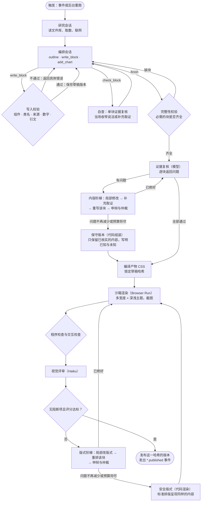
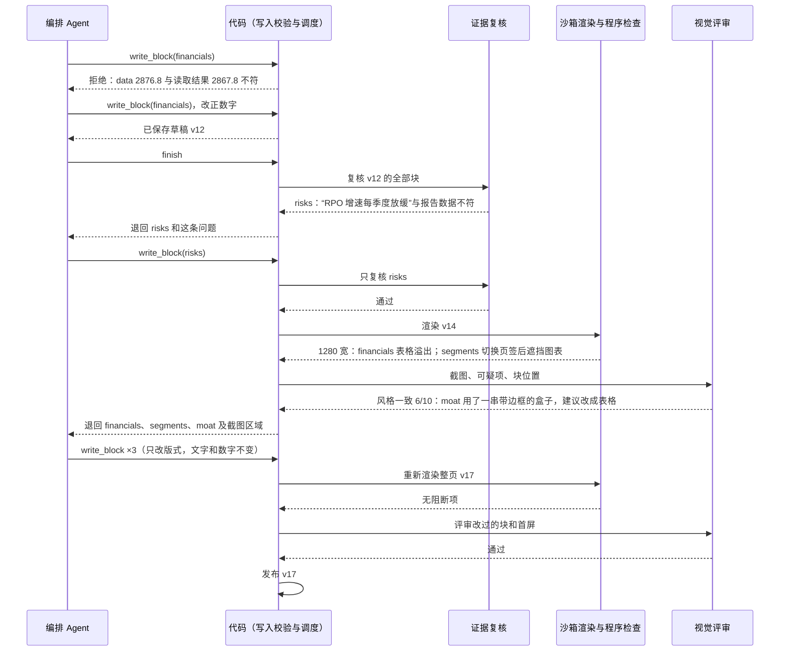

# 分析产物：可局部修改、发布前验收的 HTML 文档

2026-11-10 设计，未实现。

## 1. 要解决的问题

现在每个分析 Agent 交出的是一次性产物：文件分析发布一段 Markdown，公司分析交出一份 JSON 初稿，要点和卷宗用各自的文档格式。产物要么整体通过，要么整体作废，而且发布前没有人看过它渲染出来的样子。

- 公司分析的证据复核只要指出一处问题，整次运行就报错。重试从研究会话开始全部重来，复核意见也不会交给下一次（`company-analysis/business-agent.ts`）。NET 在 2026-11-10 因此连续失败两次，两次的问题都只涉及一两段。
- 前端对每种产物各有一套渲染：Markdown 走 `react-markdown`，要点图表走沙箱 `/html-frame`，公司分析和估值各有组件。新增一种分析就要新增一套前端代码。
- 目前只有要点图表在发布前经过浏览器渲染测量（`lens/draw.ts`），其他产物渲染后是否溢出、留白失衡、主次颠倒，没有任何检查。HTML 语法正确、组件合规，不等于页面好看。

## 2. 原则

1. **每次分析任务构建一份 HTML 文档**，这份文档就是产物本身。前端拿到后直接渲染，不再转码。
2. **文档由块组成，块可以单独修改**。校验、复核或视觉验收发现问题时，只改出问题的块，其他块保持不变。
3. **只能使用 shadcn 的数据展示组件，样式在设计变量内自定义**。块内只允许第 4 节登记的组件，标记与 shadcn 组件的输出一致；模型可以用 Tailwind 类名自定义样式，但颜色、字号、间距只能取自站点主题，交互由站点提供的固定组件脚本实现。产物里不允许 `style`、模型写的脚本和外链资源。版面要符合第 4.3 节的项目风格：少用圆角边框的卡片式样式，多用组件把内容讲清楚。
4. **产物在沙箱中渲染**。报告需要交互，所以产物放进不同源的沙箱 iframe，只运行站点自己的组件脚本（第 8 节）。验收和读者看到的是同一个沙箱页面。
5. **代码负责规范，模型负责内容和版式**。每次写入都由代码解析、校验并规范化，不合格就当场拒绝，错误返回给模型在同一会话里修改。
6. **数字和引用由代码核对**。每个数字都要标注取值来源，每段文字都要标注引用的来源 ID。
7. **审查渲染后的画面，而不只是源码**。发布前在真实浏览器中用线上同一份样式和组件脚本渲染，先用程序检查客观缺陷和交互，再由独立的视觉评审模型看截图判断设计质量。
8. **发布权在服务端**。生成报告的 Agent 不能绕过验收；只有通过验收的那个版本会被发布，发布内容与验收内容逐字节一致。
9. **每次运行都交付成果**。改错不设“改不好就交给人”的出口：每个问题按第 6.3 节的阶梯逐级处理，最后一级一定能得到可以发布的内容。人只看结果和过程记录，不需要接手。

## 3. 文档结构

```html
<article data-artifact="company-analysis" data-ticker="NET" data-version="7" lang="en">
  <header data-block="head">…</header>
  <section data-block="business" data-sources="sec-0001477333-26-000061 web-3">
    <h2>…</h2>
    <p>…</p>
  </section>
  …
  <footer data-block="limitations">…</footer>
</article>
```

- 根元素 `article` 标注产物种类、股票代码和版本。
- 每个块是 `section`（页眉、页脚分别用 `header`、`footer`），带唯一的 `data-block`。块是修改、复核、视觉验收、翻译和对比的最小单位。
- 块必须带 `data-sources`，列出本块引用的来源 ID，ID 只能是本次运行中由工具登记过的来源。
- 块内的数字写成 `<data value="2876.8" data-ref="xbrl:…" data-unit="USD_m">$2,876.8m</data>`。`data-ref` 指向本次运行读取过的取值，写入时代码核对 `value` 与读取结果一致，显示文本由代码按站点格式重新生成。
- 原文引述写成 `<blockquote data-source="…">`，写入时代码核对引文在该来源中逐字出现。

## 4. 组件、样式与设计风格

### 4.1 可用组件

模型可以使用 shadcn/ui 的全部数据展示组件，标记与 shadcn 组件的输出一致（`data-slot` 加 Tailwind 类名），例如：

| 类别 | 组件 |
|---|---|
| 排版 | 标题 `h2`/`h3`、段落、列表、`blockquote`、`strong`/`em`，以及 shadcn Typography 的样式 |
| 结构 | Separator、Aspect Ratio、Scroll Area |
| 数据 | Table、Data Table（排序与分页由组件脚本实现）、Chart、Progress、Badge、Kbd |
| 分组 | Card、Item、Alert、Empty |
| 交互 | Tabs、Accordion、Collapsible、Tooltip、Hover Card、Carousel |

- 不允许表单与输入类、导航类、弹出层与全局提示类组件：Input、Select、Form、Dialog、Sheet、Drawer、Popover、Command、Dropdown/Context Menu、Navigation Menu、Sidebar、Sonner 等。产物是报告，不是应用界面。
- 组件清单以代码形式放在 `shared/analysis-contract/`：每个组件登记它的 `data-slot`、允许的子结构，以及是否需要组件脚本。新增 shadcn 组件就是在清单里加一行，并把组件加进 `packages/web/src/ui`。
- 交互组件的行为由站点编写的固定组件脚本实现，在沙箱中按 `data-slot` 接上交互、键盘操作和 ARIA 属性。模型不写脚本，也不能注册事件。
- 数字写成 `<data>`、引述写成 `blockquote[data-source]`（第 3 节），无论放在哪个组件里都照此核对。
- **图表**：模型提交图表规格（沿用 `LensChart`，由 `shared/analysis-runtime/lens/compile.ts` 编译），服务端渲染成 shadcn Chart 样式的 SVG，颜色用 `--chart-1` 至 `--chart-5`；悬停显示数值由组件脚本实现。模型不直接写 SVG，所以图中每个数字都来自编译结果。

### 4.2 自定义样式

模型可以像使用 shadcn 一样，用 Tailwind 类名调整组件的样式。限制如下，写入时由代码检查：

1. **服务端编译**：用 Tailwind 4 的 `compile` 接口，以站点同一份主题（`packages/web/src/styles/globals.css` 的 `@theme`）编译产物里出现的类名，生成这份产物专用的 CSS，与 HTML 一起存储和锁定。编译后不产生任何样式的类名视为无效，写入时拒绝。
2. **颜色只能用主题变量**：只允许 `@theme` 中映射过的颜色，例如 `bg-card`、`text-muted-foreground`、`border-border`、`text-primary`、`bg-chart-1`、`text-loss`、`text-profit`。不允许 Tailwind 自带的色板（`bg-red-500`）和任何任意值（`bg-[#fff]`、`w-[437px]`）。
3. **尺寸用站点的刻度**：间距、字号、圆角、阴影只能用主题刻度内的值；不允许任意值和 `!important`。
4. **响应式用容器查询**：舞台宽度不等于视口宽度，所以只允许容器查询变体（`@container` 与 `@sm:`、`@md:`、`@lg:` 等），不允许按视口的 `sm:`、`md:`。
5. **主题自动切换**：深浅色由主题变量和沙箱根元素上的 `.dark` 类决定，产物不写 `dark:` 变体。
6. **不允许的写法**：`style` 属性、`fixed` 定位、`z-index`、动画类（动效只由组件脚本提供）、外链资源。

### 4.3 设计风格

产物要像 Spontra 自己的页面：一份研究报告，而不是仪表盘。站点已有的风格要点（深色为主的“墨与荧光笔”配色，首页用列表和表格，估值用带脚注的报告）同样约束产物：

- **组件尽管用，目的是讲清楚**：表格、图表、页签、折叠、进度条、提示框都可以大量使用，只要它让要表达的内容更清楚。
- **少用圆角边框的盒子**：不要把内容一块块装进带圆角和边框的卡片里。章节靠标题、正文、细分隔线和留白区分；卡片样式只在确实需要从正文中独立出来时使用。
- **强调色克制**：荧光笔强调色（`--sp-accent`）只用于最关键的一处或几处；涨跌只用 `profit`、`loss` 两种颜色。
- **徽标少用**：Badge 只用于状态和分类，不用来装饰标题。
- **不加装饰**：不用渐变、大面积底色块、表情符号或图标充当标题装饰。

这些风格要求写进编排 Agent 的系统提示，由模型自己排版。代码只检查颜色来源和类名范围（第 4.2 节），不限制卡片或其他组件的数量；版面是否契合项目风格，由第 7.4 节的视觉评审判断，“风格一致”一项专门对照这里的要求。

## 5. 编辑工具

所有分析 Agent 共用一套工具，配方按需选用：

| 工具 | 作用 |
|---|---|
| `outline` | 返回当前文档的块列表（ID、标题、字数、校验状态、未解决的复核和视觉问题），不返回全文 |
| `read_block` | 读一个块的当前 HTML |
| `write_block` | 新建或整体替换一个块；写入前校验，失败返回具体错误（哪个元素、哪个属性、哪个数字对不上） |
| `remove_block` | 删除一个块，并写明原因，原因记入局限说明 |
| `move_block` | 调整块的顺序 |
| `add_chart` | 提交图表规格，编译成功后返回可放入块中的 `figure` |
| `view_issue` | 读一条视觉问题的详情和对应截图区域 |
| ~~`check_block`~~ | 已移除（见 filing-analysis-optimization.md §4.1）：证据复核只在 `finish` 时并行运行。原说明：在编排过程中对一个块做一次证据复核，返回问题；Agent 写完一块就可以自查，不必等到 `finish` |
| `finish` | 结束编排；必需的块缺失或仍有未通过写入校验的块时拒绝 |

每次写入成功都保存一个草稿版本。草稿只给后台和视觉验收使用，读者只看到通过验收的发布版本。

### 5.1 执行与改错流程

一次分析从触发到发布的全过程。三道检查各自只把有问题的块交回编排会话；同一个问题改不好时不放弃，而是按第 6.3 节（内容）和第 7.6 节（版式）的阶梯换一种办法，最后一级由代码兜底，所以流程总会走到发布：



视觉修复中如果改动了文字或数字，这些块重新经过写入校验和证据复核，再回到渲染验收。

一轮改错的具体往来（示例）：



每次退回都只带被指出的块和问题本身，Agent 看不到也改不了其他块的验收结论。什么时候升级到下一级、什么时候改用保守版本或安全版式，由代码按第 6.4 节的规则决定，不由 Agent 决定。

## 6. 内容校验与证据复核

1. **写入校验**（代码，每次写入）：元素和属性是否在规范内、来源 ID 是否登记过、`data` 数字是否与读取结果一致、引文是否逐字出现。不通过就不写入。
2. **完整性校验**（代码，`finish` 时）：必需的块是否齐全（第 6.1 节）。
3. **证据复核**（模型，`finish` 之后）：读文档和本次运行的原始材料，逐块返回 `{block, issue}`；没有问题的块直接通过。
4. **改错**：有问题的块按第 6.3 节的阶梯处理，直到通过或得到保守版本。

内容复核通过后，才进入第 7 节的视觉验收；视觉验收只改版式，修复中若改动了文字或数字，那些块要重新经过写入校验和证据复核。

### 6.1 必需的块

- 每种产物在 `shared/analysis-contract/` 中登记自己的必需块，由代码定义，模型不能修改。公司分析沿用现有的 `REQUIRED_BUSINESS_KEYS`（`company-analysis/contracts.ts`）：业务、机制、收入、财务、行业、护城河、风险、投资。
- 必需块不能被删除：`remove_block` 对必需块直接拒绝。必需块改不好时，结果是第 6.3 节的保守版本，而不是删除。
- 非必需块可以由 Agent 删除，原因写进局限说明。

### 6.2 先收窄说法，再谈降级

好的分析师写不出确定结论时，会写“文件没有披露”“这两个数字口径不同，不能直接比较”“下一份季报要看什么”，这本身就是正确的分析，不是失败。编排 Agent 的系统提示把这一点作为正常写法：

- 材料支持多少，就写多少；材料没有的，明确写出没有，以及需要什么材料才能判断。
- 写完一块就用 `check_block` 自查，按复核意见当场收窄说法或补充取证，而不是写完整份再一起交给复核。

这样多数问题在编排过程中就被 Agent 自己消化了，`finish` 之后的证据复核主要是最后确认。下面的阶梯只处理自查之后仍然遗留的问题，第 5 级的保守版本是最后的兜底，正常情况下很少用到。

### 6.3 内容改错阶梯

同一个块的问题按下面的顺序升级处理。每一级都只针对这个块，其他块保持不变：

| 级别 | 做法 | 解决的情况 |
|---|---|---|
| 1. 局部修改 | 把问题和原始材料交回编排会话，Agent 改这个块 | 措辞过度、数字期间写错这类可以直接改正的问题 |
| 2. 补充取证 | 给 Agent 开放只针对这个块的取证工具：读更多章节、更早的文件、网页，额度单独计算 | 问题是“材料支持不了这个说法”，而证据可能存在，只是这次没读到 |
| 3. 重写该块 | 开一个只负责这个块的新会话，只给它块的目标、原始材料和这个块的问题历史，不给原来的写法 | Agent 在原写法上反复打转，同一个问题改了又出现 |
| 4. 申辩与仲裁 | Agent 可以对某条问题提出申辩并附上原文引述；由独立的 OpenAI 模型担任仲裁，看问题、申辩和原始材料后裁定，裁定对这条问题是最终的。复核走 DeepSeek、仲裁走 OpenAI，两者是不同来源的判断 | 复核过严或理解错了材料，原写法其实是对的 |
| 5. 保守版本 | 代码组装这个块：只保留已经通过复核或仲裁的句子和数字，其余部分写成“已经核实的内容、尚不清楚的内容、下一份文件需要看什么”，并照常经过写入校验 | 前四级都没能解决，或预算将尽 |

- 第 5 级只使用已核实的内容，所以一定能通过复核，块不会空缺。必需块因此总是存在，运行不会因为内容改不好而失败。
- 保守版本在 D1 中标记为“降级”，页面上这一块明确写出哪些内容尚未核实，不会把不确定的说法当作结论呈现。
- 降级的块在下一次触发时（新文件归档、材料更新、版本变化）自动重新编写，不需要人处理。

### 6.4 什么时候升级

- **按进展而不是按固定轮数**：同一级别内，只要问题在减少或变化，就继续改；同一条问题连续两次原样出现，就升到下一级。每一级最多尝试 2 次。
- **整次运行有总预算**（回合数、token、时间）。预算用到 80% 时，所有还没解决的块直接改用保守版本（内容）或安全版式（第 7.6 节），保证在预算内交付。
- 升级、仲裁结果和降级都记进 D1，后台可以看到每个块经过了哪几级、每级的问题和结论。这只是记录，不需要人操作。

### 6.5 运行中断

内容和版式问题都由阶梯消化，运行只会因为外部原因中断：模型服务不可用、Browser Run 不可用、额度用尽。

- 每一步都在持久运行（`TaskRunner`）中记录，草稿每次写入都已保存。中断后按退避重试，从最近的草稿和步骤继续，不从头重来。
- 中断期间线上继续显示上一份发布版本。
- 渲染服务长时间不可用时，用安全版式发布，并在服务恢复后补做视觉验收；安全版式只用经过验证的标准排版，不依赖本次渲染结果。

## 7. 发布前视觉验收（Visual QA）

流程见第 5.1 节的流程图：渲染 → 程序检查与交互检查 → 视觉评审 → 验收报告（问题、严重程度、视口、块、截图区域、修改建议）→ 通过则发布，不通过则逐块交回修复。

客观问题交给浏览器和程序，主观问题交给视觉模型，两者都通过才能发布。不使用单一的“设计总分”作为发布依据。

### 7.1 渲染环境

- **在真实舞台中渲染**：业务站新增一个只供验收使用的预览路由，加载真实的公司页，用指定的草稿版本替换舞台内容。草稿和发布版本一样放在第 8 节的沙箱 iframe 里，组件脚本也相同。路由要求一次性签名令牌，不对外公开。这样渲染出的就是读者看到的样子，包括固定 Sider 占去的宽度。
- **按舞台的实际宽度测试**：浏览器宽度不等于报告可用宽度。验收按视口渲染整页，同时记录舞台容器的实际宽度，问题按舞台宽度描述。
- **视口**（初始建议，不是实际用户设备统计，上线后按访问数据调整）：

| 场景 | 视口 | 关注点 |
|---|---|---|
| 大桌面 | 1920 × 1080 | 过度拉伸、留白过大 |
| 普通桌面 | 1440 × 900 | 主要场景 |
| 窄桌面 | 1280 × 800 | 图表与多栏 |
| 平板 | 768 × 1024 | 版式切换 |
| 手机 | 390 × 844 | 可读性、溢出 |

  每个视口在深浅两种主题下各渲染一次。第一版先跑 1440、1280、390 三个宽度，其余随后加入。
- **截图稳定**：等字体加载完成、图表绘制完成再截图；开启减少动态效果；记录 Browser Run 返回的浏览器版本，问题记录中附带版本号。

### 7.2 截图与定位

每个视口生成三类图像，存 R2：

1. **首屏截图**：判断第一印象。
2. **分段截图**：沿舞台滚动，按可视区域逐屏截取，判断局部排版。
3. **整页缩略图**：判断整篇的视觉节奏。

每张截图记录滚动位置，并记录每个 `data-block` 在该视口下的边界框。程序和视觉模型发现的问题都换算成“哪个块、哪个区域”，修复时直接交给对应的块。

### 7.3 程序检查

沿用 `lens/draw.ts` 的做法（Browser Run + 页内测量脚本），再加上 axe-core（已在根依赖中）：

| 检查 | 方式 | 级别 |
|---|---|---|
| 舞台横向溢出 | 内容宽度与舞台宽度比较 | 阻断 |
| 文字、图表被裁切 | 边界框与 `overflow` 检查 | 阻断 |
| 异常重叠 | 边界框相交，排除有意的叠放 | 阻断 |
| 图表未绘制 | `figure` 内 SVG 是否存在且有尺寸 | 阻断 |
| 页面错误 | `pageerror`、控制台错误、请求失败 | 阻断 |
| 样式未生效 | 组件的计算样式与浏览器默认值相同，说明产物 CSS 没编译到或站点缺规则 | 阻断（编译问题交给开发处理，不交给 Agent） |
| 设计变量 | `getComputedStyle` 得到的颜色、字体、字号都来自站点设计变量 | 阻断 |
| 对比度与结构 | axe-core：对比度、标题层级、表格表头 | 中高 |
| 大面积空白、内容过稀或过密 | 块边界框的几何分析 | 可疑，交给视觉评审判断 |

- 级别分两档：阻断项直接判不通过；可疑项只作为提示交给视觉评审，由它决定是否构成问题。
- 有意的设计不算缺陷：例如表格容器内的横向滚动是规范允许的，不算溢出。

### 7.4 视觉评审

由一个独立的多模态模型担任视觉评审，只评设计，不评投资观点，也不核对财务数据（那是第 6 节的事）。

- **模型**：通过 OpenAI Chat Completions API 调用独立的多模态模型。`OPENAI_API_KEY` 配置密钥，`OPENAI_REVIEW_MODEL` 配置模型，模型须支持图片输入、Structured Outputs 与评审使用的 reasoning effort。图片以 `image_url` 的 base64 data URL 传入，结果由严格 JSON Schema 约束，用量记入 `ai_usage`。视觉评审默认 effort 为 `medium`，仲裁为 `high`。缺少任一配置、拒绝回答或输出未完成时，本轮评审不可用。

- **输入**：分段截图和首屏截图、视口与舞台宽度、组件规范和设计规范摘要、程序检查发现的可疑项、每个块的边界框。
- **评分维度**（初始权重，需要用实际样本校准）：

| 维度 | 权重 | 看什么 |
|---|---|---|
| 版式与空间 | 25% | 网格、对齐、留白、版面平衡 |
| 视觉层级 | 25% | 标题、关键数字、图表的注意力顺序 |
| 信息密度 | 20% | 是否拥挤，或浪费大量版面 |
| 风格一致 | 15% | 是否符合第 4.3 节的项目风格：组件是否把内容讲清楚、有没有堆叠圆角边框盒子、强调色是否克制，颜色和字号是否协调 |
| 可读性 | 15% | 字号、行距、对比度、阅读负担 |

- **初始通过条件**：加权总分不低于 80，任何一项不低于 7/10，且没有阻断项。评分达标不能抵消程序检查的阻断项。
- **必须给出可执行的问题**：每条问题包含严重程度、视口、块 ID、截图区域、问题描述和具体修改建议（例如“把四张指标卡片改成一张两列表格”“图表比例从 square 改为 wide”），不接受“不够精致”这类泛泛的意见。建议只能落在组件规范之内。
- **重点识别的问题**：图表占据过大面积；标题字号压过关键数字；圆角边框的盒子堆叠过多，版面像仪表盘而不像报告；整页只有表格和文字、像数据导出；同一份报告里版式语言不统一。

### 7.5 交互验证

交互组件都来自规范，所以交互清单由验收程序按组件类型自动生成，不需要 Agent 声明：

| 组件 | 操作 | 期望 |
|---|---|---|
| 页签 | 依次点击每个 `tabs-trigger`，并用方向键切换 | 只有对应的 `tabs-content` 可见，焦点与 `aria-selected` 正确 |
| 折叠 | 展开、收起每个 `accordion-item` | 内容出现并消失，下方内容随之移动，没有被遮挡 |
| 提示框 | 悬停和键盘聚焦 | 提示可见、不超出舞台、不遮住它所说明的内容 |
| 图表 | 悬停每个数据点 | 显示的数值与 `figure` 内的编译结果一致 |
| 链接 | 检查目标 | 只指向已登记的来源 |

每项操作后截图，分别判断“功能失败”（操作后状态没变）和“设计失败”（状态变了但遮挡、溢出或排版错乱）。交互后的截图同样交给视觉评审。验收还检查长报告滚动、键盘焦点顺序，以及舞台宽度变化后沙箱高度是否随之调整。

### 7.6 版式改错阶梯

版式问题同样逐级处理，最后由代码兜底：

| 级别 | 做法 |
|---|---|
| 1. 局部改版式 | Agent 用 `view_issue` 看问题和截图区域，只改这个块的版式，文字和数字不变 |
| 2. 重排该块 | 开一个只负责这个块版式的新会话，给它块的内容、截图和问题历史，不给原来的版式 |
| 3. 申辩与仲裁 | 只适用于视觉评审的主观意见：Agent 附理由申辩，由同一 OpenAI 评审模型以比视觉评审更高的 effort 看截图后裁定。程序检查的阻断项（溢出、裁切、遮挡、交互失败）不能申辩 |
| 4. 安全版式 | 代码用一套标准排版渲染这个块的同样内容：标题、正文、表格、图表，不用交互组件。这套排版由站点开发维护，并在每次站点发布时经过验收，所以一定能通过程序检查 |

- 升级规则与第 6.4 节相同：同一条问题原样出现两次就升级，每级最多 2 次，预算用到 80% 时剩余问题直接使用安全版式。
- 安全版式的块不再要求视觉评分达标，只要求没有阻断项；它在 D1 中标记为“降级”，下一次触发时重新编排。
- 不允许为了提高分数整份重写：每次只改被指出的块。

### 7.7 结果与发布

- D1 记录每次验收：草稿版本、HTML 哈希、浏览器版本、各视口的程序检查结果、视觉评分和问题列表、结论。R2 存截图。
- 发布时比对哈希：只有通过验收的那份 HTML 会被发布，发布后不可修改；任何改动都产生新草稿，重新验收。
- 发布条件：程序检查没有阻断项；每个块要么通过复核和视觉评审，要么是保守版本或安全版式。按第 6.3 和 7.6 节，这两个条件在预算内总能满足。

## 8. 存储、发布与前端

- 发布的文档存 R2，D1 存指针、版本号和每个块的哈希。块哈希用于判断哪些块变了：翻译只翻变了的块，复核和视觉验收只看变了的块，更新提示可以指出改了哪一部分。
- 发布与事件同批写入，沿用现有的 `*.published` 事件。
- 所有正常发布都经过共享发布层，并在同一事务发出 `content.published`。HTML 的唯一入口是 `artifact/store.publishStatements`；仍供读者使用的 JSON 发布入口使用 `publication/publish`。领域事件继续驱动原有业务，翻译只订阅 `content.published`，不依赖要点、公司分析或其他功能的发布链。
- 翻译属于 `publication` 后处理范围，保留文章的公司标识，不受白名单、生成功能开关或自动分析暂停拦截。全局翻译开关和每日模型预算继续有效。译文只发 `translations.published`，不会再次触发翻译或文章生成。
- **沙箱渲染**：业务站新增 `/artifact-frame` 页面，沿用现有 `/html-frame` 的做法（`HtmlFrame.tsx`）：
  - iframe 只开 `sandbox="allow-scripts"`，不开 `allow-same-origin`，页面是不透明源，读不到主站的 Cookie、存储和 DOM。
  - CSP 只允许站点构建产出的组件脚本、站点样式文件，以及随产物一起存储的产物 CSS（第 4.2 节），禁止网络请求（`connect-src 'none'`），图片只允许内联的 SVG 和 `data:`。
  - 主站通过 `postMessage` 把产物 HTML、主题、语言交给沙箱；沙箱插入前再用同一份规则校验一次，然后报告内容高度，主站据此调整 iframe 高度。
  - 产物内的链接不在沙箱里打开：点击后由沙箱发消息给主站，主站核对链接属于已登记的来源后再打开。
  - 双方只接受来自对方窗口的消息，沿用 `HtmlFrameMessage` 的校验方式。
- 组件脚本和站点 CSS 跟随业务站一起发布；产物 CSS 在服务端编译时用的是同一份主题。验收记录渲染时用的主题、CSS 与脚本版本，如果线上版本之后变了，已发布的产物在下一次发布时重新验收。
- 中文版本按块提取完整段落、表格单元格、标题和读者文字属性（`title`、tooltip 的 `data-content`）。内联元素、数字与引用用受控占位符保护，程序回填 HTML；非文案属性不变。金额和倍率可按中文格式展示，原始数值与引用不变。长段落按句界拆分，不因长度静默遗漏。
- 翻译来源只包含受支持、已正式发布的文章，不按当前要点 fingerprint 或具体功能列表筛选。旧 `valuation-report` HTML 已退役，清理其 D1 指针、版本、检查和译文尝试；R2 原对象保留为不可达归档，现行估值 JSON 不受影响。
- 原文仍是一份经过核验的不可变版本。中文译文单独存入 R2，`analysis_artifact_translations` 按原文 artifact、版本、hash 和 `zh-CN` 保存状态与指针，不推进原文版本。新图表保留冻结的 `CompiledChart` 供中文标签重绘；历史 SVG 仅处理文字和无障碍标签。
- 当前翻译尝试与已验收的中文发布指针分开：升级翻译器或重试时继续提供同一原文版本已发布的中文，直到新译文通过验收后原子替换。完整 HTML 报告优先发布，不等待无关历史 JSON 文本回填。
- 翻译复用 `i18n_strings`，只有变更的文字需要模型调用。完整中文通过语义复核和真实沙箱的多视口排版、交互检查后整份发布；预览验收等待译文实际 hash。预算或浏览器暂不可用保留可重试状态；未通过的译文不会替换原文。
- 报告接口返回真实正文 `lang` 与翻译状态，中文未完成时回退到同一版本原文并明确标注。语言切换和译文发布会重新读取，iframe 按实际内容 hash 更新；状态变化通过 `translations.published` 推进读取 revision，该事件没有生成任务订阅。
- 验收使用通用签名页面 `/article-preview?token=…`，复用同一 `ArtifactFrame`，不加载公司、要点或对话功能，也不依赖它们的可见性与开关。后台译文资源可打开原文或当前译文预览；预览 token 不写入日志。
- 后台中文译文页的「翻译现有报告」幂等地重新发出 `content.published`，由同一全局消费者入队 `translate`，不发送领域生成事件、不调用文章生成。POST `/admin/ai/companies/:ticker/translations` 使用 UUID `requestId`；重试仅清理本公司当前版本的失败译文及拒绝记忆，保留已发布译文。翻译公司列表来自已发布内容，独立于生成开关。
- 私人报告 GET 在读者鉴权后，按快照中的文章 ID 与原文版本覆盖所请求语言的 artifact；不改写 `user_reports.body`，也不以公司最新版本替代已保存快照。语言切换重新读取该版本。

## 9. 技术组件

| 组件 | 方案 | 职责 |
|---|---|---|
| 编排 Agent | Pi 会话 + 第 5 节的编辑工具 | 生成和修复文档 |
| 验收调度 | 持久运行中的步骤（`TaskRunner`），由 `finish` 后的步骤触发 | 执行验收、交回问题 |
| 浏览器渲染 | Browser Run（`BROWSER` 绑定），Playwright 或现有的 Puppeteer | 渲染、截图、测量、交互 |
| 可访问性 | axe-core | 对比度、结构 |
| 视觉评审 | OpenAI Chat Completions，`OPENAI_REVIEW_MODEL` | 设计质量 |
| 沙箱页面与组件脚本 | 业务站 `/artifact-frame` | 读者和验收共用的渲染环境与交互 |
| 预览路由 | 业务站新路由，签名令牌访问 | 在真实舞台中渲染草稿 |
| 产物与截图 | R2 | HTML 版本、截图 |
| 验收记录 | D1 | 评分、问题、发布状态 |

## 10. 迁移顺序

| 阶段 | 内容 | 完成标准 |
|---|---|---|
| P0 | 组件规范、校验器、规范化；组件清单与 Tailwind 服务端编译、类名检查；在 `packages/web/src/ui` 补齐清单中的 shadcn 组件；组件脚本与 `/artifact-frame` 沙箱；编辑工具；预览路由；程序检查与交互检查 | 用一份手写文档在业务站沙箱中实际渲染和操作；校验器拒绝规范外的元素、类名和对不上的数字；验收在三个宽度下产出截图、程序检查和交互检查结果 |
| P1 | 公司分析改为编排文档；证据复核改为逐块修复；接入 Haiku 视觉评审 | NET 跑一次：复核和视觉问题都在同一次运行里逐块修掉，通过验收后发布，后台能看到截图和验收报告 |
| P2 | 文件分析改为编排文档 | 一份 10-Q 和一份 8-K 的报告通过验收后在舞台显示 |
| P3 | 分析师卷宗与要点图表 | 卷宗以 HTML 发布，`/html-frame` 不再用于新产物 |
| P4 | 舞台报告 | 读者的报告通过验收后交付 |

每个阶段上线后，旧格式的产物保留读取，直到被新产物替换。

实现位置：

| 阶段 | 产物 | 编排会话 | 前端位置 |
|---|---|---|---|
| P1 | `company-analysis`，主体为代码 | `company-analysis/compose-agent.ts`（研究会话之后） | 舞台“公司分析”视图 |
| P2 | `filing-report`，主体为 accession | `filing-analysis/recipe.ts` | 文件报告 |
| P3 | `dossier`，主体为“要点发布指纹前 16 位.要点 id” | `analyst/agent.ts` | 要点面板：要点本身（判断、数字、观察）在上，卷宗在下 |
| P4 | `stage-report`，主体为运行 id | `stage/report.ts` | 读者报告，整份存入读者自己的报告 |

估值不在本方案内：估值页面由单独的估值任务（估值页面增强）负责，报告仍按估值自己的分段写入和展示。

### 10.1 Lens 的去留

所有产物都改为沙箱中的 HTML 文档后，Lens 不再作为一个独立概念存在。现有代码按用途分别处理：

| 现有部分 | 位置 | 去向 |
|---|---|---|
| 图表规格与编译器 | `LensChart`、`shared/analysis-runtime/lens/compile.ts` | 保留，作为 `add_chart` 的规格和编译器，P0 起改名为图表模块 |
| 浏览器渲染与测量 | `workers/analysis/src/lens/draw.ts` | 做法并入 `artifact/qa.ts` 后删除 |
| 沙箱页面与消息协议 | `/html-frame`、`HtmlFrame.tsx`、`HtmlFrameMessage` | 由 `/artifact-frame` 取代，做法沿用 |
| 要点图表 Agent | `workers/analysis/src/lens/agent.ts`、`lens/pi.ts`，AI 工具 `lens` | P3 已删除：要点保留写入时的图表，分析由卷宗产物承担；要点指纹中的 `lens.agent.v6` 保留，避免所有公司的要点因此重写 |
| 前端舞台面板 | `LensPanel`、`ReportLens`、`EventLens`、`.lens*` 样式 | P1 起承载沙箱文档；全部产物迁移完成后改名为舞台容器 |

P3 之前要点图表 Agent 仍在线上运行，不能提前删除。

## 11. 待定

- **OpenAI 评审配置**：在 Spontra Analysis 上分别配置 `OPENAI_API_KEY` secret 和 `OPENAI_REVIEW_MODEL`。模型需要支持图片输入、Structured Outputs 及 `medium`、`high` 推理档位。评审独立于 DeepSeek 的研究与创作调用。
- **Tailwind 在 Worker 中编译**：`tailwindcss` 4 的 `compile` 接口需要通过 `loadStylesheet` 提供 `@import` 的样式表（`tailwindcss`、`tw-animate-css`、`shadcn/tailwind.css` 和站点主题），需要在 P0 实际确认它能在 Workers 运行时中执行，以及编译耗时是否可以接受。
- **降级比例**：如果一份产物里降级的块很多，说明研究或材料本身不足。是否要在这种情况下先补充研究、再重新编排，需要看实际降级频率再定。
- **截图数量与成本**：每次验收 3 个宽度 × 2 种主题 × 若干分段截图，再加交互截图。实现时先实测一份报告的 token 用量，再决定每轮发给评审的截图数量。
- **设计参考集**：由人挑选一组认可的研报版式和典型失败案例，作为视觉评审的参考，用于校准评分标准，避免评审按模型自己的偏好打分或把所有报告推向同一种风格。参考集只用于评审，不用于测试。
- **评分校准**：第 7.4 节的权重和阈值是初始值，需要用实际产物人工打分后调整。
- **块的粒度**：按章节还是按段落。按段落修改更精确，但复核、验收和翻译的调用次数会增加。
- **固定界面的回归**：Sider 等固定组件可以用像素比较检查回归；生成区域不用像素比较，否则会惩罚不同但合理的版式。
