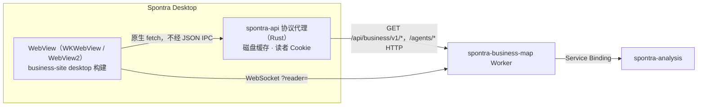

# 桌面端：Tauri 2 应用，后端复用

日期：2026-11-08。状态：已实现并在 macOS arm64 上验证；未提交、未发布。使用方法见 [apps/desktop/README.md](../apps/desktop/README.md)。

## 一、结论

桌面端是 Tauri 2.12 应用 `apps/desktop`，窗口里运行 `apps/business-site` 的 `desktop` 构建。`spontra-analysis` 没有改动。数据走现有公开门 `/api/business/v1/*`；Worker 上只改了 `stageDoor`，放行桌面 WebView 的 socket。

## 二、架构

| 决定 | 内容 | 原因 |
|---|---|---|
| 读取走自定义协议 | `boot.ts` 改写 `window.fetch`，相对路径 `/api/`、`/agents/` 转到 `spontra-api://localhost`；页面组件一行不改 | IPC 把数据序列化成字符串；协议直接给字节。Tauri 协议响应必须整体返回，不能流式，1 MB 的 opening 读取耗时 1–2 ms，无需流式 |
| 桌面代码不进网站产物 | `boot.ts` 由 Vite 插件只在 desktop 模式注入 | 网站产物不含 `spontra-api` |
| CSP 只有一个来源 | `desktop-shell.vite.ts` 把 `public/_headers` 转成 meta 标签，Tauri 的 `csp` 为 `null` | 主页、图表帧、图片帧策略不同，Tauri 的全局 CSP 表达不了 |
| 舞台 HTTP 由代理代办 | 代理带站点 Origin 与读者 Cookie，Cookie 存在应用数据目录，页面拿不到 | 这部分 Worker 不用改 |
| 舞台 socket 在 WebView | Origin 白名单 `tauri://localhost`、`http://tauri.localhost`；只有这两个 Origin 的升级请求才读 `?reader=`，转发前删除 | WebSocket 无法带头。token 是匿名读者 id，可能出现在 Worker 请求日志里，泄露代价是一份配额 |

## 窗口外观（macOS）

无标题栏（`titleBarStyle: Overlay`），红绿灯落在贴边的侧栏顶部；侧栏头部和空白背景可拖动窗口。页面缩放 0.9，常量在 `src-tauri/src/lib.rs`。系统滚动条全部隐藏且不占位，`scroll-thumb.ts` 在滚动时画一条竖向滑块，停止 0.8 秒后淡出；滑块不可拖动，横向滚动没有滑块。Windows 保留系统标题栏，这部分样式只对 macOS 生效。

## 三、磁盘缓存

| 情况 | 行为 |
|---|---|
| 未过 `max-age` | 直接应答（hit） |
| 已过 `max-age`，7 天内 | 先给旧值，后台带 `If-None-Match` 重取（stale） |
| 更久或没有 | 等网络；失败时有旧值给旧值（offline），否则 502 |
| `/revision`、`/agents/*`、失败响应 | 不缓存 |
| `/opening`（上游标 no-store） | 所有资源都已应答才缓存；页面随后用 `/revision` 判断更新 |

同一地址并发只发一次上游请求。目录上限 512 MB，启动时按最旧淘汰。

## 四、与方案草稿不同之处（实现中查证）

| 草稿 | 实际 |
|---|---|
| 窗口隐藏到内容就绪再显示 | WKWebView 在隐藏窗口里暂停 `requestAnimationFrame`，内容标记恒等于 3 秒兜底。改为窗口立刻以系统主题底色显示 |
| 协议代理流式应答 | Tauri 不支持，见上 |
| iframe 路径要改 | Tauri 未命中资源时依次回退 `路径.html`、`index.html`，`/lens-frame` 与 SPA 深链不用改，已实测 |
| 用 `plugin-http`、`plugin-store`、`plugin-os` | 都不需要 |
| 请求头 `x-spontra-client` 放行 | 代理带站点 Origin 即可，Worker 改动更小 |
| 深链 `spontra://company/X` | 站点路由是 `/companies/X`，故为 `spontra://companies/X?view=cash` |
| 轨道页签用 `<Activity>` | 轨道是一条流按页签过滤，不存在隐藏的面板，不适用 |
| 视图切换用 `startTransition` | 切换已走 View Transition，需同步提交，不适用 |
| React Compiler 配 `babel.plugins` | `@vitejs/plugin-react` 6 已移除该选项，改用 `@rolldown/plugin-babel` + `reactCompilerPreset`；只在 desktop 模式开启 |

桌面专属的取舍：首屏后空闲时预先编译公司页代码块；页面翻转动画从约 0.5 秒收短到 0.14 秒；大面积 `backdrop-filter` 去掉。

## 五、实测（M 系列 Mac，release，arm64，`docs/perf/desktop-baseline-2026-11-08.json`）

| 指标 | 预算 | 实测 | |
|---|---|---|---|
| 启动到内容上屏，有缓存 | ≤ 800 ms | 439 ms | 达标 |
| 启动到内容上屏，无缓存 | ≤ 1500 ms | 1858 ms | **未达标**，其中上游 `/opening` 约 0.87 s 首字节加 1.16 MB 传输 |
| 公司之间切换（缓存命中，无翻页动画） | ≤ 150 ms | 21–30 ms | 达标 |
| 首页进公司页（含翻页动画） | ≤ 150 ms | 210–290 ms | **未达标**，渲染约 25 ms，其余是动画 |
| 内存（全部进程 physical footprint） | ≤ 180 MB | 227 MB | **未达标**，打开一家公司约 6 秒时，主进程约 42 MB，其余在 WebKit 进程 |
| 应用体积 | ≤ 25 MB | 7.9 MB | 达标 |
| DMG / 更新包 | ≤ 25 / 15 MB | 4.8 / 4.8 MB | 达标 |

INP、CLS 未单独测量。

## 六、验证

`scripts/desktop-selftest.ts` 启动只含 `selftest` 特性的构建，在真实 WKWebView 内驱动页面：

- 线上数据读取、代理拒绝越权路径、logo、悬停预读、打开公司、视图快捷键、搜索、主题、两个 iframe（沙箱帧确认无网络）、外链交给系统浏览器、菜单命令、深链、深层地址整页刷新、无 CSP 违规与脚本错误。
- 舞台入口：用本地 `wrangler dev` 跑真实 `stageDoor` 加桩的 `StageGateway`，从真实 WebView 连 socket，令牌到达、地址中已剥离。WKWebView 实际发送的 Origin 是 `tauri://localhost`。
- 线上页面发起的舞台 socket 地址正确（host、`reader=`）；连接本身要等 Worker 上线。
- 自动更新：0.1.0 从本地更新源下载签名的 0.1.1，退出时完成替换。

## 七、未验证与待办

- **Windows 与 macOS x64**：只写了配置，未构建、未运行。协议地址按 Tauri 的约定写成 `http://spontra-api.localhost`。
- **发布流水线**：`.github/workflows/desktop-release.yml` 未运行过，需要 README 列出的 secrets。更新密钥在 `~/.tauri/spontra-desktop.key`，私钥不要入库。
- **Developer ID 签名与公证**：本地是 ad-hoc 签名。
- **人眼视觉检查**：屏幕访问未获授权，页面结构与行为由自检覆盖，版式未经截图确认。
- **`stageDoor` 改动**要随 `main` 发布后，舞台在桌面端才能连上。
- 未做：按安装 id 限流、最低客户端版本门槛。

## 八、版本（2026-11-08）

Tauri 2.12.5（CLI 2.12.4）、Rust 1.99.1、Vite 8.3.6、React 19.3.1、React Compiler 1.0.0、`@vitejs/plugin-react` 6.2.1、Tailwind 4.3.5。TypeScript 保持 5.9.3，wrangler 保持 4.127.1。React、Vite、Tailwind 的升级也作用于网站与后台。
