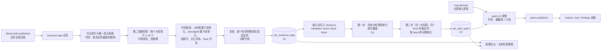

# 方案：同行相似度——两层业务标签，先按大标签圈定、再按业务与运行逻辑区分

**状态：** P0–P3 已实现（分支 `claude/model-read-sec-data-b2bed8`，未发布；发布前需先建 Vectorize 索引，见文末"实现状态"） · **日期：** 2026-10-18 · **前置：** [sec-filing-library](sec-filing-library.md)（业务主线 `library-links`）、[analyst-agent-design](analyst-agent-design.md)（`peers:v1`、分析师 `peers` 工具）、[pipeline-events](pipeline-events.md)、[businessview-admin](businessview-admin.md)

## 一句话

每家公司的业务主线做完后，给它的每个**可比单元**打两层标签：

- **第一层大标签**：比如"云服务"。MSFT、GOOGL、AMZN、ORCL、CRWV、NBIS 都有。这一层用固定词表，可以多选。
- **第二层细标签**：挂在某个大标签下，描述具体业务和运行逻辑。比如"GPU 产能租赁""多年期承诺容量合同""租赁数据中心、举债购置 GPU"。这一层是自由文本，每个标签引用原文，向量存进 Cloudflare Vectorize。

挑选对比公司分两步：

1. 共有一个大标签，才成为候选。
2. 在同一个大标签下比较细标签的向量相似度，由代码算出档位（直接同行 / 部分可比 / 相邻）。

代码再从已校验的分部收入算出**暴露度**，和档位一起决定这对同行**用什么口径比**。两层标签和配对结果都在管理后台显示出来。向量查询只在入库时进行；页面与 agent 读到的都是 D1 里算好的结果。

## 问题

现在的规则（`peers:v1`，[peers/projection.ts](../workers/pipeline/src/peers/projection.ts)、[`peersOf`](../shared/analysis-runtime/lens/table.ts)）：公司的类别 = 它所有 verified/confirmed 业务链接的类别并集；与本公司共有任一类别的公司都是同行。以 CRWV 为例，线上 D1（2026-10-18）给出的同行是 AMZN、GOOGL、MSFT、ORCL、NBIS、NET，一视同仁地进同一张比率表。

真实情况是分层的：

| 公司 | 可比业务 | 分部收入（最新季） | 占公司收入 | 事实上的关系 |
|---|---|---|---|---|
| CRWV | 整家公司（单一报告分部） | 2,575M（2026-06-30） | 100% | 主体 |
| NBIS | Nebius AI cloud | 574.9M / 582.3M（2026-06-30） | ≈99% | 同类纯 GPU 云，可整体对标 |
| ORCL | Cloud infrastructure（OCI） | 7,388M / 19,345M（2026-08-31，= Cloud 11,607 − Cloud applications 4,219） | ≈38% | 同类业务，但公司整体比率被软件稀释 |
| MSFT | Intelligent Cloud（含 Azure 与服务器产品） | 39,306M / 90,007M（2026-06-30） | ≈44% | GPU 租赁只是其中一部分且未单独披露 |
| GOOGL | Google Cloud | 24,768M / 119,796M | ≈21% | 同上，且混有 Workspace |
| AMZN | AWS | 42,232M / 200,606M | ≈21% | 同上 |
| NET | 开发者平台、网络 | — | — | 只因 CRWV 的 Kubernetes、网络业务落在 `developer_tools`/`networking_edge` 被带进来 |

现有规则有四个缺陷：

1. **类别太粗、只有一层**：`cloud_infrastructure` 同时装下纯 GPU 云和超大规模云，没有下一层来区分。
2. **共有任一类别就算同行**：次要业务也会拉来同行。例如 NBIS 的 Avride 让它和 GOOGL 的 Waymo 同类。
3. **没有可比口径**：CRWV 的 capex/revenue 和 ORCL 的 capex/revenue 被并排比较，而后者的分母有 60% 是软件收入。
4. **分析师的跨公司查找只用第一个类别**：`find_sections peers:true` 取的是 `input.categories[0]`（[analyst/agent.ts:332](../workers/pipeline/src/analyst/agent.ts)），类别按字母排序。CRWV 恰好取到 `cloud_infrastructure` 只是巧合。

另有两个数据事实：
- CRWV 的 12 条业务链接都没有 `flow_node_id`。它是单一分部公司，业务地图上只有 `reported-company-total` 一个节点。
- MSFT 的 `Server Products and Cloud Services` 等链接也没有节点，但业务上属于 `Intelligent Cloud`。

## 为什么分两层

- **第一层要稳**：它决定谁能成为候选。用固定词表，同一个大标签在所有公司里含义一致，后台可以按大标签浏览，也不会因为措辞不同而漏掉候选。
- **第二层要细**：它决定程度。"GPU 产能租赁"和"通用 IaaS"都属于"云服务"，差别在卖什么、卖给谁、怎么收费、成本结构。这一层用自由文本，由向量近似把措辞不同的同义标签对上，例如 "AI cloud compute" ≈ "GPU-as-a-service"。
- **只在同一大标签下比细标签**：可以避免跨行业的字面巧合，例如"GPU 芯片"（半导体）和"GPU 租赁"（云服务）不会被拿来比较。
- **成本线性**：每家公司只打一次标签（一次提议加一次复核）。新公司加入时，只要在共同大标签下查一次向量库，就能和所有已有公司比较，不需要两两调用模型。

## 目标与非目标

目标：

- 能说出"CRWV 与 NBIS 同在云服务大标签下，GPU 产能租赁、客户、成本结构都相近，是直接同行；ORCL 只在 OCI 上可比；MSFT/GOOGL/AMZN 同属云服务，但具体业务只部分相近"。
- 每对同行带可比口径，lens 的同行表和分析师的 `peers` 工具只给口径允许的数字。
- 两层标签、每个标签的原文出处、配对与得分都在管理后台可见。
- 全自动：模型打标签、代码校验、复核，不需要人工确认；管理员可选择覆盖。
- 事件驱动，不加轮询 Cron；读路径只查 D1。

非目标：

- 不给可比单元估算未披露的收入（例如 Azure 中的 GPU 租赁）；未披露就写未披露。
- 不做股价或估值层面的可比公司（倍数）。
- 不处理采集名单外的公司（如 IREN）：匹配只在名单内的公司之间进行，名单外的同类公司暂不考虑。

## 概念

### 可比单元（unit）

可比单元是一家公司的一个已披露收入节点，键为 `(ticker, flowNodeId)`。

- 节点取业务链接的 `flow_node_id`。
- 链接没有节点时，由打标签调用从该公司的 flow 节点列表里选一个归属节点，代码检查它确实在列表里。选不出的链接不进任何单元。
- 单一分部公司（CRWV）的所有链接都归到 `reported-company-total`。
- 落在同一节点下的链接合并成一个单元，小节取并集。例如 CRWV 的 12 条链接合成一个单元；MSFT 的 `Intelligent Cloud` 与 `Server Products and Cloud Services` 合成 `msft:IntelligentCloudMember`。
- 单元是收入口径的边界：标签描述这个节点里卖的东西，暴露度用这个节点的收入来算。

### 第一层：大标签（sector tag）

- **词表**：沿用现有的 `INDUSTRY_CATEGORIES`（[filing-library.ts](../shared/analysis-contract/filing-library.ts)，25 个），在后台显示中文名，例如 `cloud_infrastructure` 显示为"云服务"，词表里的中文描述同时调整为适合作标签的短名。词表不够用时（比如需要"数据中心与电力"），在代码里加一项并提升版本号，不允许模型自造大标签。
- **来源**：单元的大标签 = 它所含业务链接中 verified/confirmed 的类别并集，所以一个单元可以有多个大标签。业务链接已经有"提议 + 盲审"两道判断，第一层不再额外调用模型。
- **公司的大标签**：它所有单元大标签的并集，用于后台按大标签浏览。

### 第二层：细标签（business tag）

每个细标签挂在单元的一个大标签之下，属于四个方面（facet）之一：

| facet | 问的问题 | CRWV ·「云服务」下的预期细标签（示例） | MSFT Intelligent Cloud ·「云服务」下的预期细标签（示例） |
|---|---|---|---|
| offering 卖什么 | 具体业务 | GPU capacity leasing；managed Kubernetes for AI workloads | general-purpose IaaS and PaaS；server software licensing |
| customers 卖给谁 | 客户类型 | AI labs；hyperscalers as customers | enterprises of all sizes；developers |
| contract 怎么收费 | 合同与计费 | multi-year committed capacity contracts | consumption-based billing；enterprise agreements |
| cost 成本结构 | 资产与成本 | leased data center capacity；debt-financed GPU fleet | owned global datacenter network |

（示例只是预期，用作验收参照；最终标签以模型引用的原文为准。）

细标签的格式：

```ts
type BusinessTag = {
  sector: IndustryCategory;   // 所属大标签，必须是该单元的大标签之一
  facet: "offering" | "customers" | "contract" | "cost";
  label: string;              // 2–6 个英文词，用于嵌入；不含数字、不含任何公司名
  labelZh: string;            // 中文短名，只用于后台显示，不参与匹配
  definition: string;         // 一句英文说明，不含数字
  passageIds: string[];       // 支持这个标签的原文段落，至少一个，必须属于该单元的小节
};
```

每个单元的每个大标签下打 3–10 个细标签。offering 至少一个；其余 facet 原文不支持时可以没有。

### 挑选对比公司

1. **按第一层圈定（D1，纯代码）**：与本单元共有至少一个大标签的其他公司的单元，成为候选。
2. **按第二层区分（向量）**：在每个共同大标签下，计算两个单元每个 facet 的得分，取两边该大标签、该 facet 下所有细标签两两余弦相似度的最大值。得分 `≥ τ_same` 记 same，`≥ τ_near` 记 partial，否则记 different；一边没有该 facet 的标签记 unknown。阈值在验收集上校准（见"校准"）。
3. **档位（tier，纯代码）**：按每个共同大标签分别计算，取最高的一档作为这对单元的档位，并记下是在哪个大标签下得到的。
   - `direct`（直接同行）：offering 为 same，且其余三个 facet 至少两个 same。
   - `partial`（部分可比）：offering 为 same 但不满足 direct；或 offering 为 partial，且其余三个 facet 至少一个是 same 或 partial。
   - `adjacent`（相邻）：offering 为 partial，其余三个 facet 都是 different 或 unknown。
   - `sector`（同大类）：共有大标签，但 offering 为 different 或 unknown。只在后台显示，不进入分析师和页面的同行列表。

### 暴露度（exposure）

暴露度 = 单元收入 ÷ 公司收入，在各自对齐的最新季度上计算（沿用 `PEER_ALIGNMENT_DAYS = 120`）。纯代码，读已发布的业务地图。单元收入未披露时为 `null`。

### 可比口径（basis）

由档位和暴露度决定，代码给出：

| 条件 | 口径 | 可以比的东西 |
|---|---|---|
| 档位 direct 或 partial，且两边暴露度都 ≥ 0.8 | `company` | 公司整体数字与比率：capex/revenue、debt/equity、RPO/revenue、租赁…… |
| 档位 direct 或 partial，单元收入已披露 | `unit` | 单元的收入、增速；单元经营利润若有披露。公司整体比率只能带"被其他业务稀释（暴露度 x%）"标注出现 |
| 其余（单元收入未披露或档位 adjacent） | `quote` | 只能引用原文，不进数字表 |

CRWV 的预期结果（都在"云服务"大标签下）：

| 同行 | 档位 / 口径 | 说明 |
|---|---|---|
| NBIS | `direct/company` | |
| ORCL | `partial/unit` | 只比 OCI |
| MSFT、GOOGL、AMZN | `partial/unit` | 只比 Intelligent Cloud / Google Cloud / AWS 的收入与增速 |
| NET | `adjacent` 或 `sector` | 共有"云服务"等大标签，但 offering 不应达到 same |

## 架构



### 任务与触发

- **新任务 `business-tags`**（scope `data`）：作为业务主线的最后一步，由 `library-links.published` 事件触发，只处理该公司。不新增 Cron。
  - 独立成任务的原因：改标签提示词时只需提升 `BUSINESS_TAGS_VERSION`，不必重跑业务链接。
- **增量**：单元的 `fingerprint` = 单元的小节 id 集合 + 大标签集合 + `BUSINESS_TAGS_VERSION` 的哈希。fingerprint 不变就不重新打标签。
- **任务内的后续步骤**：标签写入后，同一任务内依次完成：
  1. 嵌入并写入向量库。
  2. 匹配，并更新 `sec_peer_pairs` 中涉及该公司的所有配对。余弦相似度是对称的，又取最大值，所以两个方向一次查询就能得到。
  3. 被删掉的单元，其向量和配对一并删除。
- **`peers:v2` 投影**：仍是确定性的全局发布物，在 `business-tags` 完成时或 `map.derived` 触发时重建（暴露度随分部收入变化）。`peers.published` 仍只通知引用了变化同行的公司（沿用 `citedPeers`/`changedPeers`）。

### 打标签调用

**输入**（每家公司一次调用，覆盖它的所有单元）：

- 每个单元的名字、所含业务链接名、它的大标签（中英文名与词表描述）、合并后的小节。小节给标题加原文摘录，每节约 800 字，每单元至多 8 节，带 passageId。
- 该公司的 flow 节点列表，供没有节点的链接选择归属。
- facet 定义、标签规则，以及几条跨行业的示例标签。示例不取自任何被跟踪公司，以免模型照抄。
- 不给收入数字，也不给其他公司的标签：标签只描述这家公司自己，相似度由向量决定，不让模型去"凑"同行。

**输出**：用 strict tool 返回，沿用 Claude 工具调用的做法：

```ts
{
  linkUnits: [{ businessKey, flowNodeId }],          // 没有节点的链接的归属
  units: [{ unitKey, tags: BusinessTag[] }],
}
```

**代码校验**：
- `sector` 是该单元的大标签之一。
- facet 在枚举内。
- `passageIds` 非空，且都属于该单元的小节。
- `label`、`labelZh`、`definition` 不含数字，也不含本公司或任何被跟踪公司的名字与 ticker。标签要描述业务类型，不能写成 "like CoreWeave"。
- 同一单元、同一大标签内的 label 去重。

不合格的标签丢弃，原因记入 trace。

**复核**：第二次独立调用。输入是每个标签和它引用的原文，问"这段原文是否支持这个标签"，只能删除，不能改写或新增，和分析师 review 是同一模式。不采用"两次独立打标签一致才算"，是因为自由文本很难逐字对齐，所以改为逐个标签核对引用。

### 嵌入与向量库

- **向量库**：Cloudflare Vectorize，新增索引 `business-tags`，绑定 `TAGS_INDEX`。
  - 每个细标签一个向量。id 为标签 id，由内容派生：`ticker + unitKey + sector + facet + label` 的哈希。
  - namespace 为 `{sector}.{facet}`（如 `cloud_infrastructure.offering`），查询按 namespace 限定在同一大标签、同一方面内，不需要 metadata 索引；metadata 只记 `{ ticker, unitKey }`。
- **嵌入**：用 Workers AI 的文本嵌入模型，新增 `AI` 绑定。
  - 嵌入文本为 `"{facet}: {label} — {definition}"`。
  - 带上 definition，是为了让 "GPU cloud" 与 "GPU chips" 这类字面相近、含义不同的短标签拉开距离。
  - `labelZh` 不参与嵌入。
- **查询**：对本单元的每个细标签，在它的 namespace 内取 `topK = 50`（不取 metadata），结果对照 D1 的标签，排除本公司。近邻按 `unitKey` 归并，每个大标签、每个 facet 取最大得分。
- **只在任务里使用**：向量库只在 `business-tags` 任务里读写。读路由（页面、`/api` 读取）只查 D1 的 `sec_business_tags`、`sec_peer_pairs` 和 `peers:v2`，不查向量库。

### 存储

迁移新增两张表，并修改一张：

```sql
CREATE TABLE sec_business_tags (
  tag_id TEXT PRIMARY KEY,               -- 内容派生
  ticker TEXT NOT NULL, unit_key TEXT NOT NULL,
  sector TEXT NOT NULL,                  -- 第一层大标签（IndustryCategory）
  facet TEXT NOT NULL,                   -- offering | customers | contract | cost
  label TEXT NOT NULL, label_zh TEXT NOT NULL, definition TEXT NOT NULL,
  passage_ids TEXT NOT NULL,             -- JSON 数组
  status TEXT NOT NULL,                  -- verified | rejected
  fingerprint TEXT NOT NULL, version TEXT NOT NULL, updated_at TEXT NOT NULL
);
CREATE INDEX sec_business_tags_unit ON sec_business_tags(ticker, unit_key);
CREATE INDEX sec_business_tags_sector ON sec_business_tags(sector, facet);

CREATE TABLE sec_peer_pairs (
  pair_key TEXT PRIMARY KEY,             -- 两个单元键排序后拼接
  left_ticker TEXT NOT NULL, left_unit TEXT NOT NULL,
  right_ticker TEXT NOT NULL, right_unit TEXT NOT NULL,
  sectors TEXT NOT NULL,                 -- 共同大标签，及每个大标签下各 facet 的结果、得分与命中的一对标签 id
  tier TEXT NOT NULL,                    -- direct | partial | adjacent | sector
  tier_sector TEXT NOT NULL,             -- 最高档位得自哪个大标签
  status TEXT NOT NULL,                  -- matched | confirmed
  version TEXT NOT NULL, updated_at TEXT NOT NULL
);
CREATE INDEX sec_peer_pairs_left ON sec_peer_pairs(left_ticker);
CREATE INDEX sec_peer_pairs_right ON sec_peer_pairs(right_ticker);
```

`sec_business_links` 增加 `unit_flow_node_id` 列，记录没有节点的链接由打标签调用选定的归属节点。原 `flow_node_id` 不变。

每个 facet 都记下命中的那一对标签，所以每条配对都能追溯到两边的原文，例如："云服务 · offering：CRWV 的 GPU capacity leasing [原文] ≈ NBIS 的 AI cloud GPU rental [原文]"。

### 发布物 `peers:v2`

在 `peers:v1` 的公司行之外，增加单元与配对：

```ts
type PeerUnit = {
  ticker: string; unitKey: string; name: string;
  flowNodeId: string;                    // 收入节点，单一分部为 reported-company-total
  sectors: IndustryCategory[];           // 第一层大标签
  periodEnd: string | null;
  revenue: string | null;                // 单元收入，未披露为 null
  exposure: number | null;               // 单元收入 ÷ 公司收入
  tags: Array<Pick<BusinessTag, "sector" | "facet" | "label" | "labelZh" | "passageIds">>;
};
type FacetMatch = { value: "same" | "partial" | "different" | "unknown"; score: number | null; leftTag: string | null; rightTag: string | null };
type PeerPair = {
  left: string; right: string;           // unitKey
  tier: "direct" | "partial" | "adjacent";  // sector 档只存在于 D1 与后台，不发布
  tierSector: IndustryCategory;
  basis: "company" | "unit" | "quote";
  facets: Record<BusinessTag["facet"], FacetMatch>;  // tierSector 下的结果
};
type PeersPublicationV2 = { schemaVersion: "peers.v2"; generatedAt: string; companies: PeerCompany[]; units: PeerUnit[]; pairs: PeerPair[] };
```

- `peersOf` 改为读 `pairs`：返回某公司的配对，按档位（direct > partial > adjacent）和暴露度排序，并带上口径。
- 迁移期间，`peers:v1` 的读者按 `basis !== "quote"` 的配对推出旧的 ticker 列表，保持兼容。
- `PeerCompany.categories` 保留，内容即公司的大标签，只用于显示，不再单独决定同行。

## 管理后台：业务标签视图

放在 **公司业务板块**（`/admin/business`）的视图切换里，紧接在"业务主线"之后，新增一个视图"业务标签"（`?view=tags`）。不新增侧栏入口，后台仍然只有四个入口。视图内有两种查看方式：

**1. 本公司（默认）**：左侧选公司，右侧分两栏。

- **单元与标签**：每个可比单元一张卡片。
  - **卡头**：单元名、收入节点、最新季度单元收入与暴露度。暴露度未披露时显示"未披露"。
  - **第一层**：大标签，显示为中文名的标签块，例如"云服务""开发者工具"。
  - **第二层**：每个大标签下的细标签，按 卖什么 / 卖给谁 / 怎么收费 / 成本结构 四行排列。每个细标签显示中文名，悬停显示英文 label 与 definition。点开后显示引用的原文段落，复用 SEC 文件拆分 的段落视图，也可以跳到该小节。
  - **被删除的标签**：管理员删除的标签（`rejected`）灰显，可恢复。
  - **卡尾**：没有归属节点而被排除的业务链接，列在卡尾的"未归入单元"中。
- **同行**：按档位分组（直接同行 / 部分可比 / 相邻 / 同大类）。
  - 每行显示：同行公司 · 单元 · 档位 · 口径 · 暴露度 · 得自哪个大标签。
  - 展开一行，显示四个 facet 的结果与得分，以及命中的那一对细标签，两边的原文都可以点开。
  - 管理员可以设定档位（记为 `confirmed`，之后的运行会保留），也可以恢复自动结果。
  - 排在最前面的直接同行和部分可比，就是分析师 `peers` 工具实际拿到的列表。

**2. 按大标签浏览**：先选一个大标签，例如"云服务"，列出所有带这个大标签的公司单元。每行显示公司、单元、暴露度，以及该大标签下的 offering 细标签，例如：

| 公司 · 单元 | 暴露度 | 卖什么 |
|---|---|---|
| CRWV · 全公司 | 100% | GPU 产能租赁、AI 工作负载托管 Kubernetes |
| NBIS · Nebius AI cloud | 99% | GPU 云租赁 |
| ORCL · Cloud infrastructure | 38% | 通用 IaaS、AI 训练算力 |
| MSFT · Intelligent Cloud | 44% | 通用 IaaS/PaaS、服务器软件 |

（表中内容是示意，以实际标签为准。）

这一页用来一眼看出同一个大标签下谁在做什么，判断第二层的区分是否合理。

后台接口：

- `GET /api/admin/business-tags?ticker=`：返回单元、两层标签、配对。
- `GET /api/admin/business-tags/sectors/:sector`：返回按大标签浏览的数据。
- `POST /api/admin/business-tags/:tagId/reject`：删除一个标签；对应的 `/restore` 恢复。
- `POST /api/admin/peer-pairs/:pairKey/tier`：设定档位；对应的 `/restore` 恢复自动结果。

所有读取都是 D1 查询。删除标签或设定档位后，发出 `business-tags.changed` 事件，触发该公司的匹配和 `peers:v2` 重建，不重新调用模型。

后台文案沿用现有后台的短标签风格，不加说明性句子。

## 对分析师与页面的改变

**`peers` 工具**：从"同类别的 ticker 列表 + 比率表"改为按配对输出，例如：

```
NBIS · Nebius AI cloud — direct under cloud_infrastructure, basis company (exposure 0.99)
  offering same: GPU capacity leasing ≈ AI cloud GPU rental · customers same · contract partial · cost same
  <公司级比率表：CRWV 与 NBIS 并列>
ORCL · Cloud infrastructure — partial under cloud_infrastructure, basis unit (exposure 0.38)
  <单元收入与同比；公司整体比率标注被软件业务稀释>
MSFT · Intelligent Cloud — partial under cloud_infrastructure, basis unit (exposure 0.44)
  …
```

- 比率表只放 `basis = company` 的同行。
- `unit` 同行只放单元收入与增速。
- `quote` 同行不出数字，只提示可读的小节。

**新工具 `similar_businesses`**（分析师用）：
- 输入：一段英文描述，可选的大标签和 facet，例如 "liquid-cooled data center leases"。
- 行为：在 `business-tags` 向量库里查近邻，返回命中的单元、标签和原文 passageId。
- 用途：在预先算好的配对之外，针对某个具体问题找可比公司。
- 它在分析师 Workflow 内运行，不在页面读路径上。

**`find_sections peers:true`**：查找范围改为配对另一侧单元的小节，不再用 `categories[0]`，同时修掉"只用第一个类别"的问题。可选 `tier` 参数限定档位。

**lens 同行表**：`columns: "peers"` 只接受口径允许该 ref 的同行。
- 公司级 ref（capex、debt……）只对 `company` 口径解析。
- `unit` 口径的同行需要新增单元 ref：`{ peerUnit: { unitKey, ref: "revenue" } }`。
- 列头显示同行的单元名与期末，例如 "ORCL · OCI (2026-08-31)"。
- 口径不允许的单元格编译为错误，而不是静默留空，让 agent 在 compile 时就能改。

**findings 写作**：输入里的同行段落改为按配对给出。写作模型可以说"与直接同行 NBIS 相比"，不能再把 MSFT 当成直接同行。

## 校准

阈值 `τ_same`、`τ_near` 用一个小的验收集来定：

- **正例**：在"云服务"下，CRWV×NBIS 的 offering、cost 应为 same；CRWV×ORCL OCI 的 offering 应为 same。
- **部分**：在"云服务"下，CRWV×MSFT Intelligent Cloud、×Google Cloud、×AWS 的 offering 应为 partial。
- **反例**：CRWV×NET 的 offering 不应为 same。
- **按单元而不是按公司**：NBIS 的 Avride 与 GOOGL 的 Waymo 只共有"自动驾驶"大标签，只影响这两个单元，不影响 CRWV×NBIS 的结果。

P2 先只记得分，不发布档位。在后台"业务标签"视图看完验收集的分布后，再把阈值写进 `ai-config.ts` 中同类的配置。

## 阶段

| 阶段 | 内容 | 验收 |
|---|---|---|
| P0 | 可比单元与第一层大标签：从业务链接与 flow 节点推出单元、大标签与暴露度；单一分部映射到 `reported-company-total`；`peers:v2` 发布 `units`；后台"业务标签"视图先显示单元与大标签 | CRWV 单元暴露度 1.0，大标签含"云服务"；ORCL OCI 0.38；NBIS 0.99；与分部收入逐一对上 |
| P1 | 第二层细标签：`business-tags` 任务、链接归属、代码校验、复核、`sec_business_tags`；后台显示细标签、原文、删除与恢复 | 每个数据公司的单元在每个大标签下都有细标签；每个标签可点开原文；不含数字和公司名；MSFT 的 Server Products 归入 Intelligent Cloud |
| P2 | 嵌入、Vectorize 索引、两步匹配、`sec_peer_pairs`；后台显示同行与"按大标签浏览"；先只记得分，按"校准"定阈值后再发布档位与口径 | 验收集全部符合预期；CRWV 的配对中 NBIS 为 direct/company，ORCL 为 partial/unit |
| P3 | 读者迁移：`peers` 工具、`similar_businesses`、`find_sections peers:true`、lens 单元 ref 与口径校验、findings 输入 | ORCL capex 要点的同行表不再把 CRWV/NBIS 与 MSFT 放在同一张比率表；CRWV 要点出现与 NBIS 的公司级比较和与 ORCL 的单元级比较 |

## 成本

- **模型**：每家公司 2 次高推理调用（打标签 + 复核），只在小节或大标签变化时重跑，成本随公司数线性增长。第一层不额外调用模型。
- **嵌入**：每家公司约 20–60 个细标签，每次嵌入几十个短文本；Vectorize 中的总量在千级向量以内。
- **匹配**：每个细标签一次向量查询（带大标签与 facet 过滤），只做检索，不调用模型。

## 待你决定

1. **暴露度阈值**：`company` 口径要求两边暴露度都 ≥ 0.8，这个门槛是否合适？按现在的数据，NBIS（0.99）达到，ORCL（0.38）和 MSFT Intelligent Cloud（0.44）达不到。
2. **嵌入模型**：用 Workers AI 的嵌入模型（推荐，与现有 Cloudflare 栈一致），还是用外部嵌入服务？
3. **第一层词表**：直接沿用现有 25 个行业类别并改用短中文名（推荐，已有"提议 + 盲审"两道判断），还是重新设计一套大标签？

## 实现状态（2026-10-19）

- 代码：契约 `shared/analysis-contract/business-tags.ts`；纯规则 `shared/analysis-runtime/business-tags.ts`（单元、标签校验、档位、口径、配对）；Pipeline `workers/pipeline/src/business-tags/`（input、model、match、workflow、view）；迁移 `0033_business_tags.sql`；任务 `business-tags` 与 Workflow `spontra-business-tags`；后台 公司业务板块 › 业务标签（`apps/admin/src/business-tags.tsx`）。
- 事件：`library-links` 写完发出 `library.links.published` → `business-tags` → `business.tags.published` → `peers`。后台修改业务类别、删除或恢复标签、设定档位都会重新匹配或重建投影。
- 发布物：`peers:v1` 的形状不变，增加可选的 `units` 与 `pairs`（`PEERS_VERSION` 升到 `peers.v2`），网站与旧读者不受影响；没有配对的公司仍按共享类别找同行。
- 阈值：默认 `same ≥ 0.8`、`near ≥ 0.68`，可用变量 `PEER_TAG_THRESHOLDS` 覆盖；需在首批数据上按"校准"一节核对后再定。
- 读者：分析师 `peers` 工具按配对输出，`find_sections peers:true` 查配对单元的小节（不再只取第一个类别），新增 `similar_businesses`；lens 同行表只放口径为 `company` 的同行，点名其他同行会编译报错。单元级 ref（`peerUnit`）尚未实现，`unit` 口径的同行目前只能在分析师的观察里看到单元收入。
- 发布前置：在 Cloudflare 账户里创建 Vectorize 索引 `business-tags`（1024 维、cosine），否则 Worker 部署会因绑定不存在而失败。
