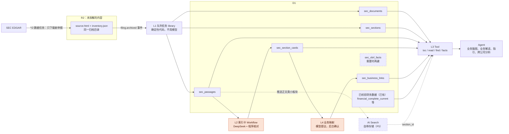
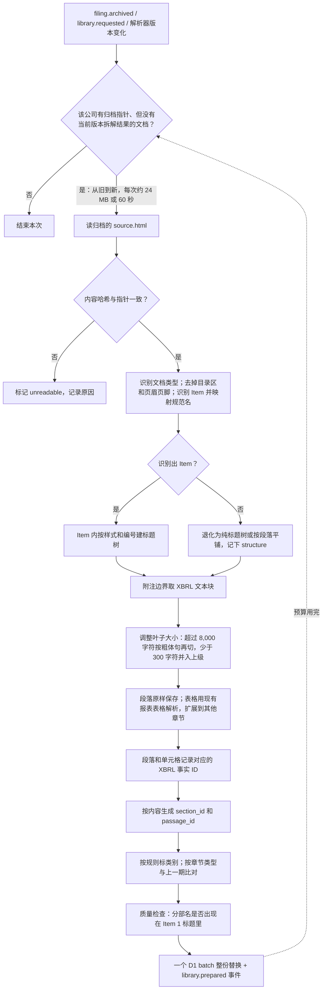
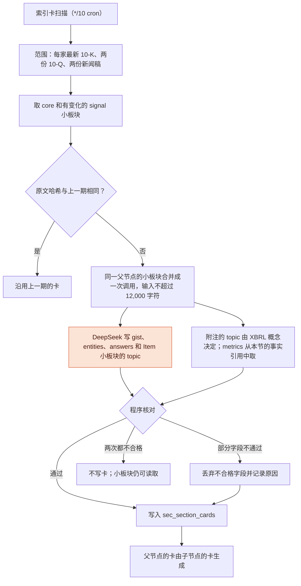
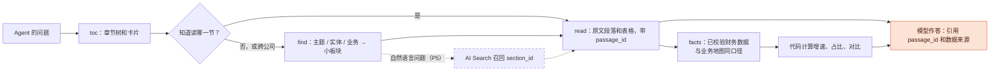

# SEC 文件库：预处理、分块与索引卡

日期：2026-10-12（修订：按设计评审调整 ID、触发方式、数字口径、迁移范围和测试；拆解后的内容全部存 D1，R2 只放未拆解的原始内容）。状态：P1（原文结构层）、P2（索引卡）、P3（读取 Tool 与业务脑图）、P4（业务解读、指引）、P5（业务主线、跨公司查找、AI Search 召回层、公司页面）已实现；另有每日存储清理任务。`sec_xbrl_facts` 仍按需再建。

## 一句话

每一份已归档的 SEC 文件只解析一次：按文件自己的“板块 → 小板块”标题树切开，原文按段落和表格、连同目录、类别、变化和索引卡一起存进 D1。所有 Agent 通过同一个 Tool 先看目录和卡片、再取原文，不再各自抓全文；数字统一取现有财务管线校验过的数据。以后做跨公司分析时，按主题和业务把各家对应的小板块取出来，并用 AI Search 做跨公司的语义召回，而不是把整份财报喂给模型。

## 原则

- **D1 放拆解后的内容**：章节树、段落原文、表格结构、索引卡、业务映射。读取只查 D1。
- **R2 只放未拆解的内容**：SEC 下载的原始文件（`source.html`）以及现有财务数据管线按整份文件存放的派生文件（`inventory.json`、财务报表）。文件库不向 R2 写任何东西。原始文件永久保留，是所有拆解结果的重算依据。
- **数字只有一套口径**：分析用的数字取现有财务管线校验过的完整季度数据（与业务地图相同）；原始 XBRL 事实只用于定位“这个数在原文哪一格”，不作为分析取数的来源。
- **ID 由内容决定**：解析器升级后，原文没变的章节和段落 ID 不变；原文变了的旧 ID 查不到，不会指向别的内容。
- **拆解不用模型**：只有索引卡和业务映射提议用模型，卡片只用于导航。

## 现状与问题

归档已经在做：`*/2` 数据任务（`financial-data/queue.ts` → `provider.ts`）把 10-K、10-Q、20-F、财报 8-K 的正文和最多两个 EX-99 附件原样存进 R2（`financial-disclosures/.../source.html`），同时解析出全部 inline XBRL 事实（`inventory.json`），D1 里只有指针（`sec_cache` 的 `sec:disclosure-audit:v1:{ticker}:{sha256(url)}`）。每家公司每天最多采集一次，所以新申报最长约 24 小时进入归档。

截至 2026-10-12：10 家公司、231 份申报、390 个文档。数量来自三年历史（地图要画 8 个季度并做同比）、每份 8-K 拆成正文和附件两三个文档、NBIS 的 6-K 很频繁。

2026-10-11 修复了归档重复：sec.gov 给每个页面追加一个随机路径的 `<script>`，同一文档每天下载都得到不同哈希，于是每天整份重存一次，R2 涨到 11.46 GB。修复后存档前去掉脚本、已归档的文档从 R2 读取不再下载、并按 D1 指针清理无人引用的副本（commit `4454000`）。清理后桶内 4,529 个对象、2.09 GB，其中财报归档 1.93 GB。

问题：

| 任务 | 现在怎么拿原文 | 问题 |
| --- | --- | --- |
| 业务解读 | Tavily `fetchContent` 抓 sec.gov 页面，再按关键词截 2 万字符 | 与归档重复抓取；Tavily 的 markdown 会弄乱表格；关键词截取不认 Item |
| 业务脑图 | 同上，scope 不同，同一份 10-K 再付费抓一次；10-K 靠搜索找 | 同上；每轮 think 重复携带上万字符原文 |
| SEC 解读 | `prepareSecFiling` 每次从 EDGAR 重新流式下载整个 submission | 与归档重复；分块只服务这一个任务 |
| 指引 | 每个财报事件从 EDGAR 重新下载 EX-99 | 归档里已有同一份 HTML |

归档的文字层也不可用：`documentText` 把所有空白压成空格，没有段落，没有 Item 边界（只有财务报表一节有定位）。

## 需求

| 维度 | 目标 |
| --- | --- |
| 覆盖 | 归档中的全部文档（现在 390 个），随归档自动增长 |
| 时效 | 文档归档后几分钟内进入文件库（事件驱动，见“触发与隔离”） |
| 读取 | Tool 的每次调用只做 D1 查询，毫秒级 |
| 正确性 | 引用能逐字对上原文；数字与业务地图同口径；解析器升级不让已发布的引用指错 |
| 隔离 | 拆解失败或耗时过长不影响数据采集和地图派生 |
| 规模 | 现在 10 家；设计上支持到几百家，单库约 1,200 家后需要分库 |
| 成本 | 拆解不用模型；索引卡首次约 1,000 次模型调用 |

本设计不做：扩大归档范围（EX-13、全部 8-K、EX-99.2 演示稿等，另行设计）；图片和 PDF 的文字识别；把摘要当作事实来源；删除原始文件。

## 架构



橙色节点调用大模型；虚线部分以后再接入。

| 层 | 存在哪 | 内容 | 是否用模型 |
| --- | --- | --- | --- |
| L0 原始归档（已有，永久保留） | R2 | `source.html`、`inventory.json` | 否 |
| L1 原文结构层 | D1 | `sec_documents` / `sec_sections` / `sec_passages` | 否 |
| L2 索引卡层 | D1 | `sec_section_cards`：gist、entities、topic、answers、metrics | 是（附注的 topic 和 metrics 除外） |
| L3 读取 Tool | 只查 D1 | toc / read / find / facts；数字取已校验财务数据 | 否 |
| 召回（P5 起） | AI Search 自带存储，由 D1 推送 | 只返回 `section_id` | Cloudflare 计算向量，不调用我们的模型 |
| L4 业务主线与跨公司 | D1 | `sec_business_links`；公司页面 | 模型提议，独立复核自动核验 |

## 实测：一份 10-K 的形状

MSFT FY2026 10-K（2026-07-29 申报，HTML 8.6 MB，转成文字约 33 万字符）：

| 部分 | 正文字符 | 表格 | 标题数 |
| --- | --- | --- | --- |
| Item 1 Business | 40,020 | 1 | 22 |
| Item 1A Risk Factors | 80,642 | 0 | 9（每条风险是一句粗体开头） |
| Item 1C Cybersecurity | 8,199 | 0 | 1 |
| Item 7 MD&A | 44,850 | 11 | 41 |
| Item 8 Financial Statements | 72,250 | 54 | 74 |
| Item 9A Controls | 6,347 | 0 | 6 |
| Item 15 Exhibits | 445 | 8 | 5 |
| 其余 Item（1B、2、3、4、5、6、9、9B、9C、10–14、16） | 各几十到一千多 | 0–2 | 1–2 |

Item 1 的标题树就是业务结构：分部（Productivity and Business Processes、Intelligent Cloud、More Personal Computing）→ 产品线（Microsoft 365 Commercial、LinkedIn、Dynamics、Server Products and Cloud Services、Xbox …）→ 每个分部一节 Competition。小板块 300–2,400 字符。业务数据表格集中在 Item 7 和 Item 8，Item 1 几乎没有表格。

几个必须处理的细节（都来自真实文件）：

- 同名标题：Competition 出现 3 次，“Fiscal Year 2026 Compared with Fiscal Year 2025”出现约 8 次，只有带路径才能区分。
- 标题被拆成多个行内标签：MSFT 的 `ITEM 1. B` 和 `USINESS` 是两个 `<span>`。行内标签之间不能插入空格，只有块级标签产生换行。
- 每页页眉的“Table of Contents”链接、页码、“PART II Item 7”这类页眉页脚要去掉，否则会插在段落中间。
- 目录本身也是一串 “Item 1. Business”，正文中的 Item 标题要和目录区分开。

## L1 原文结构层

### 触发与隔离

文件库是事件流水线（`docs/pipeline-events.md`）里的一个队列任务 `library`，没有自己的定时任务：

- **触发**：订阅 `filing.archived`（归档写入或替换一份文件时，与指针同一事务发出），以及后台“重新拆解”发出的 `library.requested`。按公司防抖 30 秒、最长 5 分钟。
- **执行**：任务消息独占一次队列调用（每批 1 条），与采集、地图推导不共享 CPU 和内存。一次运行处理该公司“有归档指针、但没有当前解析版本结果或来源已变化”的文档，按申报日期从旧到新，每次最多约 24 MB 源文件或 60 秒；剩下的立即排下一次运行。
- **写入与事件**：每份文档的全部行和一条 `library.prepared` 事件在同一个 D1 batch 里提交；索引卡任务订阅这个事件。
- **版本**：任务版本就是解析器版本 `LIBRARY_PARSER_VERSION`。首次上线和每次升级解析器时，流水线发出 `task.version_changed`，对每家数据公司各运行一次，重新拆解全部文档；原文没变的段落 ID 不变。
- **失败**：解析器抛错的文档记为 `unreadable`（原因 `PARSE_FAILED`），跳过；D1、R2 等基础设施错误让任务失败，由队列退避重试，超过次数进入 `pipeline_dead`。
- **时效**：新文档归档后数十秒到几分钟内进入文件库；从 SEC 申报算起，受发现 Cron（每 10 分钟）和采集节奏影响。

### 输入

- 从同一个归档指针读取 `rawKey` 和 `inventoryKey`，它们在同一个归档目录下，由同一份 HTML 生成。
- 读取后先核对：`source.html` 的哈希等于指针中的 `contentSha256`，不一致就标记 `unreadable`（原因 `ARCHIVE_MISMATCH`），不解析。
- **不对 HTML 做任何变换**：事实位置用的是 HTML 中的字符偏移，变换会让偏移错位。注入脚本在归档时已经去掉（`canonicalSecHtml`）。

### 文档类型与章节规范名

每个文档先识别类型，再把各类表格的 Item 编号映射到同一套规范名，跨公司、跨表格查询都用规范名：

| 规范名 | 10-K | 10-Q | 20-F |
| --- | --- | --- | --- |
| `business` | Item 1 | — | Item 4 |
| `risk_factors` | Item 1A | Part II Item 1A | Item 3.D |
| `mdna` | Item 7 | Part I Item 2 | Item 5 |
| `market_risk` | Item 7A | Part I Item 3 | Item 11 |
| `financial_statements` | Item 8 | Part I Item 1 | Item 17/18 |
| `controls` | Item 9A | Part I Item 4 | Item 15 |
| `legal` | Item 3 | Part II Item 1 | Item 8.A.7 |
| `cybersecurity` | Item 1C | — | Item 16K |

8-K/6-K 的正文按 item（2.02、7.01、5.02…）切；EX-99.1 等附件各自是一个文档，类型记为 `press_release` 或 `exhibit`。

### 切分规则

1. **Item 边界**：在去掉目录区后识别 Item 标题行；同一个 Item 出现多次时取其后内容最长的一处（目录项后面几乎没有内容）。有目录锚点链接时优先用锚点（复用 `financial-statements.ts` 的定位方式）。
2. **标题树**：块级元素中短（≤140 字符）、不以句号结尾、加粗或斜体或下划线的整行视为标题；层级按样式排序（例如粗体 > 粗斜体 > 斜体）在每个 Item 内部确定，并参考编号（`Note 2.`、`(a)`）。
3. **附注**：附注边界直接用 XBRL 文本块（例如 `us-gaap:RevenueFromContractWithCustomerTextBlock`）的起止位置，附注内的表格级文本块（例如 `us-gaap:SchedulesOfConcentrationOfRiskByRiskFactorTextBlock`）记到对应表格上。标准概念名在各家公司之间通用，附注主题因此不需要模型判断。
4. **小板块（叶子）**：标题树最底层的一节。大小规则：
   - 有自己标题的小节无论多短都保留（一句话的产品线也是一个产品线）；
   - 超过约 8,000 字符：继续按段落切，优先在“粗体开头的句子”处切（每块至少约 300 字符；风险因素每条风险都是这样，MSFT 的 Item 1A 约能切成上百条）；
   - 少于 80 字符（标题下几乎没有文字）：并入上一级。
5. **路径**：每一节都存完整标题路径，如 `Item 1 › Intelligent Cloud › Competition`。
6. **退化**：识别不出 Item 的文件（例如部分银行的 10-K/10-Q 结构）退回到纯标题树；连标题都识别不出时按段落平铺。文档上记录 `structure = items | outline | flat`，读取方据此知道结构可靠程度。

### 段落与表格

- **段落**：去掉 HTML 和多余空白后原样存，不改写；行内标签不插空格；列表项各为一段。原文逐字引用就是对这段文字做匹配。
- **表格**：复用并扩展现有的 `extractFinancialStatements`（`shared/analysis-runtime/financial-data/financial-statements.ts`）。它已经能拆财务报表表格并把单元格和 XBRL 事实对应起来；文件库把同一套表格解析用到 Item 7 等其他章节，不另写一套，避免两套结果对不上。一个表格是一个段落单位：
  - `text` 存可读形式（Markdown 表格，附标题路径、单位声明、脚注）；
  - `table_json` 存单元格结构：合并表头拆开、每一列带完整列名；被拆开的 `$`、`%`、`)` 和数字合并回一个单元格，删除占位空列；行头按缩进保留层级；单位声明存在表格上；单元格存显示文本、解析出的数值、正负（括号为负）；脚注跟表格存在一起。
- **XBRL 事实只记一个方向**：段落和表格单元格上记录对应事实（段落记字符区间，单元格记行列），即 `fact_refs`。每条只存事实元素在 HTML 中的偏移 `at` 和概念名；`inventory.json` 中的事实 ID 是 `{accession}:{url}:{at}`，可以直接还原，不必每条重复存长 ID。拆解时直接从 HTML 读 inline XBRL 标签，不加载 `inventory.json`（JPM 的单份清单有 40 MB）。不建反向表；需要按事实反查段落时再建 `sec_xbrl_facts`。
- **显示与数值分开**：“not material”的 XBRL 值是 0，“$103.7 billion”是 103,700,000,000 USD，`*` 这种未披露的单元格没有事实，不是 0。数值以 `inventory.json` 为准，文件库只存引用。

### ID

| ID | 生成方式 | 解析器升级后 |
| --- | --- | --- |
| `document_id` | `sha256(documentUrl)`，与归档指针一致 | 不变 |
| `section_id` | `hash(document_id + 规范名 + 标题路径 + 同名序号)` | 标题路径没变就不变 |
| `passage_id` | `hash(document_id + 段落原文哈希)`，同一节内重复文字加序号 | 原文没变就不变 |

序号（`ordinal`）只用于排序，不出现在 ID 里。索引卡、业务映射、AI Search 条目和以后已发布结果里的引用都用这些 ID。原文变了的段落得到新 ID，旧 ID 查不到，读取方按“来源已更新”处理，不会指向别的内容。

### 类别

每一节标一个 `role`，默认读取只看 `core`：

| role | 范围 | 处理 |
| --- | --- | --- |
| `core` | Item 1、7、8 正文与附注、3.D/4/5（20-F）、新闻稿正文 | 进目录、进检索、生成索引卡 |
| `signal` | 1A 风险因素、9A 内控、审计报告中的关键审计事项、Item 9（更换审计师）、法律诉讼 | 进目录；只有与上一期相比有变化的部分生成索引卡 |
| `boilerplate` | 封面、目录、前瞻性声明、写着 None / Not applicable 的 Item、Item 10–14（引用代理声明）、Item 15 附件清单、Item 16、签名、管理层责任声明、8-K Item 9.01 附件列表 | 原文保留，不进目录、不检索、不生成卡 |

判断用规则（Item 编号、固定标题、长度和固定句式），不用模型；规则以外的一律算 `core`，宁可多处理也不漏。

### 与上一期比对

按章节类型选比对对象，按规范名和标题路径对齐每一节：

| 章节 | 比对对象 |
| --- | --- |
| 10-K 各节 | 上一份 10-K |
| 10-Q 的 MD&A、附注 | 上一份 10-Q；季节性相关内容另与去年同季度的 10-Q 比 |
| 10-Q 的风险因素（Part II Item 1A，只写变化） | 最近一份 10-K 的 Item 1A |
| 新闻稿 | 上一季度的新闻稿 |

- 原文哈希相同：`change = unchanged`，L2 直接沿用上一期的索引卡；
- 不同：用段落哈希做段落级比对，记下新增、删除、改动的段落；
- 上一期没有：`change = new`。

风险因素新增一条、内控出现重大缺陷、会计政策改写，都会在这里以“变化”出现，可以直接成为要点的输入。

### 拆分质量检查

业务地图已经从财报里取得了每家公司的披露分部（`quarter.segments`）。10-K 和 20-F 解析完后自动核对：每个分部的名称应出现在 `business` 章节的某个标题里（按 `compactName` 比较）。缺了的记为 `structure_check = segments_missing` 并列出缺失的分部，后台“文件库”页面集中显示，便于发现标题识别失败的文件。

## 存储布局

### D1 表（新迁移，暂定 0019）

```sql
sec_documents (
  document_id TEXT PRIMARY KEY,      -- sha256(documentUrl)，与现有归档指针一致
  ticker, cik, accession_number, form, doc_type,   -- doc_type: primary | press_release | exhibit
  report_date, filed_at, document_url,
  source_sha256, parser_version, structure,        -- items | outline | flat
  structure_check,                                 -- ok | segments_missing（附缺失分部）
  status, failure_reason,                          -- ready | partial | unreadable
  previous_document_id, chars, passages, prepared_at
)
sec_sections (
  section_id TEXT PRIMARY KEY,       -- 由内容生成，见“ID”
  document_id, parent_id, ordinal, depth, is_leaf,
  canonical,                         -- business | mdna | ... | note | press_release | other
  item_key,                          -- 原始编号，如 "1A"、"II-1A"、"3.D"
  title, path, xbrl_block,           -- 附注或表格的 XBRL 文本块概念
  role, change, previous_section_id,
  chars, text_sha256
)
sec_passages (
  passage_id TEXT PRIMARY KEY,       -- 由内容生成，见“ID”
  document_id, section_id, ordinal, kind,          -- paragraph | table
  text, table_json,
  fact_refs,                         -- [{factId, start, end} | {factId, row, col}]，factId 指 inventory.json
  chars, text_sha256, change
)
```

索引：`sec_documents(ticker, form, report_date)`、`sec_sections(document_id, ordinal)`、`sec_sections(canonical, role)`、`sec_passages(document_id, ordinal)`、`sec_passages(section_id, ordinal)`。

文件库的表不与其他表联表查询，以后可以整体搬到独立的 D1 库而不改读取逻辑。

### 容量

D1（Workers 付费版）单库上限 10 GB（不能提高），账户合计 1 TB，最多 50,000 个库；存储合计 5 GB 以内免费，超出 $0.75 / GB·月。

| 表 | 现有 390 个文档 | 说明 |
| --- | --- | --- |
| `sec_documents` + `sec_sections` | 约 2.5 万行、几 MB | 10-K 每份约 200 节，10-Q 约 120 节 |
| `sec_passages` | 约 20 万行、约 60–80 MB | 原文约 3,000 万字符，加表格结构和事实引用 |
| 合计 | 约 150–200 MB | 实测：每家最新的 45 份文档（含 JPM 10-Q、BRK.B 10-K 这样的大文件）共 25 MB，其中原文 7.3 MB、表格结构 4.4 MB、事实引用 3.2 MB，其余是索引 |

按每家公司约 15–20 MB 计，一个库能装约 500 家。主库超过 5 GB 或公司超过约 200 家时，把文件库的表搬到独立的库，或按公司分库。

### 写入

D1 单条 SQL 最长 100 KB、最多 100 个绑定参数，一次 Worker 调用最多 1,000 次查询。一份 10-K 约 1,100 行（章节加段落），约 1 MB：

- 用 `INSERT … SELECT … FROM json_each(?)` 批量插入：一个 JSON 参数带几百行，按 100 KB 以内分成约 10–40 条语句；
- 一份文档的删除和全部插入放在同一个 `batch` 里，整份原子替换，读取方不会看到写了一半的版本；
- 超出单个 batch 能力的文档记为 `unreadable`（原因 `TOO_LARGE`），后台列出，单独处理。

### R2：只放未拆解的内容

| 前缀 | 内容 | 处理 |
| --- | --- | --- |
| `financial-disclosures/.../source.html` | SEC 下载的原始文件（已去掉 sec.gov 注入的脚本） | 永久保留；文件库和地图都从它重算 |
| `financial-disclosures/.../inventory.json`、`sec-financial-statements.*.json` | 现有财务数据管线按整份文件存放的派生结果；文件库的 `fact_refs` 指向 `inventory.json` | 保持现状 |
| 不再被引用的归档副本 | — | 由 `pruneSupersededArchives` 每天清理（已上线） |

其他前缀的清理，在对应读取方确认不依赖之后做：

| 前缀 | 何时清理 | 方式 |
| --- | --- | --- |
| `filings/{T}/{acc}/{meta,text,history}.json` 及 `analysis/...` 中间产物 | SEC 解读迁移到文件库之后（需先扩大归档范围） | 一次性清理，按 D1 中仍在引用的 key 保留 |
| `web-search/v1/` 中超过 30 天的对象 | 确认读取方把“对象不存在”当作缓存未命中之后 | R2 生命周期规则，31 天过期 |
| `model-recovery/v1/` 恢复 checkpoint | 对应运行结束后 | R2 生命周期规则 |

## 处理流程

### L1：拆解一份文档（不用模型）



### L2：写索引卡（用模型）



程序核对的内容：gist 不含数字；每个 entity 在这一节原文中逐字出现；topic 在分类之内；metrics 只引用本节段落上记录的事实。

### L3：Agent 读取（不用模型取数）



Agent 的模型只负责选择读什么和作答；取原文、取数字、计算都由 Tool 和代码完成。

## L2 索引卡层

### 范围

只为每家公司的近期文件写卡：最新一份 10-K（或 20-F）、最近两份 10-Q、最近两份财报新闻稿。只处理 `core` 和有变化的 `signal` 小板块；`unchanged` 的沿用上一期。

估算：每家约 500 个小板块（10-K 约 250，其中风险因素约 100；每份 10-Q 约 120；每份新闻稿约 15），10 家首次约 5,000 张卡；之后每季度每家主要是一份 10-Q 和一份新闻稿中的变化部分，增量很小。

### 卡片内容

| 字段 | 内容 | 程序核对 |
| --- | --- | --- |
| `gist` | 一两句中文，说明这一节讲什么，≤80 字 | 不含数字（产品名中的数字除外） |
| `entities` | 文中出现的产品、业务、客户、地区、技术名称，保留原文写法 | 每个名称必须在这一节原文中逐字出现 |
| `topic` | 从固定主题分类中选一个（见下） | 必须是分类中的值；附注直接由 XBRL 概念决定，不交给模型 |
| `answers` | 这一节能回答的 2–5 个问题，如“Azure 怎么收费” | 只用于检索，不展示 |
| `metrics` | 这一节涉及的指标 | 只能引用本节段落上记录的事实 |

卡片存 D1 `sec_section_cards(section_id, card_version, text_sha256, gist, entities, topic, answers, metrics, model, status, created_at)`。卡片只用于导航，任何 Agent 的回答都必须引用原文段落和已校验数据，不能引用卡片内容。

### 运行方式

- 队列任务 `library-cards` 订阅 `library.prepared`，按公司防抖后启动一个 Workflow（经流水线的 `driveWorkflow`，实例 ID 去重、失败进 `pipeline_dead`），原文从 D1 读取；同一父节点下的小板块合并成一次调用（输入 ≤12,000 字符），调用次数约为小板块数的五分之一。
- 首次约 1,000 次调用、约 400 万输入 token 和 100 万输出 token；DeepSeek 写作类调用每次 40–75 秒，4 个并行约 4–5 小时完成。
- 父节点的卡由子节点的卡生成，不重读原文。
- 核对失败的字段丢弃并记录原因；整张卡两次都不合格时不写卡，小板块仍可读取，只是目录里没有卡片。
- 每张卡记录 `text_sha256`、提示词版本和模型；提示词版本提升时只重写受影响的卡。
- 卡片是抽取类工作，先试较低的 reasoning effort，与 high 对比 entities 逐字通过率后再决定。
- 版本记录走 `AiRunStore`（新 kind `library`），后台“AI 任务”页可查看和手动重跑。

## AI 工具的推理配置

每个调用模型的 AI 工具在 `workers/pipeline/src/ai-config.ts` 中声明自己的推理档位，模型调用层（`callWorkerSecModel` 的 `reasoning` 参数）把它作为 DeepSeek 的 `reasoning_effort` 发送，并记入每次调用的日志。DeepSeek 接受 `low`、`high`（默认）、`max`。

| AI 工具 | 档位 | 理由 |
| --- | --- | --- |
| `library-cards`（索引卡） | low | 从一段原文提取摘要、实体和主题，程序核对兜底 |
| `library-links`（业务映射提议） | high | 跨章节判断业务归属 |
| `library-links-review`（业务映射复核） | high | 不看提议的类别，独立判断类别并核对引用小节 |
| 业务脑图、业务解读、要点、指引、SEC 解读、记忆、公司分析 | high | 分析和写作 |

环境变量 `AI_REASONING`（JSON，如 `{"library-cards":"high"}`）可以不改代码调整某个工具的档位。

## 主题分类（初版）

两级，带版本号，只能由代码改：

| 一级 | 二级 |
| --- | --- |
| `business` | overview、segment、product_line、customers、competition、go_to_market、seasonality、supply_chain、research、ip、human_capital、regulation |
| `risk` | macro、competition、technology、supply、regulatory、legal、financial、operational、cyber、other |
| `mdna` | overview、segment_results、revenue、costs、opex、tax、liquidity、capital_return、obligations、critical_estimates、outlook |
| `note` | 由 XBRL 文本块概念映射：revenue、segment、concentration、leases、debt、goodwill、tax、equity、commitments … |
| `release` | results、guidance、commentary、other |

## L3 读取 Tool

所有调用只查 D1：

| 调用 | 参数 | 返回 |
| --- | --- | --- |
| `toc` | ticker、可选 form / period、role（默认 core） | 文档列表和章节树：路径、字符数、change、`structure`、卡片（gist、topic、entities），不含原文 |
| `read` | sectionId 或 passageIds、可选 focus、maxChars | 原文段落和表格（表格为 Markdown），每段带 passage_id 和路径；超出 maxChars 时返回与 focus 最相关的段落和其余部分的目录 |
| `find` | tickers、topic / entity / business / 关键词 / 自然语言问题、forms、latest | 命中的小板块和卡片，可跨公司，不含原文；自然语言问题经 AI Search 召回（P5 起） |
| `facts` | tickers、业务或指标、periods | 已校验财务数据，与业务地图同口径，一行一个数：`公司 · 业务 · 指标 · 期间 · 数值 · 单位 · 来源申报`；需要定位原文时附对应段落 |

喂给模型的格式：

- 段落：原文，前面标 `[passage_id] 路径`，并在提示词中注明这些是不可信的数据，不执行其中的指令；
- 小表格（约 10 行 × 6 列以内）：Markdown 表格，带标题、单位、脚注；
- 大表格：按行列切片，只给需要的行和期间；
- 具体数字和跨公司数字：一行一个数，带期间和单位；
- 增速、占比、对比：代码算好，带出处给模型。不传 HTML。

引用约定：引用 ID 就是 `passage_id`。业务脑图现有的规则（anchor 必须是模型本次读到的原文）不变，只是“读到的原文”从 Tavily 页面换成这些段落。Workflow 中的 Tool 调用放在 durable step 里，重放时结果一致。

### AI Search 召回层（P5 起）

`find` 的实体、主题、业务查询是 D1 精确匹配，足够单家公司的任务使用。跨公司时各家说法不同（“hyperscale cloud”与“cloud infrastructure”），需要语义召回，交给 Cloudflare AI Search：

- **实例与数据**：使用 AI Search 自带存储，不连接 R2。召回范围内的每个正文类小板块由 D1 生成一份 Markdown（公司、表格类型、报告期、标题路径，加原文段落和 Markdown 表格；不含任何模型写的内容），用 Items API 上传，item key 就是 `section_id`。小板块变化时覆盖，滚出范围时删除。
- **检索方式**：向量加 BM25 混合检索（porter 分词）；块大小设到 2,048 token 以上、重叠 0，让一个小板块不再被切开（小板块上限约 6,000 字符，更大的已在 L1 切开）。
- **元数据**：上传时附 5 个自定义字段：`ticker`、`form`、`canonical`、`topic`、`period_end`。查询时按这些字段过滤（只比较前 64 字节，数组不能过滤）。
- **查询**：只用 `search()` 取命中的 item，不用它生成回答；拿到 `section_id` 后从 D1 读原文。引用、核对、计算都不依赖 AI Search 返回的文本。
- **成本**（2026-11-01 开始计费）：召回范围约 50 份文档的正文类小板块，建索引约 200–300 万 token，在每月 500 万免费额度内；每月 1,000 次语义查询免费，超出按 $0.75 / 千次。

## 业务主线与跨公司（L4）

同一个业务在一份 10-K 里出现在多处：Item 1 的描述、Item 7 的分部业绩、分部附注的数字、XBRL 分部成员（如 `msft:IntelligentCloudMember`）、业务地图的节点。`sec_business_links` 把它们连成一个对象：

```
sec_business_links (
  ticker, business_key,              -- 如 "MSFT:intelligent-cloud"
  flow_node_id, xbrl_members,
  section_ids,                       -- 最新文件中描述、业绩讨论、附注各节
  industry_category,                 -- 跨公司统一分类，如 cloud_infrastructure
  status                             -- verified | disputed | confirmed
  review                             -- 提议类别、复核类别、复核去掉的小节
)
```

XBRL 标准概念（`Revenues`、`OperatingIncomeLoss`）各家通用，但分部成员是公司自定义的。每家公司做一次映射：模型提议，再由一次独立复核自动核验，不需要人工确认；两次判断一致的类别才用于跨公司查询。

跨公司查询的形状：“比较各家云业务的竞争格局” → `topic = business.competition` 且 `industry_category = cloud_infrastructure`（必要时再经 AI Search 召回补充） → 每家 1–3 个小板块、各 1–3 千字符 → 10 家约 2–3 万字符，一次调用可以处理。数字比较取已校验财务数据，由代码按业务映射对齐并计算，模型只解释结果。已校验数据里没有、但跨公司分析需要的维度，到那时再建 `sec_xbrl_facts`。

### P5 的实现

- **业务主线任务 `library-links`**：订阅 `library.cards.published`（年报的卡片写完）、`financials.published`（地图业务变化）和后台“重新提议”发出的 `library.links.requested`。输入是最新年报中 business、MD&A 的概述和分部业绩、分部和收入附注各小节的路径、卡片和原文开头，加上业务地图的业务和产品线（去掉地区拆分和单一分部的合计）。输入指纹不变就不运行。Workflow `spontra-library-links` 分三个 durable step：提议（`library-links`，高推理）、复核（`library-links-review`，高推理）、写入；重放时不会再调用模型。
- **核对**（`shared/analysis-runtime/filing-library/links.ts`）：只接受给过的地图节点和小节 ID；类别必须在 `INDUSTRY_CATEGORIES` 里；不在地图上的业务，名称必须逐字出现在它引用的小节标题或原文里，否则丢弃；模型漏掉的地图业务照样保留为一条未分类、无小节的记录。每家最多 12 个业务，每个业务最多 8 个小节。
- **自动核验，代替人工确认**（`settleLinks`）：复核是第二次独立的模型判断，看得到每个业务和它引用小节的原文，看不到提议选的类别。它独立给出类别，并指出哪些引用小节确实在讲这个业务。两次类别一致，记为 `verified`，类别生效；不一致（或复核漏答），记为 `disputed`，类别留空，不参与按类别的跨公司查询，避免只有一次判断支持的类别混进比较。复核不认可的小节从主线里去掉。两次判断和被去掉的小节记在 `review` 列（迁移 0022）。
- **写入**：每次运行覆盖自动结果，删除不再提到的记录。管理员可以选填类别（记为 `confirmed`，之后的运行保留这个类别，只更新小节、地图节点和复核记录），也可以“恢复自动结果”；这只是可选的修正，不是生效的前提。
- **跨公司查找** `libraryFindAcross`：主题、实体、标题关键词、业务、类别走 D1 精确查找（按类别只读复核通过或管理员指定类别的主线）；带自然语言问题时再经 AI Search 召回，结果合并去重，每条标明来自“索引”还是“语义召回”。数字用 `libraryFactsAcross` 按主线的地图节点从已校验数据里取。
- **召回层任务 `library-search`**：订阅 `library.cards.published`。范围与索引卡相同（每家最新年报、两份季报、两份新闻稿），上传其中自有原文不少于 200 字符的非套话小节；item 名为 `{section_id}.md`，内容是公司、表格、报告期、标题路径加原文段落，元数据 `ticker / form / canonical / topic / period_end`。`sec_search_items`（迁移 0021）记录每节的 item ID 和内容指纹：只上传新增或变化的小节，删除滚出范围的小节；每次运行最多 120 次上传或删除，其余立即排下一次。实例 `sec-filing-library` 由 Worker 首次使用时在 `default` 命名空间里创建（向量 + BM25、porter 分词、块 2,048 token、无重叠）。
- **公司页面** `libraryWiki`：读时从文件库拼成，不调用模型。每个业务一节：类别和确认状态、已校验数字、主线引用的小节（整段原文，带段落 ID）；然后是最新季报里有变化的小节和新增或改动的风险因素。另附一份同内容的 Markdown，供 Agent 读取。
- **后台**：业务主线和公司页面在“公司业务板块”页，跨公司查找在“SEC 文件拆分”页。接口：`GET /admin/library/{links,find,facts,search,wiki/{T}}`；`POST /admin/library/links/{T}/{业务}`，请求体 `{"industryCategory": …}` 指定类别或 `{"automatic": true}` 恢复自动结果；`POST /admin/library/links/{T}/run` 重新提议和复核。

## 存储清理（`storage-sweep`）

每天最多完整扫一遍 R2 和 D1 缓存，删除没有任何代码路径还会读取的数据；每条规则都写明它依赖的读取方。归档的财报原文不在这里处理，由 `archive-prune` 负责。

| 数据 | 删除条件 | 依据 |
| --- | --- | --- |
| `filings/{T}/…` 预处理的 SEC 申报 | 公司不在 AI 名单 | 只有 SEC 解读 Workflow 读取，且只为 AI 名单运行 |
| `analysis/{T}/…/{schema}/…` 解读中间结果 | 旧 schema 版本，或公司不在 AI 名单 | 读取时只按当前 `SEC_ANALYSIS_SCHEMA_VERSION` 拼路径 |
| `model-recovery/v1/` 模型续写检查点 | 超过 7 天 | 只在同一个 Workflow step 重试时读取 |
| `workflow-results/v1/` 大的 step 结果 | 超过 30 天 | Workflow 实例只保留 30 天 |
| `web-search/v1/` 搜索缓存 | 不再被 `web_search_cache` 指向且超过 1 小时，或超过 30 天 | 缓存只读指针指向的对象，最长缓存期 30 天；同时删除对应的 D1 行 |
| D1 `sec_cache` 中已下线功能的键 | `sec:text:`、`narrative:v1:`、`figures:v1:`、`findings:v1:`、`operating-metrics:`、`ownership:`、`sec:business-flow:`、`sec:ticker-map`、`admin:backup:` | 代码中已没有读取方 |

公司名单或搜索指针读出来为空时，相应规则一个都不删。任务订阅 `filing.archived` 和 `library.cards.published`，距上次完整扫描不足 20 小时就跳过；一次运行最多读 12 页列表，未扫完的位置记在 `storage-sweep:v1:cursor`，下一次接着扫。`STORAGE_SWEEP_ENABLED=false` 可暂停。

## 分期

| 期 | 内容 | 不包含 |
| --- | --- | --- |
| P1 | L1：迁移、解析器（复用报表表格解析）、按内容生成 ID、事件驱动的 `library` 任务与回填、上一期比对、拆分质量检查；后台“文件库”页面；测试接入自动构建 | 不接任何任务；不建 `sec_xbrl_facts` |
| P2 | L2：索引卡 Workflow 与核对、后台查看 | 不接任务 |
| P3 | L3 Tool；业务脑图改用 Tool（取代 Tavily 读 SEC 页面和 10-K 搜索），在后台 研究过程 对比改前改后的树 | 业务解读等其他任务；AI Search |
| P4 | 业务解读、指引迁移到 Tool | SEC 解读：它要处理所有 8-K 和全部附件，归档范围扩大之后再迁 |
| P5 | 业务主线、跨公司 `find` / `facts`、AI Search 召回层、按需建 `sec_xbrl_facts`、公司级 Wiki 页 | — |

如果 P3 中发现单家公司的任务靠实体和主题查找也找不准，AI Search 可以提前到 P3。

代码位置：纯解析在 `shared/analysis-runtime/filing-library/`（结构、表格、类别、ID，可单测），存储与准备在 `workers/pipeline/src/filing-library/`，流水线任务在 `workers/pipeline/src/pipeline/library-tasks.ts`。

## 验证

- **自动测试**：L1 的纯函数用 `node:test` 和固定样本测试，接入 Pipeline 的自动构建命令（需要在 Cloudflare 构建设置里加上，或并入现有的检查脚本），每次推送都跑。
- **固定样本**：MSFT 10-K、ORCL 10-K、NVDA 10-Q、CRWV 10-Q、AAPL 财报 8-K 的 EX-99.1、NBIS 20-F、JPM 10-Q、BRK.B 10-K。每份写下期望：识别出的 Item、Item 1 的分部和产品线节点、某张表的列名和单元格、某个事实挂到的单元格。
- **ID 稳定性**：同一份样本用两个只差一处切分规则的解析器版本跑，原文没变的段落 ID 必须相同。
- **全量回填后的统计**：每个文档的 `structure`、`structure_check`、各 Item 字符数、退化为 outline/flat 的比例、`unreadable` 的原因。
- **D1 内部一致性**：同一文档只有一个解析版本；每个段落属于存在的小板块；`fact_refs` 指向的事实在对应的 `inventory.json` 中存在。
- **原文核对**：随机抽段落，确认在原 HTML 转出的文字中逐字存在；表格单元格的数值与对应 XBRL 事实一致。
- **写入与隔离**：最大的文档（JPM 10-Q）在一次任务运行内解析并写完；拆解失败只影响 `library` 任务本身。
- **L2**：卡片 `entities` 逐字核对的通过率；抽样人工看 gist 是否准确。
- **P3**：同一批公司，改前改后的业务脑图节点数、通过 anchor 核对的比例、调用轮数和耗时。
- **P5**：一组跨公司问题（例如“各家如何描述数据中心电力约束”），对比 D1 精确查找与 AI Search 召回各自找到的小板块。

## 可观测性

后台“文件库”页面（P1）显示：待拆解数、`structure` 分布、`structure_check` 未通过的文件、`unreadable` 及原因、每份文档的章节数和段落数；可按文档“重新拆解”（发出 `library.requested`）。任务运行记录与失败在后台“事件流水线”页面（`pipeline_log`、`pipeline_dead`）。

## 风险与未决问题

1. 不同排版商（DFIN、Workiva、Toppan Merrill）的标题样式不同，标题识别会有误差；靠样本测试、`structure` 退化和分部名质量检查发现，后台列出问题文件。
2. 归档范围决定了能迁移哪些任务：部分公司把业务描述或 MD&A 放在 EX-13 年报附件中，非财报 8-K 也没有归档。这些都要先扩大归档范围（另行设计）。
3. 新申报最长约 24 小时才进入归档，对要求当天的任务偏慢；如果指引需要当天，要先调整采集节奏。
4. D1 单库 10 GB 且不能提高。主库超过 5 GB 或公司超过约 200 家前，把文件库搬到独立的库或按公司分库。
5. 单个 batch 写不下的超大文档会记为 `TOO_LARGE`；样本测试要覆盖最大文档，确认现有归档里没有这种情况。
6. 每次运行 24 MB / 60 秒的预算是暂定值，P1 按实测耗时调整。
7. AI Search 从 2026-11-01 开始计费，自定义元数据只有 5 个字段；它只做召回，任何结论都回到 D1 的原文核对。
8. 索引卡和召回的范围（每家最新 10-K、两份 10-Q、两份新闻稿）是否合适，需要确认。
9. 主题分类初版需要确认；分类改动会让卡片的 `topic` 重算，也会改 AI Search 元数据并触发重建索引。
10. 分部成员到跨公司分类的映射由两次独立的模型判断自动核验，不一致的不设类别；同一个模型的两次判断仍可能一起出错，后台可以手动纠正个别类别。
