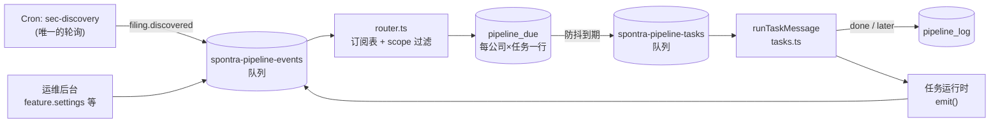
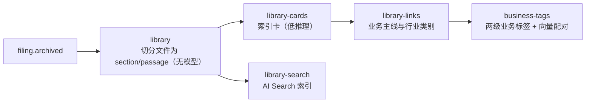
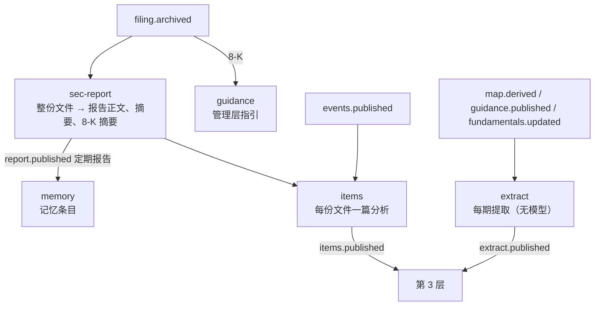
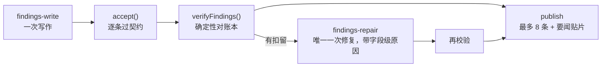

# Spontra Analysis 架构：从数据到估值的五层

日期：2026-11-04。本文描述上线后的现状（69cb72e3）。升级的动机、取舍与实施记录见 [spontra-architecture-upgrade](spontra-architecture-upgrade.md)；各层内部细节另有专文（文末索引）。

本文只讲从 SEC 原文到估值的五层核心链路，由宏观到具体分四级：定位与原则 → 运行骨架 → 每一层 → 跨层机制。

---

## 一、定位与原则

Spontra Analysis 是跑在 Cloudflare 上的后端（`workers/analysis/`，Worker `spontra-analysis`）。它为每家美股公司把 SEC 文件逐级加工成五种产物，前端（DeepSeek Harness 的 investment 应用）只读产物，不读原文。

### 1.1 五层

| 层 | 名称 | 产物（公司级） | 读什么 | 用模型 | 联网 |
|---|---|---|---|---|---|
| 1.1 | `map` 表格数据拆解 | 历期三表、分部、资本结构快照、事件轨 | EDGAR 文件的表格与 XBRL | 只在读笔记与利润表判定，按算术校验 | 只访问 EDGAR |
| 1.2 | 文本拆解入库 | 文件库（section/passage）、索引卡、业务主线、业务标签 | 已归档原文 | 切分不用；卡片、主线、标签用（低推理） | 否 |
| 2 | `filings` 文件分析 | 每份文件的报告与摘要、指引、记忆、每份文件的分析、**每期提取** | 第 1 层产物 + 已归档原文 | 是 | 按需（逐文件分析；指引的 IR 幻灯片） |
| 3 | `findings` 关键点 | 公司分析、要点、分析师卷宗、三表体检笔记 | 第 2 层产物 | 是 | 按需（公司分析、分析师） |
| 4 | `tree` 业务拆解 | 业务脑图、各业务说明 | 第 1.2 层文件库 + 第 1.1 层分部 + 网页 | 是 | 是（脑图的主要来源之一） |
| 5 | `valuation` 估值 | 五维评分 + 计算模型 + 报告 | 第 2、3、4 层产物 | 是 | 按需（研究阶段） |

第 1 层分两个子层：1.1 把文件的**表格**拆成数字，1.2 把文件的**文本**拆成段落入库。两者都是拆解，不做解读；解读从第 2 层开始。代码里第 1.2 层的任务（`library`、`library-cards`、`library-links`、`business-tags`、`library-search`）挂在 `filings` 开关与 scope 下，开第 2 层即一并开启；本文按职责归入第 1 层。

层的定义在 `shared/analysis-contract/business-features.ts`：`LAYERS`、`FEATURES`（第 2–5 层的开关）、`LAYER_REQUIRES`（阶梯：每层要求其下一层已开）。

### 1.2 三条原则

1. **上层只读下层产物，不读原文。** 原文只在第 1 层（拆解）与第 2 层（解读）被读。第 3 层起，引用的是第 2 层已核验过的段落 id；读取端的引文重验因此必然通过。
2. **数字只有一个来源。** 第 2 层的每期提取（period extract）含账本（ledger），上层陈述的每个数字都来自账本行；要点的校验是确定性的（`verifyFindings`），不是让模型再核一遍。
3. **下层产物优先，网页按需。** 第 2–5 层的 agent 都有原生 `web_search` 与读页工具，但提示词规定只在下层产物答不上时才用（文件点名却没解释的交易对手或产品、最新文件之后的事件、未跟踪同业的自有披露、行业背景），并有每次运行的搜索与读页预算；一条搜索摘要从不算证据，只有读过的页面才成为可引用的材料。第 4 层的脑图是例外：网页是它的主要来源之一。要点写作与三表体检是单次 JSON 调用或只读文件分析的窄 agent，没有网页工具。

两条配合原则的工程约束：

- **一个产物生成一次。** 每个任务按输入指纹判断是否有新内容要写；指纹未变不启动模型。上层等下层"沉降"后再写，避免每来一份下层发布就重写一次。
- **修复只给一次。** 模型产物不过校验，只给一轮修复；仍不过则扣留（withheld），不无限重试烧 token。

---

## 二、运行骨架

### 2.1 事件驱动，没有轮询

所有任务由事件触发，只有 SEC 发现（`sec-discovery`）是 Cron。注册表 `workers/analysis/src/pipeline/registry.ts` 是纯数据：事件类型、每个任务的 `scope`（属于哪一层）、`emits`（发什么事件）、`debounceMs`/`maxWaitMs`，以及事件 → 任务的订阅表。构建期的 `check:analysis:boundary` 校验这张图无环、无孤儿订阅。

一次触发的生命周期：事件进入 events 队列 → 路由器按订阅表和公司所在层过滤 → 在 `pipeline_due` 写（或推后）该公司该任务的到期行 → 到期后 tasks 队列投递 → 任务运行，`done` 删行，`later` 推后再排。同一公司同一任务只有一行到期，所以一阵下层发布只换来上层一次运行。

### 2.2 执行与存储

- **任务与 Workflow。** 无模型的任务在 Worker 里直接跑；用模型的任务（sec-report、guidance、items、company-analysis、findings、analyst、checkup、explainer、tree、valuation、translate 等）各自是一个 Cloudflare Workflow，步骤可重放，模型调用按步骤缓存。
- **存储。** D1 是真相：`sec_cache`（按 key 存 JSON 产物）、`sec_documents`/`sec_sections`/`sec_passages`（文件库）、`filing_read_notes`、`valuation_*`、`ai_usage`（每次模型调用的账）。R2 存归档原文与网页缓存。Vectorize 存业务标签向量。
- **模型。** 全部经 `api.deepseek.com/anthropic`，deepseek-flash；按任务分推理档位。

### 2.3 开关与阶梯

每家公司五个开关：第 1 层是白名单 `financial_company_settings`；第 2–5 层在 `business_feature_settings`，各有 `generate`（跑不跑）与 `display`（前端显不显示）。

- 开某一层要求它下面那层已开（后台 409 拒绝："请先开启该公司的X"）。
- 关某一层连带关其上所有层；一次运行失败后的自动关闭同样连带。
- 后台 `/admin/companies` 列出 EDGAR 目录里的每家美股发行人，按开关筛选、分页搜索（`GET /admin/business-map/directory`）。
- 任务运行时按 `scope` 再核一次该公司是否仍在该层（`inScope`），开关关掉后排队中的运行会自行结束。

### 2.4 沉降门（settle gate）

上层任务开跑前查 `pipeline_due`：若该公司在下层还有未到期的运行（`unsettledBelow`，`pipeline/ai-tasks.ts`），本次返回 `later`，10 分钟后再看。一个下层运行等了超过 6 小时视为卡住，不再挡上层。

| 任务 | 等待的层 | 额外等待 |
|---|---|---|
| findings | map, filings | company-analysis；在跑的记忆与公司分析 Workflow |
| analyst, checkup | map, filings | findings |
| explainer, tree | map, filings | — |
| valuation | map, filings, findings | tree, explainer |

这样一家公司一次开到第 5 层，每层各写一次，而不是每次下层发布都写一次。

---

## 三、逐层设计

### 3.1 第 1.1 层 `map`：表格数据拆解

**职责。** 把一家公司的每一份定期报告与财报 8-K 的表格变成可比的季度数据。模型只在两处出现，且都不产数字：读笔记指位置，利润表判定定口径。

**入口与任务。**

| 任务 | 做什么 |
|---|---|
| `collect` | 从 EDGAR 取最新完整三表并发布（`financials.published`）；财报季先用 8-K 发布季度，10-Q 到了再对账。新文件经**读笔记**（见下）入账 |
| `archive` | 归档其余现行报告（如无 2.02 项的 8-K），之后任何模块只从归档读原文（见 [sec-archive](sec-archive.md)） |
| `history` | 季度收入历史 |
| `map-derive` | 从归档重建更早的季度与资本结构快照（`map.derived`） |
| `fundamentals` | 重读 Company Facts（`fundamentals.updated`） |
| `events` | 现行报告与 Form 4 的事件轨、文件列表 |
| `presentation` | 利润表后半段无法配平时由模型判一次，再走维护任务重采 |

**产物。** 完整发布（三表 + 分部 + 来源）、派生快照（旧季度、资本结构、RPO）、SEC 基本面序列、事件轨。所有数字带来源 accession。

**读笔记（`financial-data/read-note.ts`，`read-note.v3`）。** 新文件的季度怎么进账：代码先把文件里的每张表切成文本行，模型读一遍后只写一张"笔记"——最新一期的每个金额在第几张表、第几行、正负号、哪一列是本期，以及它引用的期末日期原文。笔记里**从不出现金额**。代码按笔记指的位置去读金额，再做算术：完整性门知道的每个合计都要勾稽，文件里重复出现的上一季收入列要与已发布的那一季相等；全部对上才接受这一期，否则笔记作废、这期不发布（`filing_read_notes` 记状态与问题）。笔记写错的后果是校验失败，而不是发布一个错数。

**校验。** 算术：报表自身勾稽、相邻累计期对照、重述通过比较前后文件得出；分部拆分按文件声明的计算弧与收入表配平。

### 3.2 第 1.2 层：文本拆解入库

**职责。** 把归档原文的叙述部分（MD&A、风险因素、附注、8-K 正文）拆成带稳定 id 的段落存进 D1，并给每份文件打上索引卡、业务主线与业务标签。上层引用的每一条原文段落都指向这里。

| 任务 | 做什么 | 产物 |
|---|---|---|
| `library` | 从 R2 读归档 HTML 一次，按 item/章节切成 section 与 passage | `sec_documents` / `sec_sections` / `sec_passages` |
| `library-cards` | 每份文件一张索引卡，说明各章节讲什么 | 文件库卡片 |
| `library-links` | 从卡片与段落提取业务主线与行业类别 | 业务链接 |
| `business-tags` | 两级业务标签，bge-m3 向量配出同业单元对（`business_tag_pairs`） | 同业标签 |
| `library-search` | 把段落送进 AI Search 供召回 | 索引 |

只有 `library` 读 R2；其余三个模型任务读 D1 段落。它们不解读文件，只是让文件可定位、可检索、可配同业，所以归第 1 层而不是第 2 层。标签放在这里还有一个原因：同业比较的质量取决于打了标签的公司数量，拆解层比解读层便宜，覆盖的公司更多。

### 3.3 第 2 层 `filings`：文件分析

**职责。** 解读。把每份文件变成上层可直接引用的报告、摘要、指引、记忆与分析，并把本期关键数字确定性地提取出来。读的是第 1.1 层的数字、第 1.2 层的段落，以及（sec-report 与 guidance）整份归档原文。

**任务链。**

**关键产物。**

| 产物 | 存放 | 说明 |
|---|---|---|
| 报告正文与摘要、8-K 摘要 | `sec_published_reports`、`sec_filing_summaries` | 见下；`verificationStatus` verified / partial / failed |
| 指引 | guidance 产物 | 来自财报 8-K、IR 幻灯片、已存通话记录 |
| 记忆 | `d1-memory` | 每份定期报告的记忆条目，公司分析的输入 |
| **每份文件的分析** | `item-analysis:v1:<ticker>:<id>`，索引 `items:v1:<ticker>` | 由共享 agent loop 写、`compose` 核验；`items/library.ts` 的 `listFilingAnalyses`/`readFilingAnalysis` 是上层读它的唯一接口 |
| **每期提取** | `period-extract:v1:<ticker>`（`period-extract.v1`） | 见下 |

**sec-report（`sec/pipeline.ts`，`sec-analysis.v4`）是什么。** 每份定期报告（10-K/10-Q/20-F）与事件报告（8-K/6-K）各跑一次的 Workflow，产出这份文件的**读者报告**：正文 3–8 节、1–5 条变化、可证伪的条件、摘要（`headline` / `bullets` / `analystView`），以及可放的图。定期报告走完整路径：原文切成带位置的证据块 → 全文扫描出披露候选 → 加载 Company Facts 里本期已验证的 XBRL 事实与历史序列 → manager 提问 → 各节点研究 → manager 复审（最多一轮修复）→ 确定性财务透镜 → 综合成文 → 结构校验 → 独立编辑评审（一次修订）。8-K/6-K 走简析路径。它另外把这份文件的会计期写进库（guidance 按它给指引定日期），并发 `report.published`，memory 由此生成记忆条目。细节见 [sec-reader-report](sec-reader-report.md)。

**sec-report 的校验为什么是确定性的。** 这份报告是模型读整篇原文写出来的，而原文里的数字模型会抄错、会算错、会把累计期当单季。所以数字不信模型：

- 文中的关键指标（`keyMetrics`）逐条对回证据——要么是 XBRL 事实，要么是带证据块 id 的事实；对不上的指标被丢弃，不改写成对的，并记进 `dataQuality.warnings`。
- 同比、环比、百分点变化由代码从序列算，不让模型写增长率；比率的变化按百分点，不按相对值。
- 现金流桥（OCF − 资本开支等）由代码按原表的符号算，`arithmeticVerified` 标在透镜上。
- 通过的指标数 ≥2 且 XBRL 覆盖率 ≥90% 才记 `verified`，否则 `partial`；一个都对不上记 `failed`。状态随报告存储，前端照状态展示。

这与第 1.1 层读笔记的算术校验是同一个思路：模型负责"在哪、怎么读、说明什么"，数字由代码从来源取并勾稽。

**每期提取（`extract/period-extract.ts`）。** 无模型，从第 1.1 层的完整发布、派生快照、SEC 基本面和第 2 层的指引确定性地切出：八个季度的 `FindingData`（三表、资本、基本面、指引）与账本 `Ledger`（上层可陈述的每一个数字，带 yoy/qoq 与来源）、三表体检的标记。指纹按内容（覆盖的期、最新积压、指引内容、基本面哈希）而非重建时间，所以只有内容变了才发 `extract.published`。它的存在就是为了让第 3 层不再回头读第 1.1 层。

**items 的工具策略。** `ITEM_POLICY = company_overview / read_series / find_sections / read_section / search / read_web / compose / finish`：这里允许读第 1.2 层的段落，是整个系统里模型读原文的最后一处（连同 sec-report 与 guidance）。网页预算每次运行 2 次搜索、2 次读页，只给文件点名却没解释的东西。

**第 2 层在哪里读原文、读的是什么。** 第 1.1 层只产数字，第 1.2 层只产段落；两者都不解读。第 2 层的读取点：

| 步骤 | 读的是 | 从哪读 |
|---|---|---|
| `sec-report` | 整份归档文件（含附件）、本期 XBRL 事实、历史序列 | R2（sec-archive 的 `archivedFiling`）+ Company Facts |
| `guidance` | 财报 8-K 正文、IR 幻灯片、已存通话记录 | R2 + 指引存储 |
| `memory` | sec-report 自己写出的报告产物 | R2（`sec_memory_jobs.source_r2_key`） |
| `items` | 第 1.2 层的文件库段落、第 1.1 层的序列 | D1；只有尚未入库的现行报告回退读 R2 的预处理文本 |
| `extract` | 第 1.1 层发布与派生、Company Facts、指引 | D1 / KV，无模型 |

第 1 层的意义在于数字与定位：第 2 层每一处模型读文字的地方，都拿第 1.1 层核过的数字去约束它（sec-report 的指标对证、每期提取的账本），引用则落到第 1.2 层的段落 id，而不是让模型自己从文字里抄数、凭记忆引文。

### 3.4 第 3 层 `findings`：关键点

**职责。** 以公司为单位跨文件综合。四个任务都只读第 2 层的产物。

| 任务 | 输入 | 产物 | 版本 |
|---|---|---|---|
| `company-analysis` | 已发布的 SEC 分析报告（`read_sec_report`） | 公司业务深度解读（`company_analysis_runs`） | `business-deep-dive-react.v2` |
| `findings` | 每期提取 + 公司分析 + 最多 16 篇文件分析（`payload.filings`） | `findings:v2:<ticker>`：要点、每要点的 lens 文档、各报表视图的要闻贴片 | `findings.writer.v11`，lens `lens.agent.v6` |
| `analyst` | 已核验要点 + 文件分析 + 同业 | `dossier:v1:<ticker>`：每条要点一份研究卷宗 | analyst v7 |
| `checkup` | 体检标记 + 文件分析 | `checkup:v1:<ticker>`：每个被标记指标一篇笔记 | checkup notes v4 |

**要点写作的校验路径。**

- 契约是 zod（`shared/analysis-runtime/findings.ts`）：每条要点的证据是账本 ref，lens 是图表语法或 HTML，watch 是下期要核的条件。
- 校验是算术：证据引用的账本行存在、数值与文本一致、来源 id 在来源表里。
- 超过 8 条只保留前 8 条；每条不过契约的原因随修复请求一起给模型。
- 没有任何要点通过时，仍发布要闻贴片（stat tiles），要点为空。

**分析师与体检的工具。** 分析师：`filings`、`read_filing_analysis`、`read_web`、`peers`、`similar_businesses`、`compile`、`finish`，加原生 `web_search`（deep 档 3 搜 3 读，standard 档 2 搜 2 读）。体检：`read_filing_analysis`、`finish`。都没有 `find_sections`/`read_section`。引文来自文件分析的段落或读过的网页，各带 id。公司分析读已发布的 SEC 分析报告，网页按需（最多 4 次搜索），不再要求必须搜。

**失败语义。** 模型调用全部失败（如余额不足 402）时，运行报错交给任务重试，不记空结果把这份输入标为已完成。全部要点都是轻量级（不研究）才记 `dossier:empty:v1`。

### 3.5 第 4 层 `tree`：业务拆解

**职责。** 把地图上的每个业务节点拆成 分部 → 产品线 → 产品 → 收入 的树，并为每个业务写说明。唯一允许联网的层。

| 任务 | 输入 | 产物 | 版本 |
|---|---|---|---|
| `tree` | 第 1.1 层的业务节点、第 1.2 层文件库（`treeLibrary`）、网页搜索 | `business-tree:v1:<ticker>` | `business-tree.react.v15` |
| `explainer` | 第 1.2 层文件库段落 | `business-explainer:v1:<ticker>` | `business-explainer.sections.v5` |

**tree 的 ReAct 循环（`business-tree/agent.ts`）。** 工具 `read`（按来源 id 读段落）、`add`/`revise`/`remove`（harness 逐个检查节点）、`finish`，加原生 `web_search`（每个业务有搜索预算，sec.gov 被排除，SEC 原文只从文件库读）。每个节点必须锚定一段读过的文字；审阅阶段有记录的裁定可移动节点；描述阶段补写缺失说明。

**网页缓存。** `web_search_cache`（D1 指针 + R2）的 scope 按 agent × ticker 划分，只用于同一次运行内去重、7 天内重跑复用与失败重试，不是跨层共享研究的机制。

### 3.6 第 5 层 `valuation`：估值

**职责。** 读前四层，给出五个维度的评分、一个可计算的模型与一份带脚注的报告。

**输入（`valuation/input.ts`，无模型）。** 每期提取给财务事实；指引；通话记录；可读文件清单；后台维护的公司输入（`valuation_company_inputs`：管理层目标、可比集）。指纹额外含 `below`：`findings:v2`、`business-tree:v1`、`items:v1` 三者的指纹——下层任一重新发布，估值就是新输入。订阅 `findings.published`、`tree.published`、`items.published`。

**三个阶段（`valuation/workflow.ts`，`valuation.v10`）。**

| 阶段 | 工具（`RESEARCH_TOOLS` 等） | 产出 |
|---|---|---|
| research | `read_financials`、`read_filing_analyses`/`read_filing_analysis`、`read_findings`、`read_business_tree`、`list_filings`/`find_filing_sections`/`read_filing_section`、`read_guidance`、`read_transcript`、`search_evidence`/`read_web_evidence`（3 搜 4 读）、`submit_dimension`、`finish_research` | businessQuality、growthExecution、financialResilience、mispricingCatalysts 四维评分，每条引用登记过的证据 |
| assumptions | `configure_valuation`、各 `set_*_case`、`calculate_prepared_valuation`、`declare_model_insufficient`、`submit_dimension`（valuationSafety） | 一个模型、三个情景共享一个有来源的折现率、方法权重与情景概率；计算器是代码，失败的门不记录 |
| compose | `compose_valuation`、`finish_valuation` | 报告与脚注 |

**存储。** `valuation_versions` / `valuation_current` / `valuation_evidence`；方法变更可被 `methodChangeHeldBack` 暂扣，不自动覆盖。

**与原则的已知出入。** research 阶段仍可用 `find_filing_sections`/`read_filing_section` 读债务、股数、租赁附注的原文；同业数据仍读同业的第 1.1 层发布。这是升级记录里明确留下的两项。

---

## 四、跨层机制

### 4.1 指纹与"一次生成"

每个模型任务有一个 `readInput` 风格的无模型函数，把本次会写的全部输入哈希成指纹（含任务版本号）。`runWhenChanged`（`pipeline/ai-tasks.ts`）比较存储产物的指纹，不变就不启动 Workflow；Workflow 开头再读一次输入，指纹已变则 `superseded` 退出。版本号是重写的唯一开关：改了提示词必须升版本，否则线上不重写；反过来，不想让全部公司重写就不升版本（company-analysis 去联网时就是这样处理的，老公司等下一份文件自然切换）。

### 4.2 产物版本与账

每个发布都经 `AiRunStore.saveVersion` 留一个版本；`ai_usage` 记每次模型调用的 kind、stage、token、`search_calls` 与结果。验收时看三样：各层 `pipeline_log` 的 done 次数、`ai_usage` 里各 kind 的 `search_calls` 不超过其预算、每次 compose 的修复不超过一轮。

### 4.3 失败与自动关闭

任务层面：`later` 重排、失败按退避重试、最终进 `pipeline_dead`。公司层面：一个功能多次失败后 `recordFeatureFailure` 关掉该公司这一层及其上各层的 `generate`，保留 `display`，后台收到消息；管理员修好后再开。

### 4.4 读取与翻译

前端经 `MapReads` 具名入口读产物，按资源的 `publication_revisions` 做缓存键，发布即刷新。每个带读者文字的发布（report、findings、dossier、checkup、explainer、tree、valuation、events、items）都触发 `translate`，逐字符串译成中文，前端按语言读。

---

## 五、延伸阅读

- 升级方案与实施记录：[spontra-architecture-upgrade](spontra-architecture-upgrade.md)
- 第 1.1 层：[revenue-flow](revenue-flow.md)、[sec-archive](sec-archive.md)
- 第 2 层：[sec-reader-report](sec-reader-report.md)、[sec-report-continuity](sec-report-continuity.md)、[sec-business-report](sec-business-report.md)、[guidance](guidance.md)、[transcripts](transcripts.md)
- 第 4 层：[web-search](web-search.md)
- 第 5 层：[valuation-price-guide](valuation-price-guide.md)
- 可靠性：[sec-generation-reliability](sec-generation-reliability.md)
