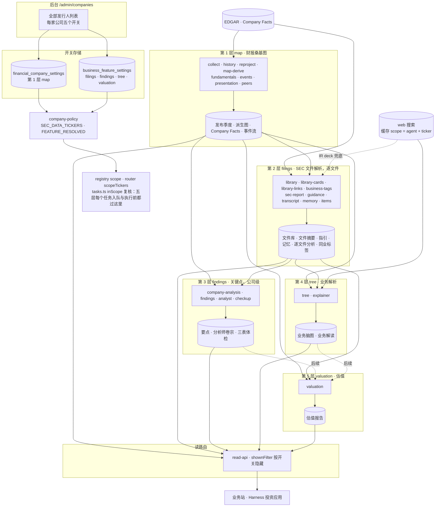
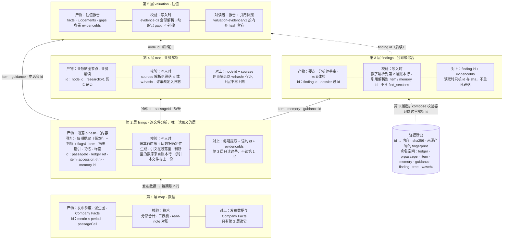
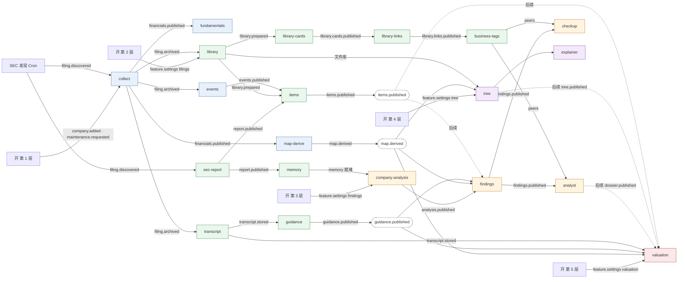
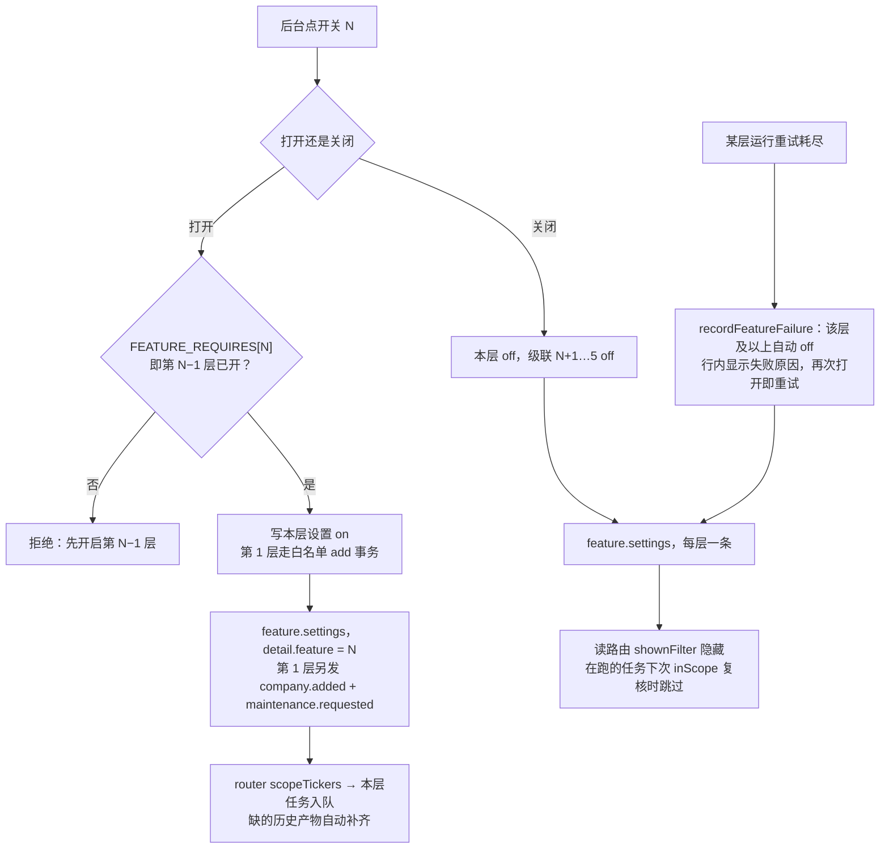

# Spontra 项目架构优化升级方案

日期：2026-11-03。状态：方案，未实施。前置：[analysis-events](analysis-events.md)（事件图）、[item-analysis](item-analysis.md)（逐文件分析）、[analyst-agent-design](analyst-agent-design.md)（分析师卷宗）、[whitelist-feature-switches-design](whitelist-feature-switches-design.md)（今天的四个功能开关，本文替代其后台部分）。

## 一句话

Spontra Analysis 今天是一组各自读文件原文、各自上网、各自从第一手数据重算的 agent；本方案把它升级为**五层分析架构**：每层只读下一层的产物，第 1 层按算术校验，第 2 层是唯一读原文的层，第 3 层起的校验只是解析 id 与核对哈希；数字只有一个来源（第 2 层每期生成的账本行），网页研究只留在第 4 层。后台公司页的五层开关是这套架构的操作面，作为配合需求一并实施：每层一个开关，上层要求下层已开。

## 升级目标

- **可信的依赖。** 上层引用下层产物的语句 id，不回原文核验；每层对上一层保证什么，写成契约。
- **数字只有一个来源。** 任何层的数值都是第 2 层每期账本行的引用，校验器拒绝不是 evidence 产出的数字。
- **原文只读一次。** 读文件原文的工具只在第 2 层；第 3 层起读的是逐文件分析、记忆、指引、要点、脑图。
- **网页研究只在第 4 层。** 业务解析做网页调研并把摘录存证；估值与分析师不再各自上网。
- **新鲜度靠事件图。** 产物带它读过的下层 fingerprint，下层重发布时上层经订阅重跑，读路由只判 outdated。
- **每层可单独开关与计费。** 白名单变成第 1 层开关，五层一条链；只看桑基图的公司不付解析与模型的费用。

## 现状与问题

### 现状 agent 链路

按各 workflow 的输入读取核对（2026-11-03），现状不是一条链：

| 层 | 任务 | 实际读取 | 上网 |
|---|---|---|---|
| 1 | collect / map-derive / fundamentals / presentation | EDGAR；collect 的 read-note 与 presentation 的判断是模型调用 | 否 |
| 2 | sec-report | 本文件 + 第 1 层历史序列 id | 否 |
| 2 | guidance | 本文件附件、电话会、第 1 层历史 | IR deck 兜底搜索 |
| 2 | memory → company-analysis | sec-report 摘要 → 记忆条目 → 公司分析（含上一期分析、Company Facts） | 是（business tools） |
| 2 | items | 本文件与上一份文件的库文档、第 1 层数据、**第 3 层已发布要点**（`findings` 工具） | 否 |
| 3 | findings | 第 1 层发布与派生、fundamentals、guidance、company-analysis；lens 读库的原文段落 | 否（lens 只有 series/compile） |
| 3 | analyst | findings、库文档、peers/tags、events、上一版 findings | 是 |
| 3 | checkup | findingsInput（第 1 层 + guidance）、库目录、peers | 否 |
| 4 | tree / explainer | 第 1 层分部、库文档 | 是 |
| 5 | valuation | 第 1 层发布与派生、fundamentals、guidance、库文档、电话会、peers、后台输入 | 是 |

与「高层依赖底层」的出入：

1. **第 3 层不读第 2 层的分析产物。** findings 与 analyst 读的是文件库原文与第 1 层数据，不读 sec-report 摘要和逐文件分析（items）；只有 company-analysis 经 memory 间接用到 sec-report。「关键点基于所有 SEC 文件分析结果」今天只在 memory 这一条路上成立。
2. **items 反向读第 3 层。** items 的工具表含 `findings`（最新要点），而方案把 items 归入第 2 层。实施时从 `ITEM_POLICY` 去掉 `findings`，逐文件分析只引用文件与数据，不引用要点；要点反过来读 items（见第 3 点）。
3. **第 4、5 层不读第 3 层，第 5 层也不读第 4 层。** tree 只读分部与库；valuation 读库原文和电话会，自己上网查业务与行业。开关链 4→3、5→4 今天只是策略，没有数据依赖；「估值读前四层」是后续改动。
4. **第 1 层不是零模型。** read-note 与 presentation 判断是模型调用，但按算术校验，归第 1 层不变。

### 核验在哪里

| 层 | 写入时校验 | 读取时校验 | 读原文 |
|---|---|---|---|
| 1 | 算术：分部合计、三表桥、read-note 对账；季度带 verified / unverified | 无 | collect 读 EDGAR |
| 2 items | `compose`：数字由 evidence 产出、引文在所给段落里、必引本文件与上一份 | `useVerifiedAnalysis` 按段落重验引文 | 是（`find_sections` / `read_section`） |
| 2 sec-report | 编辑评审 | 无 | 是 |
| 2 memory | evidenceIds 须属于摘要的证据集 | 无 | 否 |
| 3 findings | `verifyFindings`：evidence 解析到第 1 层数据、锚点存在 | `verifyQuote`：引文须出现在**现在**服务的段落里 | lens 不读；writer 读派生数据 |
| 3 analyst / checkup | 同 compose | 同上 | **是**（库文档、库目录） |
| 4 tree | sources 来自段落或网页记录；评审裁定 | 无 | 是（库 + 网页） |
| 5 valuation | evidenceIds 登记；缺的记 gap | 引用快照 | 是（库文档、电话会、网页） |

两件事让上层离不开原文：第 3 层的 analyst 与 checkup 直接读文件库；读取时的 `verifyQuote` 要拿当前段落重验。第 2 层的摘要 bullets 没有 evidenceIds，不能被引用。

### 两套机制

今天后台有两套机制叠在一起：

| 机制 | 存储 | 控制的任务（scope） | 页面上的样子 |
|---|---|---|---|
| 白名单 | `financial_company_settings.enabled` | `data`：采集、历史、地图推导、基本面、事件轨、文件库拆分、索引卡、业务主线、业务标签、AI Search 同步、翻译、利润表判定 | 「加入白名单」表单 + 行尾「移出」 |
| 功能开关 | `business_feature_settings`（`reports`、`findings`、`tree`、`valuation`） | 各自的 scope | 四列开关 |

问题有三个。

1. **白名单与开关是两种交互。** 加入白名单要先搜索、再点「加入」，之后四个开关才可用；移出是行尾的删除图标并弹确认。读者看到的其实是五块内容，管理员看到的却是「一个名单 + 四个开关」。
2. **`data` scope 不只是财务数据。** 白名单一开，文件库拆分、索引卡（模型，低推理）、业务主线（模型，高推理）、业务标签（模型，高推理）、翻译、逐字稿抓取（Alpha Vantage 配额）全部跟着跑。想只看一家公司的桑基图，也要付这些费用。
3. **要点与文件分析的边界不清。** `items`（逐份文件的分析报告）挂在 `findings` scope 下，而它是按文件写的，不是按公司综合的；`memory`（逐份定期报告的记忆抽取）也挂在 `findings` 下，却是公司分析的输入。要点开关因此既管「每份文件写什么」又管「公司层面综合什么」。

## 目标架构

### 五层

五层落到现有任务图上。每层列出它的任务和它读的下层产物（目标状态）。🤖 调用模型。

| 层 | 开关（页面名） | Feature 键 | 任务 | 读什么 |
|---|---|---|---|---|
| 1 | 财报桑基图 | `map`（= 白名单） | `collect`、`history`、`reproject`、`maintenance`、`map-derive`、`fundamentals`、`events`、`presentation` 🤖、`archive-prune`、`peers`（全局投影） | EDGAR 申报、Company Facts |
| 2 | SEC 文件解析 | `filings`（今 `reports`） | `library`、`library-cards` 🤖、`library-links` 🤖、`business-tags` 🤖、`library-search`、`sec-report` 🤖、`guidance` 🤖、`transcript`、`memory` 🤖、`items` 🤖 | 第 1 层的发布数据与快照；每份申报的原文 |
| 3 | 关键点 | `findings` | `company-analysis` 🤖、`findings` 🤖、`analyst` 🤖、`checkup` 🤖 | 只读第 2 层：每期提取（账本行 + 判断 + 体检标记）、逐文件分析、记忆、指引、标签配出的同业 |
| 4 | 业务解析 | `tree` | `tree` 🤖、`explainer` 🤖 | 第 2 层：分部与文件库章节、标签；网页检索并存证 |
| 5 | 估值 | `valuation` | `valuation` 🤖 | 第 2 层：每期提取、指引、逐字稿、同业；第 3 层要点与卷宗、第 4 层脑图（后续）；后台估值输入 |

`translate` 不属于任何一层：它只翻译已发布的内容，跟着发布事件走，scope 保持 `data`。`storage-sweep`、`archive-prune-scan` 是全局维护。

### 架构图

实线是实施本方案后的数据流，虚线是后续改动（估值读第 3、4 层）。analyst 与 valuation 今天也上网，读到第 2、4 层产物后去掉，图中不画。



### 层次图：每层的产物、校验与对上接口

上层只按 id 引用下层产物，不回原文。第 1 层按算术校验，第 2 层是唯一读文件原文的层；从第 3 层起，校验只是解析 id、核对内容哈希与来源 fingerprint。



### 第 2 层与第 3 层的边界

两个开关都保留。边界按产物的粒度划：

- **第 2 层（SEC 文件解析）的产物都以一份文件为单位**：文件库里这份文件的章节与段落、索引卡、它的摘要报告（`sec-report`）、8-K 摘要、它的分析文档（`items`）、从它抽出的指引（`guidance`）、从它抽出的记忆（`memory`）、它描述的业务与行业标签（`library-links`、`business-tags`）。关掉第 2 层，新文件不再被解析；已解析的文件保留。
- **第 3 层（关键点）的产物以公司为单位，跨文件综合**：公司分析（`company-analysis`，读全部记忆）、要点（跨季度、对照指引与基本面）、分析师档案、三表体检笔记（对照同业）。它读第 2 层的产物，自己不读 SEC 原文。

`items` 与 `memory` 从 `findings` 移到 `filings`。`memory` 工作流今天在提交记忆后直接启动公司分析；改为只在第 3 层开着时启动（`featureTickersFor(env, "findings")` 判断），第 3 层打开时由 `feature.settings` 触发 `company-analysis` 补齐缺的分析（今天已经这样做）。

业务主线与业务标签放在第 2 层而不是第 3 层，是因为同业比较的质量取决于**有多少公司打了标签**：第 2 层比第 3 层便宜，开第 2 层的公司更多，同业池就更大。

### 依赖：一条链，还是一张图

目标是线性的：1 → 2 → 3 → 4 → 5。按今天代码里的真实读取关系，是一张图：

```
1 财报桑基图
└─ 2 SEC 文件解析
   ├─ 3 关键点
   ├─ 4 业务解析
   └─ 5 估值
```

第 4 层不读第 3 层；第 5 层今天不读第 3、4 层的产物（估值 agent 的目录里没有要点、档案、脑图）。

建议：**开关规则按线性链实施，代码里把依赖写成每个功能一个 `requires` 列表**。理由：

- 线性链对管理员最好解释：开到第几层，就得到前几层的全部内容；读者页面上也不会出现「有估值报告但没有要点」这种组合。
- 目标是估值综合前面所有层的产物。那是估值 agent 的输入改动（给它读要点、档案、脑图的工具），改完后第 5 层对第 3、4 层的依赖就是真实的。链先于实现存在，不用再改规则。
- `requires` 写成数据，将来要放松（比如让第 4 层不依赖第 3 层）改一行。

```ts
// shared/analysis-contract/business-features.ts
export const FEATURES = ["map", "filings", "findings", "tree", "valuation"] as const;
/** The switch each feature needs on first: the ladder. */
export const FEATURE_REQUIRES: Record<Feature, Feature | null> = { map: null, filings: "map", findings: "filings", tree: "findings", valuation: "tree" };
```

规则：

- 打开第 N 层：要求第 N−1 层已开，否则拒绝并提示「先开启 X」（沿用今天财报摘要 → 要点的做法，不自动连开）。
- 关闭第 N 层：连带关闭 N+1 … 5（今天只有 reports → findings 一级，改为沿链到底）。
- 失败自动关闭（`recordFeatureFailure`，重试用尽后）：只关失败的那一层和它上面的层，与手动关闭一致。
- 全局开关：每层一个，仍在列头；全局关闭只暂停生成，不动公司开关。

## 架构升级内容

### U1 任务归层：第 1 层只取财报数据

从 `data`（即 `map`）scope 移出的任务：

| 任务 | 新 scope | 为什么 |
|---|---|---|
| `library`、`library-cards`、`library-links`、`business-tags`、`library-search` | `filings` | 都是解析文件的产物；桑基图不读它们 |
| `transcript` | `filings` | 只有指引（第 2 层）和估值（第 5 层）读逐字稿；配额给开了第 2 层的公司 |
| `memory`、`items` | `filings` | 见边界一节 |

留在第 1 层的模型任务只有 `presentation`（利润表判定）：它是把报表算平的一步，没有它桑基图可能画不出来，且每日上限 60 次。

受影响的读取方：

- `tree`、`explainer`、`checkup`、`items`、`valuation` 读文件库——它们都在第 2 层之上，链保证文件库存在。
- `peers` 投影读每家第 1 层公司的数字（不用标签），不变；标签配对（`business_tag_pairs`）只在开了第 2 层的公司间产生。三表体检的排名要求 ≥2 家同标签同业，这个要求现在落在「≥2 家开了第 2 层的同业」上，在页面上说明。
- `storage/sweep.ts` 的 `aiTickers` 改为 `filings ∪ findings`。

### U2 每期提取：账本下移到第 2 层

账本（metric × period 行，带 yoy / qoq，`findings/ledger.ts`）今天由 findings 任务从第 1 层发布数据现算，三表体检标记也在那里算，第 3 层因此直接读第 1 层——这意味着第 2 层没有把每期的关键之处提取出来。改为第 2 层每份定期报告发布时**确定性生成**该期的账本行与体检标记，连同 items 的判断构成「每期提取」；第 3 层读八期提取叠起来的序列，不再读发布数据与 Company Facts。数值仍是 ledger ref，compose 校验器照旧拒绝不是 evidence 产出的数字。账本行是算法切片而不是模型挑选，第 2 层不会"漏提"关键数字；模型只负责每期的判断。

### U3 证据契约：每层对上一层保证什么

1. **产物有稳定 id，按版本不可变。** 段落 id 已是内容寻址（`p` + hash(documentId | 文本 hash)），解析器重建只要文本不变 id 不变；item、finding、tree 节点、valuation 的 fact / judgement 各有 id。摘要 bullets 加 id 与 evidenceIds。
2. **校验在写入时做完，结果随产物存储。** 每份产物带 `verification: { at, inputs: [{ id, fingerprint }], checks }`；第 2 层是唯一把引文对回段落的层，第 3 层起只解析 id、核内容 sha、核来源 fingerprint。
3. **上层引用下层的语句 id，不引段落。** 第 3 层引 `item:‹accession›#‹n›`、`memory:‹id›`、`guidance:‹id›`；第 5 层引 `finding:‹id›`、`tree:‹node›`。证据登记把语句 id 展开到它自己的 evidenceIds，溯源仍能一路落到段落与 ledger，但上层 agent 不读。
4. **数字只有一个来源，而且在第 2 层。** 任何层的数值都是第 2 层每期提取里的账本行引用（U2）；compose 校验器照旧拒绝不是 evidence 产出的数字。
5. **新鲜度由事件图保证，不由重验保证。** 产物 fingerprint 包含它读过的下层产物 fingerprint（findings 已含 guidance hash 与 analysis 时间，analyst 已含 findings fingerprint 与文档 id）；下层重发布时上层经订阅重跑，读路由在 fingerprint 不符时标 outdated 而不是重验引文。
6. **原文工具只在第 2 层。** `find_sections` / `read_section` 留给 items、cards、links、tags；第 3 层换成 `read_item` / `read_memory` / `read_guidance`，第 5 层再加 `read_finding` / `read_tree`。网页工具只在第 4 层与第 2 层 IR deck 兜底，网页摘录以 `w‹hash›` 记录（`research:v1`）供上层引用。

### U4 工具收口：上层只读下层产物

- 第 3 层：findings writer 与 lens 读 items 的每期提取、memory、guidance；analyst、checkup 去掉 `find_sections` / `read_section`，换成 `read_item` / `read_memory` / `read_guidance`。items 的工具表去掉 `findings`（今天它反向读第 3 层）。
- 第 5 层：读 finding / tree / item 的 id，去掉 `search` / `read_web`。这是原「估值读前四层」的后续项，纳入同一契约。
- 读取时：`verifyQuote` 只对第 2 层产物（items）保留按段落重验；第 3 层起的产物只核 id 与 sha，fingerprint 不符标 outdated。

### U5 网页研究只在第 4 层

`web_search_cache`（D1 指针 + R2 `web-search/v1/`）不是跨层共享研究的机制：缓存 scope 按 agent 与 ticker 划分（`spontra:analyst:T`、`spontra:business-tree:T`、`spontra:valuation:T`…），不同 scope 的键不同，tree 读过的页面 valuation 不会命中。它的作用只有：同一次运行内同一页面只取一次（分部分支之间）、7 天内重跑与失败重试复用、`busy` 租约避免并发重复请求、每次未命中才计入 `ai_usage`。

因此多余的不是缓存，而是第 3、5 层各自上网。按五层链路，上网只留在第 4 层（tree / explainer）和第 2 层的 IR deck 兜底；findings 的 lens 今天本就没有网页工具，analyst 与 valuation 在读到第 2、4 层产物之后去掉 `search` / `read_web`（归入「估值读前四层」那次改动）。缓存保留：一张表、一个前缀、一条清理规则，去掉只会让第 4 层每次重跑重新付费；命中率目前没有统计，若要决定去留先在 `web-page-read` 日志里加命中计数。

### U6 事件订阅

`feature.settings` 的 `detail.feature` 加 `map`（第 1 层打开时与 `company.added` 一起发，关闭时单独发，让地图版本号前进）。订阅表改为：

```ts
"feature.settings": [
  { task: "sec-report",       when: e => e.detail?.feature === "filings" },
  { task: "library",          when: e => e.detail?.feature === "filings" },
  { task: "items",            when: e => e.detail?.feature === "filings" },
  { task: "company-analysis", when: e => e.detail?.feature === "findings" },
  { task: "findings",         when: e => e.detail?.feature === "findings" },
  { task: "explainer",        when: e => e.detail?.feature === "tree" },
  { task: "tree",             when: e => e.detail?.feature === "tree" },
  { task: "valuation",        when: e => e.detail?.feature === "valuation" },
],
```

`library` 加进来是因为第 2 层打开时要把已归档的申报拆进文件库（今天由 `filing.archived` 触发，第 1 层先开、第 2 层后开的公司会漏）。`library` 任务本身按 `filing.archived` 的记录逐份拆，已拆的跳过，所以重复触发无害。

`task.version_changed` 按新 scope 路由，不用改。

事件名与任务名取自 `registry.ts` 的 `SUBSCRIPTIONS`；每个任务执行前经 `inScope` 复核本层开关。



### U7 校验预算：校验不吃 token

今天 token 浪费最大的一类是「模型写—harness 验—退回—模型重写」：`compose` 一次最多退 8 条问题并要求整份重交；items、lens 的轮次上限（12、10）只是循环上限，不是修复上限；引文按子串匹配，一处抄错整份被退，退回时 2,400 字的段落再进一次上下文。规则：

1. **约束输入，不校验输出。** 模型只拿到它可以引用的 id（账本目录、语句 id、段落 id），校验退化为"id 是否存在"。U3 的 id 契约做到这一点后，引文核验这一类错误在第 3 层起整体消失。
2. **结构错误由 harness 修，不退给模型。** 数字的量级与小数位（"$55,700 million" ↔ "$55.7 billion"）、ref 的字段顺序、空白与大小写，harness 规范化后直接接受；只有语义错误（数字不在账本、id 不存在、锚点缺失）才退回。
3. **退回最小单元，带最少文字。** 通过的部分直接接受（findings 的 repair 已只退未通过的条目），lens 文档按块接受；错误信息只给块 id 与错误码，不回显文档，不重发目录。
4. **一次修复，修不好就扣留。** 每个单元最多一轮修复，之后 harness 去掉该块、接受其余（findings 已如此；items、lens、tree 补上同样的上限），不再用轮次预算碰运气。
5. **前缀缓存。** 系统提示、目录、材料放在前缀并保持字节一致（`cache_control` 已加），变化的错误信息只追加在尾部；重试时前缀命中缓存，只为新尾巴与输出付费。
6. **计量后再定预算。** `ai_usage` 已记 input / cached / output，再记每次运行的修复轮数与扣留单元数；每个任务加 token 预算（与 turns、wallMs 并列），修复占比超过阈值进后台消息。先量一周，再定阈值。

### 改动清单

| # | 改动 | 位置 |
|---|---|---|
| C1 | 证据登记与解析器：按命名空间解析 id → 内容 + sha256 + 来源 fingerprint；所有 compose 校验器只向它解析 | 新 `evidence/registry.ts`；`compose/tools.ts`、`lens/verify.ts` |
| C2 | 摘要 bullets 加 `id` 与 `evidenceIds`，写入时按 items 的规则校验；memory 的 evidenceIds 改用库段落 id，不再用报告步骤的 R2 文本块 id | `sec/sec.ts`、`sec/report.ts`、`sec/memory.ts` |
| C3 | 产物带 `verification` 记录与 `inputs` fingerprint；读路由按 fingerprint 判 outdated | 各 workflow 的 publish 步骤；`read-api` |
| C4 | 第 3 层工具换成读第 2 层产物：findings writer / lens 读 items；analyst、checkup 去掉 `find_sections` / `read_section` | `findings/workflow.ts`、`analyst/agent.ts`、`checkup/workflow.ts`、`tools/registry.ts` |
| C5 | 读取时校验改为核 id 与 sha；`verifyQuote` 只对第 2 层产物（items）保留段落重验 | `shared/analysis-runtime/lens/verify.ts`、业务站 `useVerifiedAnalysis` |
| C6 | 第 5 层读 finding / tree / item id，去掉 `search` / `read_web`（原「估值读前四层」后续项，纳入同一契约） | `valuation/tools.ts`、`valuation/input.ts` |
| C7 | 账本与体检标记改为第 2 层每期产物：定期报告发布时生成该期账本行与 flags，存进 items 的每期提取；findings writer 的 payload 改为八期提取 + guidance + memory，`findingsInput` 不再读发布数据与 Company Facts | `findings/ledger.ts` 移到 `items/`、`items/workflow.ts`、`findings/workflow.ts`、`findings/writer.ts` |
| C8 | 校验预算：harness 规范化数字量级与 ref 形状；compose / lens / tree 的修复上限为 1 轮，超过扣留该块；错误只回块 id 与错误码；`ai_usage` 加修复轮数与扣留数，任务加 token 预算 | `compose/tools.ts`、`lens/agent.ts`、`agent-loop.ts`、`ai-runs/usage.ts` |

## 配合需求：公司页与五层开关

架构分层之后，每层需要一个开关：决定哪家公司生成到第几层，也决定读者看到什么。白名单不再是一个页面概念，而是第 1 层开关的存储。

### 第 1 层：白名单成为开关

白名单机制保留，只是换了外观：`financial_company_settings` 继续是第 1 层的存储，`data` scope 不变，`company.added`、`maintenance.requested` 的发出不变。变化：

- 「加入白名单」表单、行尾「移出」按钮、「加入」按钮都去掉。第 1 层开关打开 = 今天的加入（校验 EDGAR 目录、折算主股份类别、写设置、建首次 extract 任务、发事件）；关闭 = 今天的移出（设置置 0，连带关闭上四层，存储保留）。
- 关闭第 1 层要确认一次（今天移出也确认），因为它停掉整家公司的一切。
- `Feature` 合约里 `map` 是第 1 层的键；`featureShown(db, ticker, "map")` 读 `financial_company_settings`，其余四个读 `business_feature_settings`。读 API 已经按 `dataTickers` 判断公司页是否存在，不用改。
- `TaskScope` 的 `"data"` 改名为 `"map"`，与 Feature 键一致（纯改名，`inScope`、`scopeTickers` 的逻辑不变）。

不把 `financial_company_settings` 并进 `business_feature_settings`：第 1 层的开启有自己的事务（设置 + 首次任务 + 回执），和其余四层「写一行、发一个事件」不是一回事；并表只省一个 JOIN。

### 开关操作与级联



### 页面

路由 `/admin/companies`（旧 `/admin/whitelist` 跳转）。导航名「公司」。

#### 列表

EDGAR 交易所目录约一万个代码、六七千家发行人。不能像今天那样一次读全表、每 5 秒刷新。

- **一行一家发行人**：按 CIK 去重，显示主股份类别（`primaryTicker`），其他类别以小字列出。ETF（Nasdaq Trader 的 ETF 标记）不列：它们不出 10-K。
- **接口分页**：`GET /admin/companies?q=&page=&filter=`，每页 50 行。`q` 匹配代码或名称（目录在 Worker 内存里，`searchIssuers` 已有）。`filter`：`on`（任一层已开，默认）、`all`。默认打开页面看到的是已开公司，和今天一样；搜索框查全目录。
- **行内只有**：logo、代码、名称、交易所、五个开关、一个状态徽章（财务地图已显示 / 准备中 / 未就绪）、当前动作一行小字。展开后是今天的详情（流程图、进度、可展示期间、收入构成、采集、税前至净利润、问题、估值输入）。
- **状态与进度分开读**：列表接口只返回目录字段 + 五个开关值 + 发布时间；运行状态由 `GET /admin/companies/activity`（只查 `sec_analysis_jobs`、AI 运行表、`pipeline_due` 里在跑的行，按 ticker 返回）每 5 秒刷新。目录页不轮询。
- 开关写接口统一为 `POST /admin/companies/:ticker/features/:feature` `{on}`；`map` 走今天的加入 / 移出事务（带 `requestId`）。全局：`POST /admin/companies/features/:feature`。
- 五列开关从左到右按层排列，列头是层名 + 全局开关。未满足前置的开关禁用，`title` 说「先开启 X」。关闭第 N 层时上面的开关一起滑回。

#### 文案

| 层 | 列名 | 开关说明（展开详情里） |
|---|---|---|
| 1 | 财报桑基图 | 从 EDGAR 取历次财报的数字，画利润、现金流、资产负债图 |
| 2 | SEC 文件解析 | 拆分每份申报，写摘要、指引与逐文件分析 |
| 3 | 关键点 | 跨季度与同业比较，写要点、分析师档案、三表体检 |
| 4 | 业务解析 | 按分部做网页调研，画业务脑图并解读 |
| 5 | 估值 | 用前四层的数据跑估值模型，写估值报告 |

读者页面文案同步：`reports` 相关的标签改为「SEC 文件解析」（后台 `FEATURE_LABEL`、`RUN_LABEL`，`admin_messages` 的功能名）。

### 存储与迁移

`0045_company_ladder.sql`：

1. `business_feature_settings`、`admin_messages` 重建 CHECK（与 0040 同法）：`feature IN ('filings','findings','tree','valuation')`；`UPDATE ... SET feature='filings' WHERE feature='reports'`。
2. 不动 `financial_company_settings`。
3. 迁移只增不删。

`company-policy.ts`：`FEATURE_RESOLVED` 的键改为 `filings`；`SEC_AI_TICKERS` / `SEC_AI_ENABLED` 继续等于第 2 层的名单与全局开关（读它们的旧代码含义不变）。

## 后续

让第 5 层对第 3、4 层的依赖成真：估值 agent 的目录加三类可读材料——当前要点与分析师档案（`findings:v2:*`、dossier）、业务脑图与解读（`business-tree:v1:*`）、逐文件分析（`item-analysis:v1:*`），以引用 id 进入 evidence。指纹加这三者的发布时间。这是 `valuation/input.ts` 与 `valuation/tools.ts` 的改动，单独一个 PR。

## 实施顺序与验证

分四批，每批可独立上线：

**A 分层与开关基础**

1. 合约与策略：`FEATURES`、`FEATURE_REQUIRES`、`TaskScope` 改名、`company-policy.ts`、迁移 0045；`company-policy.test.ts`、`test/fixtures/company-settings.ts` 跟着改。
2. registry：任务 scope 按 U1 改、订阅表按 U6 改；`check:analysis:boundary` 与 registry 测试通过。`memory-workflow.ts` 只在第 3 层开着时启动公司分析。`transcripts/library.ts` 改读 `filings` 名单。`storage/sweep.ts` 改 `aiTickers`。
3. 后台接口：`admin/business-map.ts` 拆成列表（分页、搜索、过滤）、活动、开关三个读写路径；`admin/messages.ts` 的 `KIND_FEATURE`、`TASK_FEATURE`、`PUBLISHED` 改映射；`recordFeatureFailure` 沿链关闭；admin 代理白名单换路径。
4. 页面：`business-map-companies.tsx` 改为分页列表 + 活动轮询 + 五列开关；去掉加入表单与移出按钮；本地用 mock API 预览。

**B 每期提取与证据契约**（C7、C1、C2、C3）

5. 账本与体检标记下移到第 2 层，items 发布每期提取；证据登记与解析器；摘要 bullets 加 id 与 evidenceIds，memory 改用库段落 id；产物带 `verification` 与 `inputs` fingerprint，读路由按 fingerprint 判 outdated。

**C 上层收口**（C4、C5、C8）

6. findings writer 改读八期提取 + guidance + memory；analyst、checkup、items 的工具表按 U4 改；读取时校验改为核 id 与 sha；校验预算按 U7 收口，先记一周修复轮数再定阈值。

**D 估值读前四层**（C6）

7. 估值 agent 读 finding / tree / item id，去掉网页工具。

**文档与核验**

8. 文档：本文、`businessview-admin.md` 的白名单段、`whitelist-feature-switches-design.md` 顶部加「已被本文替代」、`analysis-events.md` 的任务表 scope 列、`item-analysis.md` 的 scope 与工具表。
9. 上线后核验：**只用 CRWV，每层只生成一次。** 核验公司固定为 CRWV；每批上线后由版本号变化（`task.version_changed`）为它各层各跑一次，不手动触发重跑，不用「重新准备」、逐文件重读或改版本号来再生成；一次运行里的失败按扣留处理，修复后随下一批上线再跑那一次。要看的东西：开关——开第 1 层看到 `company.added` 与首次采集，开第 2 层看到 `library`、`sec-report` 排队，直接开第 4 层被拒并提示，关第 2 层时第 3、4、5 层一起关，读者页面相应块消失、版本号前进。架构——items 的每期提取先于 findings 出现；findings 运行轨迹里没有发布数据与 Company Facts 的读取；analyst 轨迹里没有 `find_sections`；`ai_usage` 里 `web` 阶段只剩 tree / explainer 与 guidance deck；每次运行的修复轮数 ≤ 1。

### 不做的事

- 不给翻译、同业投影、存储清理做开关。
- 不把第 1 层并入 `business_feature_settings`。
- 不改 `SEC_AI_TICKERS` 等部署变量的名字（它们只在 Worker 内部承载解析结果）。
- 不在本次让估值读第 3、4 层的产物。
