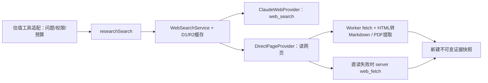

# Spontra 个股估值评估：构建方案与资料链路

更新日期：2026-10-27（Asia/Shanghai）。状态：设计方案，估值功能尚未实现、未生成评估报告。

**开发交接请同时阅读[独立开发交接规格 v1](valuation-assessment-implementation.md)。** 本文说明资料链路与架构，交接规格补全评分锚点、十类模型公式、报价/失败规则、API、存储、页面状态、接线清单和验收样本。两者冲突时以交接规格中的首版行为为准；接手者无需原对话、截图或 Mispriced 访问权限。

代码核查基线：2026-10-24，[Spontra d798cc1](https://github.com/Paikchu/Spontra/tree/d798cc142910721e2c0a7cb8cd4efad6d7187eff)。源码引用固定到该版本，实施前按最新 main 复核。

**参考 Mispriced 的五维评估、情景估值和证据审阅方法，在 Spontra Analysis 内重新构建评估能力。以 Spontra 已有 SEC 原文、财务数据和研究材料为基础，针对明确缺口调用 Spontra 现有 Web Search 补充证据。仅公司主开关和 Admin「估值评估」开关均开启的公司可以运行。**

本方案基于上述代码基线的源码、数据库迁移和调用链核查。以下明确区分「现有能力」与「本次新增」；尚未查询生产 D1 的具体公司覆盖，也未实测线上搜索凭据和服务可用性，因此不宣称某家公司的材料已经齐备。

**一、产品目标与范围**

- Admin 公司列表增加「估值评估」开关，所有公司默认关闭；开启后生成、已有材料变化后按需更新。
- 前端落在用户已选定的现有业务地图网页 `apps/business-site`。三大表旁增加「估值评估」，内容展示在截图红框区域。
- 复用 Spontra 的资料采集、存储、模型调用、Web Search、队列和运行记录，不另建股票池或研究服务。
- Mispriced 仅提供方法与交互参考，不导入其公司名单、旧报告、评分、个股模型参数、来源库或模拟组合。
- 外部搜索只为获准公司的具体研究问题补证据。读取同行公开资料不等于为同行开启评估；不做全市场扫描，也不自动打开其他公司或 AI 功能。

此前「只用现有材料」的定义在此修正为：优先使用已经收集的资料，复用 Spontra 自身的材料与检索能力；不是仅允许读取摘要，也不是禁止 Web Search。

**二、公司与 Admin 开关**

Admin 列为：`公司｜状态｜财报摘要｜要点｜业务解读｜业务脑图｜估值评估｜操作`。

公司有效名单由 `companyPolicyEnvironment()` 合并部署默认数据名单与 `financial_company_settings.enabled` 的显式增删，再由 `dataTickersFor()` 读取。不能只查 enabled=1 的行，也不能拿 reports/findings 名单替代公司准入。

新增 `valuation` 功能，复用 `business_feature_settings`、单公司功能接口和表头全局生成开关。公司默认 valuation 名单为空；全局生成可默认开启，但仍必须逐公司手动开启。valuation 不继承 `SEC_AI_ENABLED` 或 reports 的名单/关闭级联。

- **可生成** = 公司 data 已启用 ∩ valuation.generate 已开启 ∩ valuation 全局生成未暂停。
- **可展示** = 公司 data 已启用 ∩ valuation.display 已开启。
- 公司估值开关手动切换时 generate/display 同步变化；全局暂停只停止生成，保留已发布报告显示。

| 操作 | 结果 |
| --- | --- |
| 首次部署功能 | 所有估值开关关闭，不批量生成 |
| 打开某公司估值开关 | 确认公司已开启后安排评估；已有同版本结果可复用 |
| 相关资料更新 | 仅对符合开关的公司比较输入指纹，按需复评 |
| 关闭估值或公司 | 停止后续评估和发布，读者端隐藏；历史版本保留 |
| 全局暂停估值 | 不开始新评估/补证据，已发布结果仍按各公司展示权限显示 |
| 再次开启 | 比较材料与方法版本，决定复用或重新生成 |
| 搜索、打开页签、访问旧链接 | 只读，不改变开关、不触发模型或外部搜索 |
| 管理员重跑、补跑、死信重试 | 遵守相同开关，不隐式启用 |

现有路由在入队时检查 scope，但通用执行器与死信重放不能替代执行前检查。本次估值在入队、执行前、每个逻辑工具步骤开始前以及发布前检查当前设置。已开始步骤内的 SDK 重试或直读失败后的网页读取回退可能完成，关闭后不启动下个工具步骤、不发布结果。首版不承诺撤回在途请求；若需约束每次物理请求，须另在 provider/transport 增加统一许可检查。

接入点：`FEATURES`、`defaultFeatureResolution`、Admin 功能标签/状态映射、`feature.settings` 订阅与新增 `scope: "valuation"` 任务。实际执行资格仍取 data 与 valuation 交集。已有设置表和 Admin 消息表有四功能 CHECK 约束，须新增数据库结构迁移扩展 valuation；保留旧行，不回填开启公司。

**三、SEC 原文到底存在哪里、怎样取出**

这是三层资料，不能混用：申报索引告诉系统「有哪些文件」，R2 保存已归档文件，D1 原文库提供 Agent 可以按章节读取的原句与表格。AI 摘要/卡片只是导航。

| 现有位置 | 主要字段/内容 | 估值怎样使用 |
| --- | --- | --- |
| D1 `sec_filings` | ticker、cik、accession_number、form、filing_date、report_date、document_url、ingest_status | 申报目录，没有全文；用来定位报告和申报日期 |
| D1 `sec_cache` 的 `sec:disclosure-audit:v1:{ticker}:{documentId}` | payload 内的 rawKey、inventoryKey、statementsKey、source、contentSha256 | 找到已归档 HTML、事实库存与财报表格的 R2 指针 |
| R2 binding `SEC_FILINGS` | `financial-disclosures/{extractionVersion}/{ticker}/{accession}/{documentId}/{contentSha256}/source.html` | 需要核对原件或处理抽取缺口时读取 |
| 同一 R2 目录 | `inventory.json` 与财报表格版本 JSON | XBRL concept/context/unit/period 及财报表格的来源 |
| D1 `sec_documents` | document_id、ticker、accession_number、form、doc_type、filed_at、report_date、document_url、source_sha256、parser_version、status | 已拆分文档目录；仅 ready 文档作为可读原文 |
| D1 `sec_sections` | section_id、document_id、parent_id、ordinal、canonical、path、role、text_sha256 | 定位业务、风险、MD&A、附注和业绩发布章节 |
| D1 `sec_passages` | passage_id、document_id、section_id、ordinal、kind、text、table_json、fact_refs、text_sha256 | 真正读给 Agent 的原文段落和结构化表格 |
| D1 `sec_section_cards` | gist、topic、entities、answers | AI 导航卡片，用来找到章节，不当成 SEC 原文 |

`documentId` 是文件 URL 的 SHA-256，不是 accession。同一申报的主文档和附件有不同 documentId。`source.html` 是移除 SEC 动态 script 后的规范化 HTML，contentSha256 对应这一内容，不承诺与原 HTTP 响应逐字节相同。

运行时读取顺序：

1. 通过公司/估值开关后，解析 ticker 与发行人，冻结 `researchAsOf`。财务期末和研究截止日期是两个字段。
2. 用 `listLibraryDocuments(db,{ticker,forms,accessions,limit})` 列出文档，选取截止时间前的 ready 年报、季报、20-F、业绩附件及相关事件文件。一个 accession 可能有多个文档。
3. 用 `libraryToc()` 看目录，用 `libraryFindAcross()` 定位研究问题。冻结允许读取的 documentId 集合，检索结果也按该集合和日期过滤。
4. 调 `libraryRead(db,{documentId,sectionId,focus,maxChars})` 取原文；返回 `passages[{passageId,path,text}]` 与 omitted。需要表格和 fact_refs 时再用 `libraryPassages(db,passageIds)` 精确读取。
5. 将真正读到的段落登记为本轮证据，保留来源、章节、日期与哈希。全文预算截断和 omitted 不能被描述为「已完整读过申报」。
6. 若要核对完整 HTML，用 `readArchivedDocument({DB,SEC_FILINGS},ticker,url)`；如要核对 XBRL 或报表行，用 `getFilingDisclosureAuditPage()` / `getFinancialStatements()`。这些入口读取既有归档，不另建 SEC 下载器。

可复用入口与签名：

| 现有函数 | 返回/说明 |
| --- | --- |
| `knownCik(db,ticker)` | 现有公司身份，返回补齐 10 位的 CIK |
| `listLibraryDocuments(db,{ticker,forms,accessions,limit})` | 文档列表；当前默认 100，最多 500；日期截止过滤由新适配层补充 |
| `libraryToc(db,ticker,{forms,accessions,limit})` | ready 文档及目录/卡片；默认最近 6 个，估值应显式限定所需报告 |
| `libraryFindAcross(env,{tickers,keywords,question,canonical,limit})` | 章节定位，可能结合库内语义召回，不返回可直接代替原文的结论 |
| `libraryRead(db,{documentId,sectionId,focus,maxChars})` | 原文片段，默认字符预算 12,000 |
| `libraryPassages(db,passageIds)` | 精确段落、table、factRefs、documentId；对应底层 table_json/fact_refs 列 |
| `readArchivedDocument(env,ticker,url)` | 归档规范化 HTML 或 null |
| `getFilingDisclosureAuditPage(env,ticker,documentId,{concept,periodEnd,offset,limit})` | 原始事实库存分页，保留 context/unit/period |
| `getFinancialStatements(env,ticker,documentId)` | 已归档财务表格；必要时从存量原件只读重新投影 |

以下是可用于实现/排查的只读 SQL，使用实际现有表和列；本次未连接生产执行：

```sql
-- ?1=ticker，?2=本次研究截止时间；先定位可读文档。
SELECT document_id, accession_number, form, doc_type,
       report_date, filed_at, document_url, source_sha256, parser_version
FROM sec_documents
WHERE ticker = ?1 AND status = 'ready'
  AND date(filed_at) <= date(?2)
ORDER BY filed_at DESC, document_id;

-- ?1=ticker，?2=已确认的documentId，?3=已选sectionId。
SELECT d.document_url, d.source_sha256, s.path,
       p.passage_id, p.kind, p.text, p.table_json,
       p.fact_refs, p.text_sha256
FROM sec_documents d
JOIN sec_sections s ON s.document_id = d.document_id
JOIN sec_passages p ON p.document_id = d.document_id
                   AND p.section_id = s.section_id
WHERE d.ticker = ?1 AND d.document_id = ?2
  AND d.status = 'ready' AND s.section_id = ?3
ORDER BY p.ordinal;

-- ?1=ticker，?2=documentId；Worker 再调用 SEC_FILINGS.get(raw_key)。
SELECT json_extract(payload,'$.rawKey') AS raw_key,
       json_extract(payload,'$.inventoryKey') AS inventory_key,
       json_extract(payload,'$.statementsKey') AS statements_key,
       json_extract(payload,'$.contentSha256') AS content_sha256
FROM sec_cache
WHERE cache_key = 'sec:disclosure-audit:v1:' || ?1 || ':' || ?2;
```

第二条展示单个章节；包含子章节的读取应使用现有 `libraryRead`，避免漏掉附注下属内容。已有文档/章节/段落索引支持按 ticker、documentId 和 sectionId 定位，无需全表扫描正文。第一条 SQL 是按披露日期过滤，部分 SEC 字段没有精确接受时刻，不能据此承诺盘前/盘中的历史信息边界。首版生成当期研究、展示已存历史版本，不提供任意历史时刻重算。

当前 `sec_documents.cik` 从 URL 提取，可能未补零，不能直接与 knownCik 的 10 位字符串等值 JOIN。以 ticker/accession/documentId 定位资料；跨股类复用需规范化 CIK 并验证来源归属。

**库内检索与 Web Search 是不同能力。** 当前 `libraryFind` 不是 D1 FTS：它按结构字段筛选，再匹配标题、gist、entities；`libraryFindAcross` 可以调用 Cloudflare AI Search hybrid 召回 sectionId，随后回 D1 读原文。该语义索引主要覆盖卡片集合中的最新一份年报、两份季报和两份业绩稿，并不代表全部历史文件。历史比较必须指定 accession/documentId 分别读取。

材料就绪状态也要分开：

| 观察到的情况 | 处理 |
| --- | --- |
| sec_filings 有索引，归档指针没有 | 等待现有 collect/history，不能说原文已可读 |
| R2 原件存在，sec_documents 未准备或 hash 不匹配 | 等待现有 library 任务；不以摘要替代 |
| sec_documents 为 unreadable | 记录解析缺口，交材料库重处理 |
| 原文 ready，卡片/AI Search 未准备 | 仍可按目录和章节直接读原文 |
| 现金流、股数、历史期间不完整 | 明确模型输入缺口；不由网页摘要补成三大表 |

现有链路为 `filing.discovered → collect → filing.archived → library → library.prepared → library-cards → library-search`。原件收集目前是主文档和最多两份同申报 Exhibit 99，不能假定所有附件都已归档。估值复用该链路，缺失的公司正式申报进入既有材料问题处理，外部行业/催化信息再走 Web Search。

**四、结构化财务、指引、电话会怎样进入估值**

新增 `valuation/input.ts::buildValuationInput` 作为材料适配层。它直接组合现有读取函数，不调用公开网页 API 绕一圈，也不要求先开启「要点」或「财报摘要」。

| 材料 | 实际读取入口与存储 | 必须处理的限制 |
| --- | --- | --- |
| 已发布利润与业务数据 | `readCompletePublicationForTicker(db,ticker)`；`financial_complete_current JOIN financial_complete_versions.payload_json` | 只用完整发布，不用 staged quarters；金额带 scale/币种/lineage |
| 历史财务与资本投影 | `readMapDerived(db,flow)`；`sec_cache[sec:map-derived:v1:TICKER]` 的 reports/capital | 仅接受与当前 flow 匹配的投影，不能声称一定有多年全量历史 |
| SEC 财务指标 | `getSecFundamentals()`：先读 `sec:fundamentals:TICKER`，再回退 sec_facts + sec_filings | 回退只取 validated_xbrl、非 legacy_unvalidated；公开结果偏向季度，估值要增加期间适配 |
| 股数与补充财务事实 | SEC 原始 facts 的 concept/context，或归档 inventory/表格/附注 | 区分期末普通股、基本加权平均股、稀释加权平均股、ADR比例 |
| 管理层指引 | `readGuidanceResponse(db,ticker)`；`sec_cache[guidance:v1:TICKER]` | 是经验证提取的指引，不是市场共识 |
| 指引原话/业绩材料 | `earnings_materials` 的 source_url/text_key；`guidance/store.ts` 的 material/materialText | text_key 指向 R2 `earnings-materials/v1/{ticker}/{id}.txt`；由 guidance_items.material_id 反查 |
| 电话会原文 | `readyTranscripts(db,ticker,sincePeriodEnd)`；`company_transcripts.content` | 只取 ready 且有 content 的正确财季，需新增估值读工具包装 |
| 同行 | `readPeersResponse(db)`；`sec_cache[peers:v1]` | 业务相似不等于已有市场估值倍数；缺行情/股数就不生成 PE/EV 比较 |
| 既有公司分析/要点 | 公司分析 publication、findings/dossier | 作为研究背景，关键事实仍回到原件/验证数字 |

**需要新增的两个数值适配，不能直接假定已具备：**

1. 现有 fundamentals 将 shares 映射为 ordinary_shares，但单位过滤未接受 shares；上游 canonical series 又可能合并多种股数名称。因此估值必须读取原 concept/context，并显式区分股数类别。不能拿当前普通股或基本股数冒充稀释分母。
2. 现有图表部分 `fiscal_year` 语义实际是截至期末的四季度合计。估值输入合同应明确 `quarter | ttm | fiscal_year | instant`。流量可用连续四季，或可核验的「上年全年 + 本年累计 − 上年同期」；期末资产负债取存量，不做四季相加；股数和 EPS 不按金额通用求和。

模型输入逐项保留 `value/decimal, unit, currency, scale, periodType, start/end, basis, formula, sourceRefs`。缺少连续期间不得用单季乘四替代，除非作为明确研究假设单独展示而不冒充已报 TTM。旧图表可以正常运行，不代表已经具备所有估值输入。

材料包只包含类型化事实、目录与版本，正文按需取：`identity`、`researchAsOf`、`financialPeriodEnd`、`facts`、`documents`、`earningsMaterials`、`transcripts`、`peers`、`coverage/gaps`、`baseInputFingerprint`。新 Web 证据另生成 evidenceSetHash，不能因本轮补证据就把自己的输入变化误判为外部版本冲突。

**五、Web Search 具体怎么做**

当前代码入口是 `workers/analysis/src/web-search/research-search.ts::researchSearch(env)`，不是旧文档中的 Tavily。它使用 `DEEPSEEK_API_KEY`，通过 `modelFor(env,"web")` 和 `reasoningFor(env,"web")` 读取现有模型配置；当前 Anthropic SDK 格式请求发往 DeepSeek 的兼容端点。`ClaudeWebProvider` 是类名，不意味着直连 Anthropic。

`docs/web-search.md` 仍有已过时的 `createTavilyWebSearch/TAVILY_API_KEY` 示例，实施时应按当前源码修正文档，不据此新增另一套供应商。



按一个研究问题走完整路径：

1. Agent 说明具体缺口，例如「最新指引为何变化」「产品商业化的兑现日期」「某项风险有没有正式公告」。先查库内 SEC 附件、电话会和已存网页证据。
2. 新增 `search_evidence` 工具接收 `gapId + question + query + dateRange + domains`；后端校验公司开关、剩余预算、重复问题及允许域名。
3. 调用 `researchSearch(env).search()` 得到候选标题、URL、snippet、发布日期；只登记为搜索命中，不登记为已验证证据。
4. Agent 选择本轮 hit，调用 `read_web_evidence`；后端只接受搜索返回的 URL，或现有可信公司材料中已核实的官方链接，不能让模型任意拼 URL。
5. 调用同一服务的 `fetchContent()`，检查正文对应的公司、日期和事件、是否被截断或缺关键表格；读取相关原句/表格后才能支持结论。
6. 保存独立证据快照，保留原始获取时间、实际阅读时间、网页日期、正文 hash、摘录和来源 URL；把 evidenceId 返回给 Agent。
7. 最终只允许引用成功读取且已保存的证据。搜索失败不等于没有相关事件，snippet 不作为模型输入或评分结论的唯一依据。

下面复用的是现有服务签名；query、selectedHit 等变量由上述新工具适配层产生。scope 和缓存时长是本方案建议值：

```ts
const web = researchSearch(env);
const scope = `spontra:valuation:${ticker}`;

const found = await web.search({
  query,
  maxResults: 5,
  includeDomains: verifiedDomains,
  startDate,
  endDate: researchAsOf.slice(0, 10),
}, { scope, maxAgeMs: 6 * 60 * 60_000 });

const page = await web.fetchContent(
  { url: selectedHit.url, depth: "advanced" },
  { scope, maxAgeMs: 24 * 60 * 60_000 },
);
// page.data.text 提供正文；page.fetchedAt 是实际获取时间。
// 将确认使用的正文及出处保存到新增 valuation evidence 层后，才可引用。
```

查询模板按公司实际财年和研究截止时间生成，不能只搜索「这只股票是否便宜」：

| 缺口 | 示例模板 | 优先范围 |
| --- | --- | --- |
| 指引变化原因 | `{company} {fiscalYear} {quarter} results outlook free cash flow` | 已核实公司 IR 域名 |
| 经营执行依据 | `{company} earnings call pricing renewal demand {period}` | 公司 IR、已公开电话会 |
| 催化兑现时间 | `{company} investor day product launch commercialization timeline {year}` | 公司官网、正式发布方 |
| 风险反证 | `{company} investigation disclosure {year}` | SEC、相关监管机构、公司正式公告 |
| 行业/竞争证据 | `{industry metric} {period} official statistics methodology` | 官方统计、行业组织及有原始研究的机构 |

先搜一手资料，必要时新闻作为线索并回到原始声明。券商目标价、公司指引与市场一致预期分开；找不到同口径共识时保留缺口。报价和同行倍数使用可识别时点/口径的数据入口，不从搜索片段拼出“最新价格”。

**现有服务的真实限制：** SearchRequest 接受日期、depth、topic，但当前 provider 主要向搜索工具发送 query 和域名约束，日期按返回的 page_age 后过滤，不是原生严格日期检索；无日期结果仍可能出现。日期还要写进 query，并回正文确认。搜索截至 researchAsOf，而不是财务期末，避免漏掉财报期末之后的重大事件。若后续扩展历史时点研究，须使用截止日前已获取的快照或可核验的当时版本；旧网页的早期发布日期不能证明今天读取的正文当时已存在，版本时间不明应列为证据缺口。

网页读取优先由 Worker 直接 fetch：HTML 通过 `env.AI.toMarkdown`，PDF 用 `unpdf`，Markdown/纯文本直接读。当前直读限制为 20秒、8MiB、最多5次跳转，basic/advanced 保留约4万/10万字符；无法读取时才交给 server web_fetch。返回的 completeness 仍为 unverified，抓取成功不证明电话会/Q&A或全文完整。

**预算建议（新增估值策略，不是现有已配置数值）：** 初评最多4次逻辑搜索、6次网页读取，增量最多2/3；不要求用满。SEC库内读另设字符/工具预算。命中缓存也占本轮工具阅读预算；实际供应商请求/重试费用单独记录。现有 SDK 有重试，4次逻辑搜索不保证只有4次网络尝试。

复用现有 ai_usage 记录，并为 researchSearch 增加可选 `{ticker,runId,kind}` 调用上下文，以便 Admin 看到本家公司搜索/读取成本；不另搭搜索计费系统。配置检查只能说明 DB/key 存在，实施时须实测服务可用性；本次未读取密钥值或执行实际搜索。

**六、搜索缓存与报告证据必须分开保存**

| 现有存储 | 实际用途 | 不能做的假设 |
| --- | --- | --- |
| D1 `web_search_cache` | cache_key、object_key、lease_owner、lease_until | 不保存可永久引用的研究版本 |
| R2 `web-search/v1/{cacheKey}/{owner}.json` | `{data,fetchedAt,expiresAt}`，保存搜索结果或正文 | 当前清理会删除超过30天或被替代的缓存对象 |
| D1 `sec_cache[research:v1:{ticker}:{id}]` | analyst 已有网页摘录：URL、title、publishedAt、retrievedAt、textSha256、excerpt | id只按URL生成，同URL再读会覆盖，不能直接充当历史证据快照 |

搜索默认缓存1小时、正文24小时；可信后端可设置最多30天。两分钟 lease 合并并发请求，busy 交 Workflow 有限重试，不绕开缓存重复付费。缓存命中保留原 fetchedAt，不能用本次阅读时间冒充获取或发布日期。

**新增 `valuation_evidence`，只固化本次报告实际使用的证据。** 字段建议：evidence_id、source_kind、source_url、document_id/passage_id、accession、title、published_at、fetched_at、read_at、source_sha256、passage_text_sha256、content_sha256、quote/excerpt、location、object_key、extraction_version。SEC 的 source_sha256 对应整份规范化 HTML，passage_text_sha256 对应引用段落；网页 content_sha256 对应本次保存的抽取正文，三种含义分别保留。证据 ID 包含来源身份与对应内容 hash；报告绑定 evidenceId，不跟同一URL的新内容漂移。

SEC 证据保留当次引用原文/表格单元格及哈希，引用既有归档，不复制整套文件库。当前解析重建可能替换 passageId，因此历史报告不能只存一个动态段落ID。网页正文如需长期留存，使用独立 R2 前缀 `valuation-evidence/v1/` 并按内容hash复用；不能永久指向 web-search 缓存。保存抽取文本及出处，不把摘录称为完整原始网页。该前缀的保留策略按报告引用关系管理，不纳入短期缓存清理。

SEC 来源可复用现有 `GET /api/v1/companies/{ticker}/passages/{passageId}`，返回原文、表格、章节、SEC URL及前后段。估值新增同源代理/来源视图并遵守估值展示权限；当前段落失效时显示本报告保存的引用快照，注明生成时核验，而非伪称刚从原库重读。

**七、评估 Agent、计算器与 Workflow 怎样衔接**

复用 `runAgentLoop`、`defineTool` 和 Cloudflare Workflow 的 `step.do`，新增 valuation recipe/workflow。不要整条复制 AnalystWorkflow：它依赖已发布 findings；`composeTools` 的最终 compose/finish 又是单条 finding/lens 合同，不包含估值模型。可以复用其「查章节→读原文→登记证据→验证输出」原则与底层工具。

| 新估值工具（拟新增包装） | 复用的真实能力 |
| --- | --- |
| `read_financials` | complete publication、map-derived、validated facts、原始归档适配；输出明确期间与来源 |
| `list_filings` / `find_filing_sections` | listLibraryDocuments、libraryToc、libraryFindAcross；限制本轮可用文档 |
| `read_filing_section` | libraryRead + libraryPassages；记录读到的段落和表格 |
| `read_earnings_material` / `read_transcript` | earnings_materials/R2 与 readyTranscripts；新增估值包装 |
| `read_peers` | 已有同行与业务相似资料；不生成同行报告 |
| `search_evidence` / `read_web_evidence` | researchSearch.search/fetchContent；预算、URL约束、证据快照新增 |
| `calculate_valuation` | 新增确定性估值计算器，输入只能引用已登记事实或显式假设 |
| `compose_valuation` / `finish_valuation` | 新增 ValuationPublication 合同与发布校验，不能套用 findings 的最终产物 |

具体 Workflow：

1. **policy/input**：核对开关、冻结研究截止时间及基础材料版本，建立事实与目录包；不把整库一次塞进提示词。
2. **research**：按五维提出问题，优先读 SEC 原文、指引、电话会及已有同行资料；缺口明确时搜索并读网页，登记证据。
3. **assumptions**：选择适合业务及材料的模型，输出有理由的悲观/基准/乐观假设，区分事实与假设。
4. **calculate**：TypeScript 计算器计算现金流、折现、股权桥接与每股价值；最终金额不得由 LLM 心算或直接填写。
5. **compose/verify**：综合五维理由、预期差、催化与反证；数值从计算结果引用；检查原句、单位、期间、证券和证据完整性。
6. **publish**：重新确认开关、基础材料指纹与引用版本；被更新替代的运行不覆盖当前指针。完整写入报告版本和 evidence references，再事务更新当前版本并发 valuation.published。

模型调用和工具步骤由 step.do 持久化，任务重放复用已完成结果。发布时比较的是本轮冻结的基础材料指纹与当前基础材料，补充证据另以 evidenceSetHash 固化。报告缺关键输入为 insufficient，不把抓取完成当研究完成；有旧完整版本时保留它并标注待更新/新尝试缺口。

**八、五维、模型与报告输出**

| 维度 | key | 权重 |
| --- | --- | ---: |
| 生意质量 | businessQuality | 20% |
| 增长兑现 | growthExecution | 20% |
| 估值安全 | valuationSafety | 30% |
| 错杀催化 | mispricingCatalysts | 20% |
| 财务韧性 | financialResilience | 10% |

每维0–10分，有理由、支持证据、反证及置信度；完整综合分固定权重加总并保留一位小数。具体锚点、0.5分精度、置信度和结论规则见交接规格第3节，这是 Spontra v1 的设计选择，不要求新报告复现 Mispriced 旧分数。证据不足的维度记未评估，不补0分、不重分配权重，总分为null，雷达和文字显示相应缺口。

判断分清：公开事实、管理层指引、可验证市场共识、研究假设。公司已开启不代表一定低估；允许「不支持错杀」或「证据不足」。模型从 FCFF/FCFE、收入驱动现金流、剩余收益、盈利倍数、NAV、AFFO 等方法中按实际适用性选择，不为凑模型而编输入。

示例：FCFF 由税后 EBIT + 折旧摊销 − CapEx − 营运资本增加 + 正常化调整构造，折现后做非经营资产/债务桥接；FCFE 按对应现金流定义处理利息、SBC、资本开支与净借款，避免再次重复减债或加现金。安全边际 `1−价格/基准价值` 与相对基准空间 `基准价值/价格−1` 分开显示。没有有效价格时模型仍可展示，现价比较留空或明确标为历史报价比较。

最小报告合同包含：schemaVersion、ticker/CIK/security identity、researchAsOf、financialPeriodEnd、generatedAt、methodVersion、calculatorVersion、baseInputFingerprint、evidenceSetHash、dimensions、weightedScore、confidence、verdict、model/inputs/assumptions/scenarios、evidenceIds、gaps、reportStatus。模型输入保留 reported/derived/company_guidance/assumption 分类及推导。

新建 `valuation_versions`、`valuation_current` 和 `valuation_evidence` 保留不可变报告及来源引用，继续使用现有 Analysis D1/R2。运行过程复用 AiRunStore/trackRun，但不把其保留的最近20次运行/30个版本误当永久报告库。新增状态映射须显式处理 insufficient/superseded/cancelled，避免未知状态被计作 succeeded。

**九、展示、触发与后台状态**

网页页签为 `利润｜现金流｜资产负债表｜估值评估`，估值开关关时隐藏。红框使用可滚动报告区：结论和日期、五维图/文字评分、三情景估值、模型输入、预期差、催化/失效条件、来源、历史版本。

估值针对公司/证券整体，不继承子业务选择。财务专用同比/环比、时间轴和趋势控制在估值模式隐藏；切回三大表恢复原状态。内部区分 financial/valuation 内容与 profit/cash/balance 财务图类型，按需加载，估值故障不拖慢三大表。

后台显示「开关已开启」与「报告已生成」两个独立状态，并可查看本次读过哪些申报、搜索问题、来源链接、资料缺口、所选模型及成本。新增同源只读 valuation/current、version、evidence 接口，均服从开关；付费搜索和模型调用不暴露成浏览器直接调用接口。

自动触发限定为估值开启、相关财务/文件/指引/电话会材料更新、方法版本变化；管理员可手动复评。初版不新增全市场或持续新闻扫描。外部新闻不会凭空推送到报告：在下一次获准评估时按 researchAsOf 搜索补证据；没有新触发时保留原研究日期。若以后需要定时复评，再单独定义频率与预算。

首版只在获准评估时取得并冻结参考收盘价，页面明确显示报价日期，不新增独立行情定时任务。以后如增加持续报价，可只更新价格比较，不能修改冻结模型与五维分数。现有行情入口、时效和缺价规则见交接规格第2节。同一材料多事件以内容hash去重，不能用更新时间戳变化触发无意义重写。

**十、实施顺序、验收与发布**

| 阶段 | 具体工作 | 验收 |
| --- | --- | --- |
| 1. 资料盘点 | 对候选的已开启公司做只读覆盖清点：filings、归档指针、ready原文、财务期间、股数、电话会、搜索配置；修正过时Web说明 | 给出真实可用材料与缺口；无模型调用、无自动开启 |
| 2. 开关与合同 | valuation功能、默认关闭、Admin列、枚举约束迁移、报告/证据合同、公司资格 | 两层开关及全局暂停、旧队列检查一致 |
| 3. 资料工具与研究 | 实现buildValuationInput、SEC/电话会工具、Web适配与不可变证据；单公司取证 | 能从真实D1段落/R2归档取到原句，搜索结果必须经阅读和保存才可引用 |
| 4. 计算与发布 | 模型适配、五维规范、计算器、校验、版本与任务映射 | 期间/股数/量纲正确，报告金额与计算输出一致，缺口不伪装为完成 |
| 5. 网页和更新 | 第四页签、五维与来源视图、历史、材料事件去重和Admin运行明细 | 打开估值开关后完整走通，关闭后停止且隐藏，三大表不回归 |

实施样本从 Spontra 已开启且资料较完整的公司选择，并通过 Admin 估值开关启动；不固定要求 ADSK。重要验证包括：

- SEC 索引、原件归档、段落ready三种状态能区分；原文引用返回正确公司/申报/章节，历史版本保留证据快照。
- 库内语义召回不被误当全历史全文检索；以前年度比较使用明确的两个文档。
- TTM/FY/instant、货币scale、CapEx/SBC及股数口径正确；不能将缺失shares补为零或普通股。
- Web 服务实际可用；时间范围限制、无日期网页、正文截断、搜索失败、缓存命中日期分别处理。
- 同URL内容变化、网页缓存清理和SEC重新解析均不会改写已发布报告的证据。
- 公司/估值开关关时不能通过手动、自动或死信任务绕过；中途关闭不再搜索、不发布新结果。
- 数据没变不重算；新任务失败保留旧报告；运行状态与报告完整度分离。
- 换股不串报告，点击引用可读原句，长文可滚动，窄屏可读，财务状态可恢复。

复用现有检查，只增加上述关键计算/开关/证据/交互验证，不建立大量重复实现的测试。本次设计不执行这些线上调用或业务生成。

实施完成并要求上线后，按仓库规则提交本任务、合并本地main、推送origin/main，由Cloudflare自动构建；数据库结构迁移走既有CI，分别核验业务地图/后台和Spontra Analysis，禁止本地手动部署。

**主要源码依据**

- [SEC 原文表结构](https://github.com/Paikchu/Spontra/blob/d798cc142910721e2c0a7cb8cd4efad6d7187eff/workers/analysis/migrations/0020_filing_library.sql#L4)、[归档与原件读取](https://github.com/Paikchu/Spontra/blob/d798cc142910721e2c0a7cb8cd4efad6d7187eff/workers/analysis/src/financial-data/disclosure-audit.ts#L114)、[R2 到段落库](https://github.com/Paikchu/Spontra/blob/d798cc142910721e2c0a7cb8cd4efad6d7187eff/workers/analysis/src/filing-library/prepare.ts#L47)。
- [原文检索与阅读工具](https://github.com/Paikchu/Spontra/blob/d798cc142910721e2c0a7cb8cd4efad6d7187eff/workers/analysis/src/filing-library/tool.ts#L20)、[语义召回](https://github.com/Paikchu/Spontra/blob/d798cc142910721e2c0a7cb8cd4efad6d7187eff/workers/analysis/src/filing-library/search.ts#L135)、[来源段落 API](https://github.com/Paikchu/Spontra/blob/d798cc142910721e2c0a7cb8cd4efad6d7187eff/workers/analysis/src/filing-library/passage-read.ts#L26)。
- [结构化材料组合参考](https://github.com/Paikchu/Spontra/blob/d798cc142910721e2c0a7cb8cd4efad6d7187eff/workers/analysis/src/findings/workflow.ts#L47)、[SEC 指标与股数适配限制](https://github.com/Paikchu/Spontra/blob/d798cc142910721e2c0a7cb8cd4efad6d7187eff/workers/analysis/src/fundamentals/sec-fundamentals.ts#L21)、[指引原件](https://github.com/Paikchu/Spontra/blob/d798cc142910721e2c0a7cb8cd4efad6d7187eff/workers/analysis/src/guidance/store.ts#L81)、[电话会原文](https://github.com/Paikchu/Spontra/blob/d798cc142910721e2c0a7cb8cd4efad6d7187eff/workers/analysis/src/transcripts/library.ts#L116)。
- [当前 Web Search 入口](https://github.com/Paikchu/Spontra/blob/d798cc142910721e2c0a7cb8cd4efad6d7187eff/workers/analysis/src/web-search/research-search.ts#L12)、[搜索适配器](https://github.com/Paikchu/Spontra/blob/d798cc142910721e2c0a7cb8cd4efad6d7187eff/workers/analysis/src/web-search/claude.ts#L63)、[网页直读与回退](https://github.com/Paikchu/Spontra/blob/d798cc142910721e2c0a7cb8cd4efad6d7187eff/workers/analysis/src/web-search/page.ts#L47)。
- [搜索缓存存储](https://github.com/Paikchu/Spontra/blob/d798cc142910721e2c0a7cb8cd4efad6d7187eff/workers/analysis/src/web-search/store.ts#L19)、[缓存期限与并发](https://github.com/Paikchu/Spontra/blob/d798cc142910721e2c0a7cb8cd4efad6d7187eff/workers/analysis/src/web-search/service.ts#L21)、[现有可变网页摘录](https://github.com/Paikchu/Spontra/blob/d798cc142910721e2c0a7cb8cd4efad6d7187eff/workers/analysis/src/analyst/web.ts#L30)、[缓存清理](https://github.com/Paikchu/Spontra/blob/d798cc142910721e2c0a7cb8cd4efad6d7187eff/workers/analysis/src/storage/sweep.ts#L45)。
- [通用 Agent 循环](https://github.com/Paikchu/Spontra/blob/d798cc142910721e2c0a7cb8cd4efad6d7187eff/workers/analysis/src/agent-loop.ts#L46)、[Workflow 内 recipe 示例](https://github.com/Paikchu/Spontra/blob/d798cc142910721e2c0a7cb8cd4efad6d7187eff/workers/analysis/src/stage/report-workflow.ts#L47)、[现有 compose 合同边界](https://github.com/Paikchu/Spontra/blob/d798cc142910721e2c0a7cb8cd4efad6d7187eff/workers/analysis/src/compose/tools.ts#L88)、[运行记录保留策略](https://github.com/Paikchu/Spontra/blob/d798cc142910721e2c0a7cb8cd4efad6d7187eff/workers/analysis/src/ai-runs/store.ts#L10)。
- [公司策略](https://github.com/Paikchu/Spontra/blob/d798cc142910721e2c0a7cb8cd4efad6d7187eff/workers/analysis/src/financial-data/company-policy.ts#L36)、[功能开关](https://github.com/Paikchu/Spontra/blob/d798cc142910721e2c0a7cb8cd4efad6d7187eff/workers/analysis/src/admin/feature-settings.ts#L14)、[截图对应公司页](https://github.com/Paikchu/Spontra/blob/d798cc142910721e2c0a7cb8cd4efad6d7187eff/apps/business-site/src/BusinessMap.tsx#L648)。
